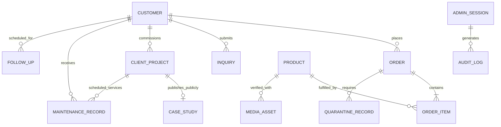
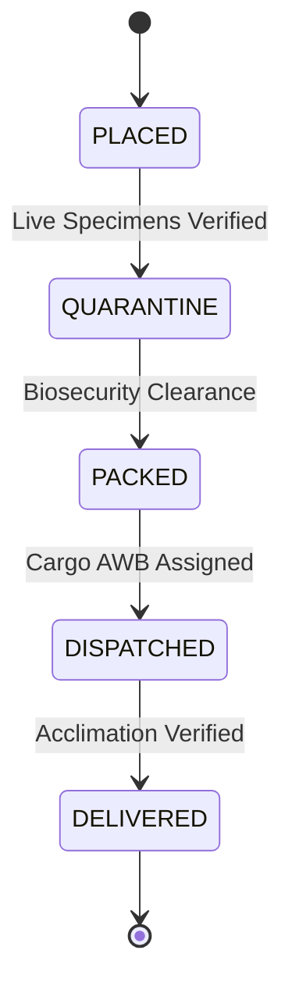
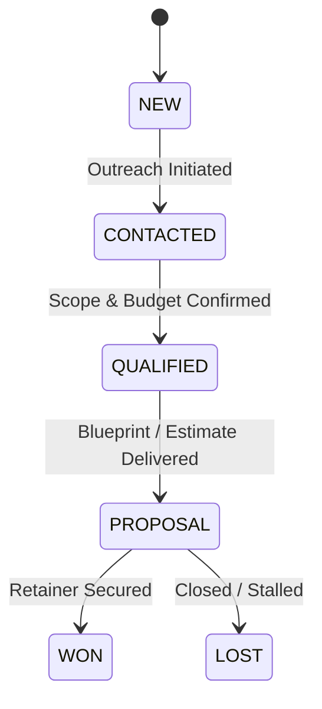
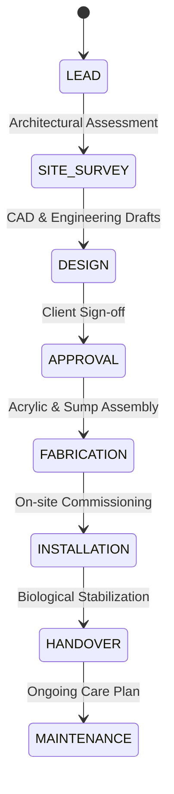
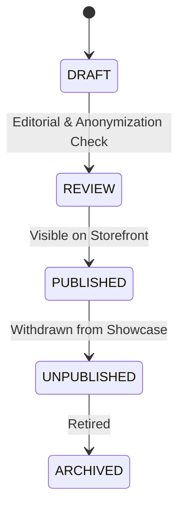

# MARINE CREATURES — CONTROL OS
## Master Administrative Operating System Architecture
**Document Version:** 2.0.0 (Production Release)  
**Security Classification:** Highly Confidential / Internal Private Operations  
**Architecture Role:** Product Architecture & Core Operating System  

---

### 1. Executive Summary & Purpose

The **Marine Creatures Control OS** (`/admin`) is the dedicated, private administrative operating system governing all business operations for Marine Creatures — luxury marine life procurement, bespoke living reef ecosystems, and architectural aquascaping installations across India.

Unlike consumer e-commerce dashboards, Control OS is an **operational interface** built specifically for dense, high-throughput daily management:
1. **Sales & Fulfillment**: Multi-stage live livestock order tracking with strict biosecurity verification and air cargo logistics.
2. **Concierge & CRM**: High-value client relationship management, consultation intake, and Customer 360 dossiers.
3. **Biological Quarantine**: Specimen acclimation and veterinary certification registry.
4. **Architectural Servicing**: On-site biotope installation and scheduled parameter testing maintenance logs.
5. **Catalog & Media Governance**: Strict SKU-to-photo verification preventing cross-specimen image contamination.
6. **Fleet Telemetry & Security**: Signed cryptographic sessions, tamper-resistant audit trails, and automated MongoDB Atlas state backups.

---

### 2. Information Architecture (IA)

Control OS is structured into **8 core operational domains** accessible via grouped sidebar navigation, quick command search (`Ctrl+K`), and direct URL routing:

```
/admin
│
├── OVERVIEW (/admin)
│   ├── Action Center (Urgent quarantine, pending dispatch, overdue follow-ups)
│   ├── Live Ledger Metrics (Revenue, orders, active inventory, active projects)
│   └── Biotope Telemetry (MongoDB ping, Node memory, session health)
│
├── SALES (/admin/sales)
│   ├── Orders (/admin/orders)
│   ├── Enquiries (/admin/enquiries)
│   ├── Customer 360 (/admin/customers)
│   └── Follow-ups (/admin/follow-ups)
│
├── CATALOG (/admin/catalog)
│   ├── Products (/admin/catalog)
│   ├── Marine Life (/admin/catalog?category=marine-life)
│   ├── Inventory Registry (/admin/inventory)
│   └── Media Governance (/admin/media)
│
├── WORLDS (/admin/worlds)
│   ├── Client Projects [PRIVATE] (/admin/worlds/projects)
│   └── Case Studies [PUBLIC DTO] (/admin/worlds/case-studies)
│
├── OPERATIONS (/admin/operations)
│   ├── Quarantine Protocol (/admin/operations/quarantine)
│   ├── Air Cargo Dispatch (/admin/operations/dispatch)
│   ├── Maintenance Log (/admin/operations/maintenance)
│   └── Service Schedule (/admin/operations)
│
├── CONTENT (/admin/content)
│   ├── Banners & Carousels (/admin/content)
│   ├── Storefront Editorial (/admin/content)
│   └── Technical SEO Health (/admin/content/seo)
│
├── ANALYTICS (/admin/analytics)
│   ├── Commercial Yield & Ledger (/admin/analytics)
│   ├── Catalog Specimen Performance (/admin/analytics)
│   ├── Client Conversion (/admin/analytics)
│   └── Storefront Funnel Telemetry (/admin/analytics)
│
└── SYSTEM (/admin/system)
    ├── Tamper-Resistant Audit Log (/admin/system/audit)
    ├── Cloud Snapshots & Backups (/admin/system/backups)
    ├── Infrastructure Health (/admin/system/health)
    ├── Security Posture (/admin/system/security)
    └── Operational Settings (/admin/system/settings)
```

---

### 3. Data Model Relationships



#### Primary Database Collections:
- **`Customer`** (`models/Customer.ts`): Unified Customer 360 identifier. Normalized phone number matching attribute, lifetime spend, order count, VIP tags, concierge notes.
- **`Order`** (`models/Order.ts`): E-commerce & concierge sales, line items, commercial values, shipment details (AWB, courier, ETA), fulfillment state.
- **`Inquiry`** (`models/Inquiry.ts`): Inbound consultations for custom aquariums, living reef biotopes, maintenance, and specimen procurement.
- **`FollowUp`** (`models/FollowUp.ts`): Overdue, today, and upcoming sales/concierge callback tickets.
- **`Product`** (`models/Product.ts`): Master catalog item with pricing, SKU, scientific taxonomy, care guide parameters, stock count, and verified media status.
- **`ClientProject`** (`models/ClientProject.ts`) [STRICTLY PRIVATE]: Architectural biotope project records, private addresses, client contacts, engineering notes, private jobsite media.
- **`CaseStudy`** (`models/CaseStudy.ts`) [PUBLIC DTO]: Public architectural portfolio showcases stripped of all private client identity.
- **`MaintenanceRecord`** (`models/MaintenanceRecord.ts`): Periodic on-site aquarium servicing, biological parameter readings (Salinity, pH, dKH, Calcium, Magnesium, Nitrate, Phosphate), technician notes.
- **`AnalyticsEvent`** (`models/AnalyticsEvent.ts`): Privacy-preserving storefront interaction events (view, cart, checkout, WhatsApp click).
- **`AuditLog`** (`models/AuditLog.ts`): Immutable log of administrative actions with operator, entity ID, severity, IP hash, and state diff.
- **`Snapshot`** (`models/Snapshot.ts`): Full point-in-time state backup of catalog, orders, and inquiries stored securely in MongoDB.
- **`Setting`** (`models/Setting.ts`): Operational metadata (business phone, WhatsApp destination, support email, service intervals).

---

### 4. API Matrix & Security Permissions

All admin routes (`/api/admin/*`) require server-side cryptographic session verification via `mc_admin_session` cookie signed with HMAC-SHA256. Unauthenticated requests are rejected immediately with HTTP 401.

| Endpoint | Method | Role / Auth | Description |
| :--- | :---: | :---: | :--- |
| `/api/admin/login` | POST | Public (Rate Limited) | Issues signed `mc_admin_session` cookie on valid passcode |
| `/api/admin/logout` | POST | Public | Clears session cookie |
| `/api/admin/overview` | GET | Admin Session | Aggregated action center and KPI dashboard |
| `/api/admin/orders` | GET, PATCH | Admin Session | List orders with filters; update fulfillment step, AWB, ETA |
| `/api/admin/enquiries` | GET, PATCH | Admin Session | Concierge pipeline; update stage, notes, assign follow-up |
| `/api/admin/customers` | GET, PATCH | Admin Session | Customer 360 dossiers with cross-domain activity timeline |
| `/api/admin/follow-ups` | GET, POST, PATCH | Admin Session | Manage overdue, today, upcoming client callbacks |
| `/api/admin/inventory` | GET, PATCH | Admin Session | Stock levels, livestock reservation state, low-stock alerts |
| `/api/admin/media` | GET | Admin Session | Media asset verification audit (verified vs fallback) |
| `/api/admin/operations/quarantine` | GET, PATCH | Admin Session | Biosecurity registry, days elapsed, pass/fail inspection |
| `/api/admin/operations/dispatch` | GET, PATCH | Admin Session | Air cargo packaging status, AWB numbers, flight arrival ETA |
| `/api/admin/operations/maintenance` | GET, POST, PATCH | Admin Session | Schedule aquarium maintenance, log water test parameters |
| `/api/admin/content/seo` | GET | Admin Session | Technical SEO audit (meta titles, desc, canonical, Schema.org) |
| `/api/admin/analytics` | GET | Admin Session | Database-backed ledger yield, revenue, lead velocity |
| `/api/admin/analytics/events` | POST | Public / Storefront | Privacy-preserving funnel event ingestion |
| `/api/admin/system/audit` | GET | Admin Session | Query tamper-resistant audit trail with entity/severity filters |
| `/api/admin/backup` | GET, POST, PUT | Admin Session | List, create, and restore point-in-time cloud snapshots |
| `/api/admin/system/health` | GET | Admin Session | MongoDB ping latency, Node memory, collection densities |
| `/api/admin/system/security` | GET | Admin Session | Session security posture and cryptographic verification |
| `/api/admin/system/settings` | GET, PATCH | Admin Session | Update business telephone, WhatsApp number, and intervals |
| `/api/admin/search` | GET | Admin Session | Typed global search across Orders, Products, Customers, Leads |

---

### 5. State Machines

Invalid transitions are rejected server-side to guarantee operational integrity.

#### 5.1 Order Lifecycle


#### 5.2 Concierge Inquiry Pipeline


#### 5.3 Architectural Client Projects (Private)


#### 5.4 Case Study Governance (Public CMS)


---

### 6. Privacy Boundaries & Public Serializers

#### Non-Negotiable Privacy Rule:
**ClientProject is STRICTLY PRIVATE.** Never expose client identity, contact details, residence location, or financial estimates to the public storefront.

- **CaseStudy Serializer (`toPublicCaseStudy`)**:
  - Drops: `clientName`, `clientPhone`, `clientEmail`, `privateAddress`, `estimatedBudget`, `internalNotes`, `contractDocuments`.
  - Exposes: `title`, `slug`, `space`, `scale`, `aquariumVolume`, `aquariumType`, `biome`, `gallery`, `materials`, `engineering`, `marineWorld`.

---

### 7. Global Search (`Ctrl+K`)

The admin interface features a unified, parallel search engine across 6 domains:
- **Orders**: Matches order ID, customer name, delivery city.
- **Products**: Matches SKU, common name, scientific name.
- **Customers**: Matches name, normalized phone number, email.
- **Inquiries**: Matches prospect name, service required, inquiry ID.
- **Client Projects**: Matches project code (`CP-2025-*`), project name, city.
- **Case Studies**: Matches published title, slug.

Keyboard-accessible navigation via arrow keys (`↑`, `↓`), `Enter` to select, and `Escape` to close.

---

### 8. Backup & Disaster Recovery Architecture

- **Automated & Manual Snapshots**: Captures MongoDB collections (Products, Orders, Inquiries, Banners) into serialized BSON/JSON snapshots with cryptographic checksums.
- **Safe Recovery Protocol**: Snapshot restores cannot be triggered accidentally. The operator must enter explicit `RESTORE` confirmation text inside a modal with double authorization before any rollback executes.
- **Zero Raw Credential Exposure**: Environment variables (`MONGODB_URI`, `ADMIN_PASSCODE`, `SESSION_SECRET`) are never rendered in the UI or sent over API responses.
