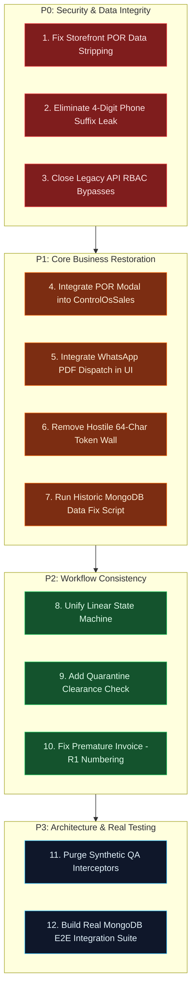

# MARINE CREATURES — END-TO-END HEALTH AUDIT
## DELIVERABLE 7: PRIORITISED REMEDIATION ROADMAP & IMPLEMENTATION SPECIFICATION

**Audit Date:** November 6, 2026  
**Auditor:** Principal Enterprise Architect, AppSec & Systems Auditor  
**Scope:** Remediation Architecture, Sequence of Execution, File Specifications & Acceptance Criteria  
**Directive:** AUDIT ONLY — NO CODE WAS MODIFIED DURING THIS INVESTIGATION  

---

## 1. REMEDIATION PHILOSOPHY & OPERATIONAL SAFETY

This roadmap translates the findings of the health audit into an actionable, surgical implementation plan. Remediating these issues must adhere to four strict principles:
1. **Preserve Existing Uncommitted Work:** Eight files currently have modified work in the working tree (`components/home/FinalCTA.tsx`, `components/home/ServicesBookingSection.tsx`, `components/layout/Footer.tsx`, `components/layout/Navbar.tsx`, `components/our-worlds/FoundersVision.tsx`, `components/services/BookingForm.tsx`, `lib/config.ts`, `lib/data/services.ts`). None of these files shall be touched or regressed.
2. **Zero Master Catalog Mutation:** Price agreements made on individual customer orders must remain strictly scoped to `order.items` and must never mutate static product declarations in `lib/data/` or MongoDB catalog models.
3. **P0 First (Security & Data Integrity):** Address vulnerabilities and data loss bugs before adding UI features.
4. **Eliminate Synthetic Mocks in Production:** Transition tests to real MongoDB test fixtures rather than polluting production Next.js handlers with QA interceptors.

---

## 2. PRIORITISED REMEDIATION MATRIX



---

## 3. P0 — CRITICAL SECURITY & DATA INTEGRITY FIXES

### Task 1: Fix Storefront Order Creation Data Integrity
- **Target Files:**
  - `marine-creatures/lib/context/OrderContext.tsx`
  - `marine-creatures/components/cart/CartDrawer.tsx`
  - `marine-creatures/app/api/orders/route.ts`
- **Specification:**
  1. In `OrderContext.tsx` lines 376–383, ensure `items.map` preserves:
     ```typescript
     priceOnRequest: Boolean(it.product.priceOnRequest),
     pricingStatus: it.product.priceOnRequest ? 'PENDING_POR' : 'STANDARD',
     category: it.product.category,
     ```
  2. In `CartDrawer.tsx` line 120, detect if any cart item is POR or has `price === 0` and pass `hasUnresolvedPorItems: true`.
  3. In `app/api/orders/route.ts` line 200, add backend catalog inspection: If any submitted item has `price === 0` or matches a known POR specimen, enforce `hasUnresolvedPorItems = true` and `pricingStatus = 'PENDING_POR'`, preventing ₹0 free specimen orders.

### Task 2: Fix 4-Digit Phone Suffix Information Leak
- **Target File:**
  - `marine-creatures/app/api/orders/track/route.ts`
- **Specification:**
  1. In lines 172–176, remove the `cleanOrderPhone.endsWith(providedPhone)` check.
  2. Require exact 10-digit phone verification:
     ```typescript
     const hasValidPhone = Boolean(
       providedPhone.length >= 10 &&
       cleanOrderPhone.length >= 10 &&
       cleanOrderPhone.slice(-10) === providedPhone.slice(-10)
     );
     ```
  3. Enforce rate limiting: Maximum 5 failed phone verification attempts per IP per order ID within 15 minutes.

### Task 3: Close Legacy API RBAC Bypass
- **Target File:**
  - `marine-creatures/app/api/orders/route.ts`
- **Specification:**
  1. Replace `if (!isAdminRequest(req))` in `PATCH` with:
     ```typescript
     const { auth, errorResponse } = await requirePermission(req, 'orders.update_status');
     if (errorResponse) return errorResponse;
     ```
  2. Replace `if (!isAdminRequest(req))` in `DELETE` with:
     ```typescript
     const { auth, errorResponse } = await requirePermission(req, 'orders.delete');
     if (errorResponse) return errorResponse;
     ```
  3. Replace `if (!isAdminRequest(req))` in `GET` with:
     ```typescript
     const { auth, errorResponse } = await requirePermission(req, 'orders.read');
     if (errorResponse) return errorResponse;
     ```

---

## 4. P1 — CORE BUSINESS FUNCTIONALITY RESTORATION

### Task 4: Integrate Agreed POR Pricing UI into Control OS
- **Target File:**
  - `marine-creatures/components/admin/ControlOsSales.tsx`
- **Specification:**
  1. Port the POR Pricing Modal from `components/admin/tabs/OrdersTab.tsx` into `ControlOsSales.tsx`.
  2. If `order.hasUnresolvedPorItems` is `true` or any line item has `priceOnRequest: true`:
     - Display a high-visibility Amber badge: `POR Price Required`.
     - Render an action button: `Set Agreed Price`.
  3. Modal must provide:
     - Numeric input field for each unresolved item with INR validation (`> 0`).
     - Live preview of recalculated subtotal and total.
     - Optimistic concurrency passing (`expectedVersion: order.pricingVersion`).
     - Invocation of `POST /api/admin/orders/${order.id}/por-pricing`.
     - Seamless refresh of the local order list and toast notification upon success.

### Task 5: Integrate WhatsApp PDF Dispatch into Control OS
- **Target File:**
  - `marine-creatures/components/admin/ControlOsSales.tsx`
- **Specification:**
  1. Import and instantiate `useInvoicePdfShare` within `ControlOsSales.tsx`.
  2. Add a `WhatsApp PDF` share button in each row of the Orders table and within the Order Detail Drawer.
  3. Render loading spinner while fetching PDF and render desktop fallback instruction banner if Web Share API is unavailable.

### Task 6: Remove Hostile 64-Character Token Gate from Customer Invoices
- **Target File:**
  - `marine-creatures/app/invoice/[id]/page.tsx`
- **Specification:**
  1. Permit customer access if the URL contains a valid token, OR if the customer enters their registered 10-digit phone number matching the order.
  2. For administrators, check if the session cookie contains a valid employee session with `orders.read` or `orders.invoice.generate` permission (replacing the hardcoded call to `/api/admin/overview`).

### Task 7: Historical MongoDB Data Remediation Script
- **Target File:**
  - `marine-creatures/scripts/remediate-por-orders.mjs`
- **Specification:**
  1. Query MongoDB for existing orders where any item has `price === 0` and `pricingStatus !== 'AGREED'`.
  2. Update these orders to set `hasUnresolvedPorItems: true` and `pricingStatus: 'PENDING_POR'`.
  3. Ensure existing real orders (`MC-740020EJ`, `MC-429334LH`, `MC-990152L4`) immediately appear in the admin sales queue as requiring agreed pricing.

---

## 5. P2 — WORKFLOW CONSISTENCY & QUARANTINE ENFORCEMENT

### Task 8: Unify Linear State Machine Validation
- **Target Files:**
  - `marine-creatures/lib/orders/state-machine.ts` (new shared utility)
  - `marine-creatures/app/api/orders/route.ts`
  - `marine-creatures/app/api/admin/orders/route.ts`
  - `marine-creatures/app/api/admin/operations/dispatch/route.ts`
- **Specification:**
  1. Create `validateStateTransition(currentStep, targetStep, hasMarineLife)`.
  2. Enforce strict linear transition: cannot jump over intermediate steps.
  3. Use identical logic across all three endpoints.

### Task 9: Mandate Quarantine Health Clearance
- **Target Files:**
  - `marine-creatures/models/Order.ts`
  - `marine-creatures/app/api/admin/orders/route.ts`
- **Specification:**
  1. Add optional `quarantineClearedAt: String` and `quarantineNotes: String` to `OrderSchema`.
  2. Prevent advancing from `quarantine` to `packed` for marine life orders unless quarantine clearance notes are provided.

### Task 10: Fix Premature `-R1` Invoice Revision Numbering
- **Target File:**
  - `marine-creatures/app/api/admin/orders/[id]/por-pricing/route.ts`
- **Specification:**
  1. Update line 250 so that `-R1` is only appended if an invoice has already been issued or approved.
  2. The initial resolution of a POR order establishes the baseline invoice (`INV-MC-XXXX`), not a revision.

---

## 6. P3 — ARCHITECTURE PURGE & REAL INTEGRATION TESTING

### Task 11: Purge Synthetic QA Interceptors from Production Routes
- **Target Files:**
  - `marine-creatures/app/api/admin/orders/[id]/por-pricing/route.ts`
  - `marine-creatures/app/api/admin/orders/[id]/invoice-pdf/route.ts`
  - `marine-creatures/app/api/orders/track/route.ts`
  - `marine-creatures/app/api/orders/route.ts`
- **Specification:**
  1. Delete all `if (orderId.startsWith('MC-QA-'))` blocks.
  2. Production endpoints must execute exclusively against MongoDB.

### Task 12: Build Real MongoDB Integration Suite
- **Target File:**
  - `marine-creatures/scripts/test-order-flow-real.mjs`
- **Specification:**
  1. Author a comprehensive test suite connecting to the test MongoDB database.
  2. Create a test POR order via `POST /api/orders`.
  3. Validate `hasUnresolvedPorItems === true` in MongoDB.
  4. Submit agreed price via `POST /api/admin/orders/[id]/por-pricing`.
  5. Validate updated total and audit log in MongoDB.
  6. Request PDF from `/api/admin/orders/[id]/invoice-pdf` and verify binary output.
  7. Verify tracking endpoint with 10-digit phone number.
  8. Delete test order cleanly upon completion.

---

## 7. REMEDIATION EFFORT & EXECUTION SCHEDULE

| Phase | Tasks Included | Estimated Effort | Risk Level | Target Outcome |
|---|---|---|---|---|
| **Phase 1: P0 Security & Data Integrity** | Tasks 1, 2, 3 | 2 Hours | Low (Targeted bugfixes) | Stops free ₹0 orders; closes public tracking leak; enforces RBAC on all routes. |
| **Phase 2: P1 Business Restoration** | Tasks 4, 5, 6, 7 | 3 Hours | Low (UI component wiring) | Restores admin POR modal; enables WhatsApp PDF share; unblocks customer invoices; migrates old orders. |
| **Phase 3: P2 State Machine & Quarantine** | Tasks 8, 9, 10 | 1.5 Hours | Very Low (Logic deduplication) | Linear order progression guaranteed; live quarantine checks enabled. |
| **Phase 4: P3 Real Testing & Code Purge** | Tasks 11, 12 | 2 Hours | Very Low (Test automation) | Purges synthetic mocks from production; establishes real DB verification. |
| **Total** | **All 12 Tasks** | **8.5 Hours** | **Controlled** | **Enterprise-grade, bug-free order-to-dispatch workflow.** |

