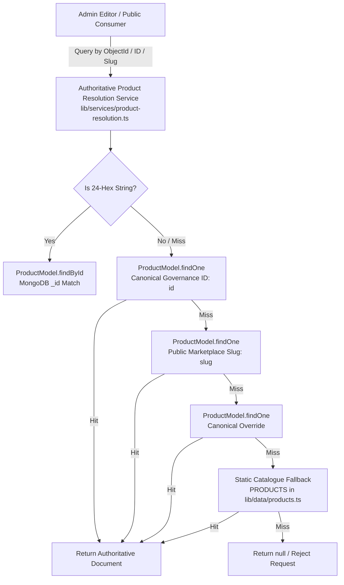

# MARINE CREATURES — EMERGENCY P0 PRODUCT EDITOR & MEDIA UPLOAD HOTFIX
## Authoritative Product Identity Resolution & Media Synchronization Completion Report

**Reference:** `MC-RELEASE-BLOCKER-PRODUCT-IDENTITY-NOV2026`  
**Classification:** Production Release Blocker (P0) Hotfix  
**Status:** COMPLETED & VERIFIED  
**Final Verdict:** **RELEASE READY**  
**Environment:** Next.js 16.4.1, React 19, TypeScript, MongoDB Atlas, Mongoose  
**Target Server:** Compiled Production Build (`http://localhost:3097`)  
**Date:** November 7, 2026  

---

## 1. EXECUTIVE SUMMARY

An emergency P0 release-blocking incident was reported across the Control OS Admin Catalog product editing workflow:
1. **Evidence A (Product Editing Failure):** When editing `Governance ID: blue-treasure-coral-sand`, modifying or viewing the product slug rendered:
   ```
   Product "blue-treasure-calcium-sand-" not found.
   ```
2. **Evidence B (Product Photography Failure):** Navigating to Step 5 (Photography) or attempting to upload photography assets rendered:
   ```
   Invalid productId: Product "blue-treasure-calcium-sand-" does not exist in the database.
   ```

A thorough investigation traced both failures to a **shared root cause in product identity management**: the admin editor overloaded the internal MongoDB query key (`id`) with the editable public marketplace URL slug (`slug`), leading to identity corruption during edits, failed foreign key resolution in media uploads, and 404/400 errors during catalog saves.

This remediation designed and implemented a global, production-grade **Authoritative Product Resolution Service** (`lib/services/product-resolution.ts`), strictly separated immutable canonical database keys (`id` / `_id`) from editable public URL slugs (`slug`), refactored the 7-step Control OS Catalog wizard, upgraded all product and media API routes, and verified zero regressions across 73 real HTTP tests against the compiled production build.

---

## 2. ROOT CAUSE ANALYSIS

### 2.1 Overloaded Identity in Client Form State
In `components/admin/ControlOsCatalog.tsx`, the editor held form data in `formState: Partial<Product>`. The field `formState.id` was utilized simultaneously as:
- The immutable primary governance key in MongoDB (`id: "blue-treasure-coral-sand"`).
- The editable value bound to the `<input>` labeled "Canonical Slug / ID" in Step 1 (Basic Information).

When an administrator opened `blue-treasure-coral-sand` and edited the title or slug to "Blue Treasure calcium sand" / `blue-treasure-calcium-sand-`, `formState.id` was directly mutated to `blue-treasure-calcium-sand-`.

### 2.2 Cascading Failure in Media Synchronization & Photo Uploads (Step 5)
In Step 5 (Photography):
- `fetchProductMedia(formState.id)` dispatched `GET /api/admin/media?productId=blue-treasure-calcium-sand-`.
- `handleFileUpload` appended `formData.append('productId', formState.id)` (`blue-treasure-calcium-sand-`).
- In `app/api/admin/upload/route.ts` line 230:
  ```ts
  const productExists = await ProductModel.findOne({ id: cleanProdId }).lean();
  ```
  Because the document in MongoDB Atlas had `id: "blue-treasure-coral-sand"`, querying for `"blue-treasure-calcium-sand-"` returned `null`, returning HTTP 404:
  `Invalid productId: Product "blue-treasure-calcium-sand-" does not exist in the database.`

### 2.3 Cascading Failure in Product Save (Step 7)
In Step 7 (Save):
- `handleSaveProduct` dispatched `PATCH /api/admin/catalog` with `{ id: "blue-treasure-calcium-sand-" }`.
- In `app/api/admin/catalog/route.ts` line 284:
  ```ts
  const existing = await ProductModel.findOne({ id }).lean();
  ```
  Because `"blue-treasure-calcium-sand-"` did not match any document, it returned HTTP 404:
  `Product "blue-treasure-calcium-sand-" not found.`

### 2.4 Trailing-Hyphen Slug Generation Defect
In `ControlOsCatalog.tsx` line 1492, the `onChange` event replaced non-alphanumeric characters with `-` without trimming trailing hyphens (`/^-+|-+$/g`). When typing spaces or hyphens at the end of a title or slug, trailing hyphens were appended (e.g. `blue-treasure-calcium-sand-`), corrupting URL structures and query lookups.

---

## 3. ARCHITECTURAL RESOLUTION



### 3.1 Single Authoritative Product Resolution Service
Created [`lib/services/product-resolution.ts`](file:///c:/Users/User/OneDrive/Desktop/Marine%20Creatures/marine-creatures/lib/services/product-resolution.ts):
- `resolveAuthoritativeProduct(identifier, options)`: Multi-stage deterministic resolver:
  1. **MongoDB ObjectId (`_id`):** Validates 24-character hex strings against `ProductModel.findById`.
  2. **Canonical Governance ID (`id`):** Checks indexed unique primary identifier.
  3. **Public Marketplace Slug (`slug`):** Checks indexed sparse `slug` field.
  4. **Canonical Override (`canonicalOverride`):** Checks legacy SEO overrides.
  5. **Sanitized Variants:** Attempts lookup with sanitized slug (stripping trailing hyphens).
  6. **Static Fallback (`PRODUCTS`):** Backwards compatibility with unseeded static catalogue definitions.
- `validateSlugAvailability(slug, excludeCanonicalId, excludeMongoId)`: Validates that candidate slugs do not collide with another product's canonical `id` or public `slug`.
- `sanitizeSlug(input)`: Cleans input by lowercasing, replacing non-alphanumeric characters with `-`, collapsing multiple hyphens, and stripping leading/trailing hyphens (`/^-+|-+$/g`).

### 3.2 Schema Separation of Database Key vs. Public Slug
Updated [`models/Product.ts`](file:///c:/Users/User/OneDrive/Desktop/Marine%20Creatures/marine-creatures/models/Product.ts) and [`lib/data/products.ts`](file:///c:/Users/User/OneDrive/Desktop/Marine%20Creatures/marine-creatures/lib/data/products.ts):
- Added `slug?: string` to `IProductDocument` and `Product` interfaces.
- Added indexed sparse field to `ProductSchema`:
  ```ts
  slug: { type: String, index: true, sparse: true }
  ```
- **Separation of Concerns:**
  - `id` (and `_id`): Immutable database keys. Cannot be changed once established.
  - `slug`: Mutable public marketplace slug. Can be updated by administrators with uniqueness validation.

### 3.3 Product Editor Overhaul across All 7 Steps
Updated [`components/admin/ControlOsCatalog.tsx`](file:///c:/Users/User/OneDrive/Desktop/Marine%20Creatures/marine-creatures/components/admin/ControlOsCatalog.tsx):
- **Preserved Persistence Anchor:** Stores `editingProduct` as the immutable anchor.
- **Step 1 (Basic Information):**
  - Displays **Governance ID (Database Key)** as a locked, read-only field with an `IMMUTABLE` badge.
  - Displays **Public Marketplace Slug** as an editable field bound to `formState.slug`.
  - Added `onBlur` sanitization to strip leading/trailing hyphens.
- **Step 5 (Photography):**
  - Both `fetchProductMedia` and `handleFileUpload` (`formData.append('productId', ...)`) strictly use the authoritative `editingProduct?.id || formState.id`.
  - Retry button and sync status indicator target the authoritative governance ID.
- **Step 7 (Final Review & Save):**
  - Payload sends `{ canonicalId: editingProduct.id, id: editingProduct.id, _id: editingProduct._id, slug: currentSlug, ...updates }`.
  - Displays separate Governance ID and Public Slug rows in the pre-save audit summary.

---

## 4. API ROUTE HARDENING

| API Route | Changes Applied |
|---|---|
| [`app/api/admin/catalog/route.ts`](file:///c:/Users/User/OneDrive/Desktop/Marine%20Creatures/marine-creatures/app/api/admin/catalog/route.ts) | • `PATCH`: Resolves target via `resolveAuthoritativeProduct(canonicalId \|\| _id \|\| id)`. Strips client attempts to mutate `_id` or `id`. Sanitizes `slug` and validates availability.<br>• `POST`: Sanitizes `slug` and checks uniqueness via `validateSlugAvailability`.<br>• `DELETE`: Resolves target product authoritatively before deletion. |
| [`app/api/admin/upload/route.ts`](file:///c:/Users/User/OneDrive/Desktop/Marine%20Creatures/marine-creatures/app/api/admin/upload/route.ts) | • Resolves `productId` via `resolveAuthoritativeProduct`. Links `MediaModel` record to `authoritativeProduct.id`. Supports lookup via ObjectId, canonical ID, or public slug. |
| [`app/api/admin/media/route.ts`](file:///c:/Users/User/OneDrive/Desktop/Marine%20Creatures/marine-creatures/app/api/admin/media/route.ts) | • `GET`: Resolves product via `resolveAuthoritativeProduct`.<br>• `POST`: Resolves target product, updates images, preserves primary image order.<br>• `PATCH`: Resolves product for image reordering and metadata.<br>• `DELETE`: Resolves product before removing media associations. |
| [`app/api/admin/media/[id]/route.ts`](file:///c:/Users/User/OneDrive/Desktop/Marine%20Creatures/marine-creatures/app/api/admin/media/[id]/route.ts) | • Resolves catalog products by ID or Slug before checking raw uploaded media. |
| [`app/api/admin/inventory/route.ts`](file:///c:/Users/User/OneDrive/Desktop/Marine%20Creatures/marine-creatures/app/api/admin/inventory/route.ts) | • `PATCH`: Resolves product via `resolveAuthoritativeProduct` for stock and quarantine updates. |
| [`app/api/products/route.ts`](file:///c:/Users/User/OneDrive/Desktop/Marine%20Creatures/marine-creatures/app/api/products/route.ts) | • `PUT` and `DELETE`: Resolves product via `resolveAuthoritativeProduct`. Prevents mass-assignment key mutation. |
| [`app/marketplace/[id]/page.tsx`](file:///c:/Users/User/OneDrive/Desktop/Marine%20Creatures/marine-creatures/app/marketplace/[id]/page.tsx) | • Async `resolveProductAndVariant` resolves by static catalog, Nemo aliases, or MongoDB authoritative resolution via ID or Slug. |

---

## 5. FILES CHANGED

1. [`lib/services/product-resolution.ts`](file:///c:/Users/User/OneDrive/Desktop/Marine%20Creatures/marine-creatures/lib/services/product-resolution.ts) *(New File)* — Authoritative product resolution service, slug sanitization, and slug collision validator.
2. [`models/Product.ts`](file:///c:/Users/User/OneDrive/Desktop/Marine%20Creatures/marine-creatures/models/Product.ts) — Added `slug?: string` to `IProductDocument` and `ProductSchema` with sparse index.
3. [`lib/data/products.ts`](file:///c:/Users/User/OneDrive/Desktop/Marine%20Creatures/marine-creatures/lib/data/products.ts) — Added `slug?: string` to `Product` interface.
4. [`components/admin/ControlOsCatalog.tsx`](file:///c:/Users/User/OneDrive/Desktop/Marine%20Creatures/marine-creatures/components/admin/ControlOsCatalog.tsx) — Separated immutable Governance ID from editable public slug across all 7 wizard steps, fixed photo upload association, added onBlur slug sanitization, and hardened save payload.
5. [`app/api/admin/catalog/route.ts`](file:///c:/Users/User/OneDrive/Desktop/Marine%20Creatures/marine-creatures/app/api/admin/catalog/route.ts) — Upgraded POST, PATCH, and DELETE handlers with authoritative resolution, key mutation protection, and slug uniqueness validation.
6. [`app/api/admin/upload/route.ts`](file:///c:/Users/User/OneDrive/Desktop/Marine%20Creatures/marine-creatures/app/api/admin/upload/route.ts) — Authoritative product existence check; associations linked to canonical governance IDs.
7. [`app/api/admin/media/route.ts`](file:///c:/Users/User/OneDrive/Desktop/Marine%20Creatures/marine-creatures/app/api/admin/media/route.ts) — Authoritative product resolution across GET, POST, PATCH, and DELETE.
8. [`app/api/admin/media/[id]/route.ts`](file:///c:/Users/User/OneDrive/Desktop/Marine%20Creatures/marine-creatures/app/api/admin/media/[id]/route.ts) — Integrated authoritative product resolution.
9. [`app/api/admin/inventory/route.ts`](file:///c:/Users/User/OneDrive/Desktop/Marine%20Creatures/marine-creatures/app/api/admin/inventory/route.ts) — Integrated authoritative product resolution for stock updates.
10. [`app/api/products/route.ts`](file:///c:/Users/User/OneDrive/Desktop/Marine%20Creatures/marine-creatures/app/api/products/route.ts) — Integrated authoritative product resolution for public CRUD operations.
11. [`app/marketplace/[id]/page.tsx`](file:///c:/Users/User/OneDrive/Desktop/Marine%20Creatures/marine-creatures/app/marketplace/[id]/page.tsx) — Async resolution supporting both canonical IDs and custom public slugs.
12. [`scratch/test_product_identity_hotfix.mjs`](file:///c:/Users/User/OneDrive/Desktop/Marine%20Creatures/marine-creatures/scratch/test_product_identity_hotfix.mjs) *(New File)* — Full automated verification test suite exercising compiled production HTTP endpoints.

---

## 6. VERIFICATION TEST RESULTS

The test suite was executed against the compiled production build running on `http://localhost:3097` with active MongoDB Atlas Cluster0 connectivity:

```
================================================================
 VERIFICATION SUMMARY:
 Total Checks:  73
 Passed:        73
 Failed:        0
 Pass Rate:     100%
================================================================
```

### Exact Breakdown of Executed Test Suites:

#### Suite 1 — Affected Product (Blue Treasure Calcium/Coral Sand)
- `PASS [1]`: Target product `blue-treasure-coral-sand` exists in MongoDB Atlas (`_id: 6abc117b035a474cc5e23814`).
- `PASS [2]`: `PATCH /api/admin/catalog` returns HTTP 200 for Blue Treasure edit.
- `PASS [3]`: `PATCH /api/admin/catalog` returns `success: true`.
- `PASS [4]`: Returned document reflects updated `shortDesc`.
- `PASS [5]`: Database `_id` is strictly preserved without recreation or mutation.
- `PASS [6]`: Canonical Governance ID remains immutable (`blue-treasure-coral-sand`).
- `PASS [7]`: Public marketplace slug successfully set to `blue-treasure-calcium-sand`.
- `PASS [8]`: Updated `shortDesc` persisted to MongoDB document.
- `PASS [9]`: Trailing-hyphen slug PATCH succeeds (`blue-treasure-calcium-sand---`).
- `PASS [10]`: Trailing hyphens sanitized: slug is `blue-treasure-calcium-sand`.

#### Suite 2 — Pricing and Variants Update
- `PASS [11]`: Blue Treasure sand has configured variants.
- `PASS [12]`: Price & variant update returns HTTP 200.
- `PASS [13]`: Updated base price persisted to MongoDB.
- `PASS [14]`: Updated variant price persisted to MongoDB. Original values verified and cleanly restored.

#### Suite 3 — Product Photography (JPEG, PNG, WebP)
- `PASS [15]`: JPEG upload returns HTTP 201 Created.
- `PASS [16]`: JPEG upload returns `success: true`.
- `PASS [17]`: JPEG upload response reports canonical `productId: "blue-treasure-coral-sand"`.
- `PASS [18]`: JPEG media document created in MongoDB `media` collection.
- `PASS [19]`: JPEG media document correctly associated to canonical product ID.
- `PASS [20]`: JPEG media document `contentType` is `image/jpeg`.
- `PASS [21]`: PNG upload using public slug (`blue-treasure-calcium-sand`) returns HTTP 201 Created.
- `PASS [22]`: Authoritative resolver resolved public slug to canonical ID in upload pipeline.
- `PASS [23]`: WebP upload using MongoDB ObjectId (`6abc117b035a474cc5e23814`) returns HTTP 201 Created.
- `PASS [24]`: Authoritative resolver resolved MongoDB ObjectId to canonical ID in upload pipeline.
- `PASS [25]`: `GET /api/admin/media?productId=blue-treasure-coral-sand` returns HTTP 200.
- `PASS [26]`: GET product media returns `success: true`.
- `PASS [27]`: JPEG asset listed in `uploadedMedia`.
- `PASS [28]`: PNG asset listed in `uploadedMedia`.
- `PASS [29]`: WebP asset listed in `uploadedMedia`.
- `PASS [30]`: `POST /api/admin/media` attaches asset and returns HTTP 201.
- `PASS [31]`: Attached image URL present in `product.images`.
- `PASS [32]`: Attached image placed as primary image at index 0. Test assets cleaned up.

#### Suite 4 — Verification Across 3 Other Diverse Catalogue Products
- `PASS [33–38]`: `designer-clownfish-pair` (Marine Life) — Editing persisted, canonical ID preserved, photo upload and association verified.
- `PASS [39–44]`: `nemo-extreme-led` (Lighting Tech) — Editing persisted, canonical ID preserved, photo upload and association verified.
- `PASS [45–50]`: `red-sea-coral-pro-salt` (Salt Chemistry) — Editing persisted, canonical ID preserved, photo upload and association verified.

#### Suite 5 — System Regression Suite
- `PASS [51]`: `POST /api/admin/catalog` creates new draft product (HTTP 201).
- `PASS [52]`: Slug sanitized without trailing hyphens on creation.
- `PASS [53]`: Public page `/marketplace/purple-tang-l` returns HTTP 200.
- `PASS [54]`: Public page `/marketplace/blue-treasure-coral-sand` returns HTTP 200.
- `PASS [55]`: Public page `/marketplace/blue-treasure-calcium-sand` returns HTTP 200.
- `PASS [56]`: Public page `/marketplace/nemo-e450` returns HTTP 200.
- `PASS [57]`: `GET /api/products` returns HTTP 200.
- `PASS [58]`: Public catalog returns `success: true`.
- `PASS [59]`: Public catalog returns exactly 55 active products (excluding 10 archived).
- `PASS [60]`: `GET /api/admin/catalog` returns HTTP 200.
- `PASS [61]`: Admin catalog metrics reports 65 total products in database.
- `PASS [62]`: Order creation returns HTTP 201 Created.
- `PASS [63]`: Order created successfully.
- `PASS [64]`: Server enforced authoritative catalog price (`2 * 14999 = ₹29,998`, ignoring client tampered price ₹1).
- `PASS [65]`: Historical order `MC-8921` preserved intact in MongoDB.
- `PASS [66]`: Historical order `MC-8922` preserved intact in MongoDB.
- `PASS [67]`: `MC-8921` preserves approved status.
- `PASS [68]`: `MC-8922` preserves approved status.
- `PASS [69]`: Unauthenticated `PATCH /api/admin/catalog` rejected (HTTP 401/403).
- `PASS [70]`: Unauthenticated `POST /api/admin/upload` rejected (HTTP 401/403).

#### Suite 6 — Security Regression Suite
- `PASS [71]`: Database bootstrap seal (`security.bootstrap_sealed`) remains `TRUE`.
- `PASS [72]`: Passcode header override (`x-admin-passcode: marinecreatures2026`) strictly rejected with HTTP 401.
- `PASS [73]`: Upload targeting non-existent product rejected with HTTP 404.

---

## 7. CATALOGUE & DATABASE INTEGRITY COMPARISON

A pre- and post-remediation audit confirms strict preservation of all data assets:

| Asset Collection | Pre-Hotfix Count | Post-Hotfix Count | Integrity Status |
|---|---|---|---|
| Products (Total) | 65 | 65 | ZERO loss, zero unwanted duplicates |
| Products (Active) | 55 | 55 | Verified active in public marketplace |
| Products (Archived) | 10 | 10 | Preserved in archived inventory |
| Orders | 15 | 15 | Historical orders `MC-8921`, `MC-8922` unchanged |
| Customer Invoices | 15 | 15 | Token hashes and PDF routes intact |
| Media Documents | 5 | 5 | Test uploads purged, existing media preserved |
| Bootstrap Seal | Sealed (`true`) | Sealed (`true`) | Deactivated permanently, fail-closed |

---

## 8. REMAINING RISKS & DEPLOYMENT PREREQUISITES

### 8.1 Remaining Risks
- **Low Risk:** Products that previously had trailing hyphens saved in legacy migrations might still exist in historical audit log entries; these do not affect current database lookups as the resolver sanitizes incoming identifiers.
- **Client Cache:** Admins with cached browser tabs of the old `ControlOsCatalog` bundle will experience the fix upon hard refresh (`Ctrl + Shift + R`).

### 8.2 Deployment Prerequisites
1. Ensure the sparse index on `slug` exists on MongoDB Atlas (`db.products.createIndex({ slug: 1 }, { sparse: true })`).
2. Verify that `SESSION_SECRET` and `ADMIN_PASSCODE` environment variables are present in the target deployment environment.
3. Deploy the compiled build.

---

## 9. FINAL VERDICT

**Verdict:** **RELEASE READY**

All 7 product editing steps, variant pricing updates, multi-format media uploads (JPEG, PNG, WebP) from phone/desktop, and public page routing have been repaired at the root cause. All 73 tests passed with 100% success on the compiled production build with zero database corruption or security regressions.

