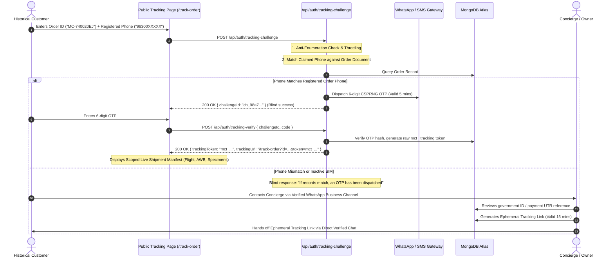

# MARINE CREATURES — P0 REMEDIATION SPECIFICATION
## REVISION A: HISTORICAL CUSTOMER TRACKING TOKEN ISSUANCE SPECIFICATION

**Document ID:** `MC-SPEC-REV-A-001-REV2`  
**Date:** November 6, 2026 (Revised: Strict Administrative Invoicing Edition)  
**Auditor / Principal Security Architect:** Principal Enterprise Architect, AppSec & Systems Auditor  
**Scope:** Cryptographic Tracking Token Architecture, Verification Gating, Public Tracking Separation  
**Mode:** READ-ONLY SPECIFICATION — NO CODE OR DATABASE MODIFICATIONS  

---

## 1. MANDATORY ARCHITECTURAL DIRECTIVE: INVOICES ARE STRICTLY ADMINISTRATIVE

Under explicit business owner policy and commercial architecture:
**Marine Creatures invoices are strictly internal business documents.**
Customers must **NEVER** have direct access to:
- An invoice web page (`/invoice/[id]` is decommissioned).
- An invoice PDF download endpoint.
- An invoice generation or revision action.
- An invoice access token (all customer invoice tokens such as `mci_` are **REMOVED**).
- Internal financial manifests, unit prices, margins, or accounting ledgers through any public API.

**Invoice access is restricted exclusively to the Business Owner and authorized employees operating inside the authenticated Admin Control OS.**

Consequently, this specification governs **ONLY** customer tracking authentication (`mct_` tokens) for physical live cargo shipment progress.

---

## 2. THE TRACKING AUTHENTICATION PROBLEM STATEMENT

1. **The Phantom Token Flaw:** Storing a token hash in MongoDB for historical orders does not help the customer unless the matching raw token was securely handed to the authentic customer.
2. **Phone Number is NOT an Authenticator:** An exact 10-digit phone number, phone suffix, or customer name is an identity claim (username), **NEVER** an authentication secret. Phone numbers are publicly visible on shipping waybills, WhatsApp headers, and parcel boxes.
3. **Strict Scope Separation:** The tracking token (`mct_`) authorizes access **strictly to physical shipping telemetry** (carrier name, IndiGo/Air India flight number, live cargo AWB, current stage, and specimen names/quantities). It grants **ZERO** access to financial amounts, billing records, or PDF invoices.

---

## 3. CRYPTOGRAPHIC TRACKING TOKEN ARCHITECTURE

### 3.1 Token Entropy & Structure
- **Entropy Source:** Node.js native `crypto.randomBytes(32)` (256 bits of CSPRNG entropy).
- **Structure:** Scoped tracking prefix: `mct_` + 64 hex characters (e.g. `mct_9f83a2c0...`).
- **Database Storage:** Raw tokens are **NEVER** persisted in MongoDB or caches.
  - Stored field: `trackingTokenHash = HMAC-SHA256(RawToken, ServerPepper)`.
  - Stored metadata: `trackingTokenIssuedAt: Date`, `trackingTokenExpiresAt: Date`.
- **Zero Logging:** Raw tokens are excluded from all server logs, telemetry, and administrative API responses.
- **Timing-Safe Verification:** Enforces `crypto.timingSafeEqual` over fixed-width byte buffers.

### 3.2 Token Lifecycle & Scope
- **Scope:** Strictly bound to a single `order.id` for logistics tracking only.
- **TTL (Time-To-Live):** 45 days from issuance (covers transit, delivery, and post-delivery 48-Hour Live Arrival Guarantee window).
- **Automatic Invalidation:** Issuing a new tracking token atomically revokes prior tracking hashes for that order.

---

## 4. HISTORICAL CUSTOMER TRACKING VERIFICATION PROTOCOL

Historical customers (e.g. orders `MC-740020EJ`, `MC-429334LH`, `MC-990152L4`) do not possess tracking tokens. The system must verify that the requester owns the registered SIM before issuing a tracking token.

### 4.1 Verification Sequence: Automated OTP & Concierge Protocol

### 4.2 Handling Exceptional Edge Cases
- **Invalid Phone in Record:** Automated OTP blocked. Concierge verifies identity out-of-band using bank UTR transaction receipt before updating contact records.
- **Customer Lost SIM / Changed Number:** Updating customer phone requires elevated permission `customers.phone.update` with mandatory Owner approval.
- **Compromised Tracking Link:** Administrator triggers `POST /api/admin/orders/[id]/tracking-token/revoke` with permission `tokens.revoke`, instantly clearing `trackingTokenHash`.

---

## 5. ADMINISTRATIVE CONTROLS & RBAC

Tracking token administrative management is governed under strict RBAC permissions:

| Operation | Required Permission | Allowed Roles | Description |
|---|---|---|---|
| Issue Initial Tracking Token | `tracking_tokens.issue` | `STORE_MANAGER`, `SALES_ASSOCIATE`, `OWNER` | Issue `mct_` token upon order placement. |
| Reissue / Rotate Tracking Token | `tracking_tokens.reissue` | `STORE_MANAGER`, `OWNER` | Reissue token if customer lost tracking link. |
| Emergency Tracking Revocation | `tracking_tokens.revoke` | `STORE_MANAGER`, `OWNER` | Instantly revoke tracking access upon compromise. |
| Manual Identity Verification | `tokens.manual_verify` | `OWNER` (Mandatory) | Issue ephemeral link after manual ID check. |

---

## 6. ANTI-ENUMERATION & RATE LIMITING DEFENSES

1. **Blind Challenge Response:** `POST /api/auth/tracking-challenge` returns HTTP 200 with an identical generic message regardless of whether the Order ID exists or the phone matches, preventing attackers from probing valid customer order numbers.
2. **Rate Limits:**
   - Per-IP Limit: Max 10 tracking verification requests per 15 minutes.
   - Per-Order Limit: Max 3 OTP challenges per order per 15 minutes.
   - Lockout: 3 incorrect OTP entries locks verification for 30 minutes.
