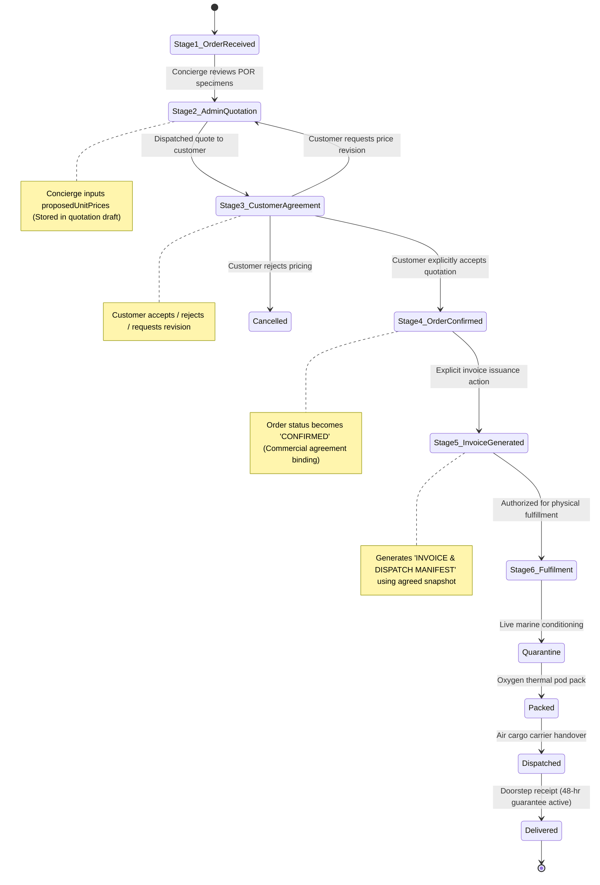

# MARINE CREATURES — P0 REMEDIATION SPECIFICATION
## REVISION D: DECOUPLED PRICING, CONFIRMATION & INVOICE WORKFLOW SPECIFICATION

**Document ID:** `MC-SPEC-REV-D-004`  
**Date:** November 6, 2026  
**Auditor / Principal Systems Architect:** Principal Enterprise Architect, AppSec & Systems Auditor  
**Scope:** Domain Event Decoupling, Multi-Stage State Machines, Separate Schema Models & API Contracts  
**Mode:** READ-ONLY SPECIFICATION — ZERO CODE MODIFICATIONS  

---

## 1. ARCHITECTURAL PROBLEM STATEMENT

In previous system designs, four fundamentally distinct commercial events were collapsed into a single synchronous operation:
$$\text{Admin Enters Price} \xrightarrow{\text{Collapsed}} \text{Price Marked Agreed} \xrightarrow{\text{Collapsed}} \text{Order Marked Approved} \xrightarrow{\text{Collapsed}} \text{Invoice Generated}$$

**THIS ARCHITECTURAL COLLAPSE INTRODUCES GRAVE BUSINESS RISKS:**
1. **The Presumption of Acceptance:** Entering a proposed quotation into an admin dialog does **not** mean the customer has accepted the price. A concierge quoting ₹28,000 for an *Acropora* frag may be countered by the customer at ₹24,000, or the customer may reject the quote and request a substitute specimen.
2. **Accidental Premature Invoicing:** If saving a price automatically issues an invoice, an invoice is generated before the customer confirms their commitment to pay. In commercial practice, an invoice represents a legal demand for payment on agreed terms; generating it prematurely causes customer disputes and corrupts billing ledgers.
3. **Loss of Business Traceability:** When `pricingStatus`, `orderStatus`, and `approvalStatus` are conflated into a single field, the system cannot answer essential operational questions:
   - *Was this price proposed to the client, or already confirmed by the client?*
   - *Who confirmed the client's acceptance, when, and via what channel (WhatsApp, Phone Call, Studio Visit)?*
   - *Has the client approved the final order, or are they still deciding on livestock add-ons?*

---

## 2. THE SIX-STAGE DECOUPLED BUSINESS LIFECYCLE

The lifecycle is partitioned into six sequential, independently authorized stages:



---

## 3. SEPARATED DATA DOMAIN MODEL

To eliminate semantic collapse, the `Order` Mongoose schema in [`marine-creatures/models/Order.ts`](file:///c:/Users/User/OneDrive/Desktop/Marine%20Creatures/marine-creatures/models/Order.ts) must be decoupled into independent domain sub-models:

```typescript
// 1. Line Item Subdocument: Clear separation of Catalog, Proposed, and Agreed Values
export interface IOrderItemDecoupled {
  id: string;
  name: string;
  category: string;
  quantity: number;
  image?: string;
  
  // Nature Classification
  isPriceOnRequest: boolean;
  classification: 'STANDARD' | 'PRICE_ON_REQUEST' | 'PROMOTIONAL_FREE';
  
  // Catalog Reference Price (Snapshot at order creation)
  catalogBasePrice: number;
  
  // Stage 2: Concierge Quotation Draft
  proposedUnitPrice?: number;
  proposedAt?: string;
  proposedBy?: string;     // Employee ID
  
  // Stage 3: Binding Customer Agreement
  agreedUnitPrice?: number;
  agreedAt?: string;
  agreedBy?: string;       // Employee who recorded agreement
  agreementChannel?: 'WHATSAPP' | 'PHONE_CALL' | 'STUDIO_IN_PERSON' | 'EMAIL';
  agreementReference?: string; // e.g. "WhatsApp chat timestamp 06 Nov 10:15 AM"
  
  // Current Item Financial State
  itemPricingState: 'PENDING_QUOTE' | 'QUOTE_OFFERED' | 'CUSTOMER_ACCEPTED' | 'CUSTOMER_REJECTED' | 'STANDARD_FINAL';
}

// 2. Order Level Domain Document
export interface IOrderDecoupled {
  id: string; // "MC-XXXXXX"
  customerName: string;
  phone: string;
  address: string;
  city: string;
  pincode: string;
  orderNotes?: string;
  
  // Line items
  items: IOrderItemDecoupled[];
  
  // Financial Totals (Strictly calculated ONLY from standard or confirmed agreed items)
  subtotal: number;
  totalAmount: number;
  
  // ── INDEPENDENT LIFECYCLE DOMAINS ─────────────────────────────────────────
  
  // Domain 1: Pricing & Quotation Lifecycle
  pricingLifecycle: {
    hasPorItems: boolean;
    allPorAgreed: boolean;
    quotationStatus: 'NOT_REQUIRED' | 'DRAFTING' | 'OFFERED_TO_CUSTOMER' | 'REVISION_REQUESTED' | 'AGREEMENT_COMPLETED';
    quotationRevision: number;
  };

  // Domain 2: Commercial Order Confirmation Lifecycle
  confirmationLifecycle: {
    isConfirmed: boolean;
    confirmedAt?: string;
    confirmedBy?: string; // Employee ID
    confirmationNotes?: string;
  };

  // Domain 3: Billing & Invoicing Lifecycle
  billingLifecycle: {
    invoiceIssued: boolean;
    invoiceNumber?: string;           // "INV-MC-740020EJ"
    originalInvoiceNumber?: string;
    invoiceIssuedAt?: string;
    invoiceIssuedBy?: string;         // Employee ID
    revisions: Array<{
      revisionNumber: number;
      invoiceNumber: string;
      issuedAt: string;
      issuedBy: string;
      snapshotTotal: number;
      reason: string;
    }>;
  };

  // Domain 4: Physical Fulfilment Lifecycle (Strict Linear Progression)
  fulfilmentLifecycle: {
    currentStage: 'placed' | 'quarantine' | 'packed' | 'dispatched' | 'delivered';
    quarantineCleared: boolean;
    quarantineNotes?: string;
    courierName?: string;
    awbNumber?: string;
    estimatedDelivery?: string;
  };
  
  // Versioning & Integrity
  version: number;
  createdAt: string;
  updatedAt: string;
}
```

---

## 4. API CONTRACTS & PERMISSION GATES ACROSS STAGES

Every stage requires an explicit API contract and strict RBAC permission gating:

### Stage 2: Record Concierge Proposed Price (Quotation Draft)
- **Endpoint:** `POST /api/admin/orders/[id]/quotation/propose`
- **Required Permission:** `orders.pricing.propose` (Role: `SALES_ASSOCIATE`, `STORE_MANAGER`, `OWNER`)
- **Request Body:**
  ```json
  {
    "orderId": "MC-740020EJ",
    "expectedVersion": 2,
    "proposals": [
      {
        "itemId": "rainbow-chalice-coral",
        "proposedUnitPrice": 18500,
        "note": "Ultra grade coloration; 7-day conditioned"
      }
    ]
  }
  ```
- **Validation Rules:**
  - `proposedUnitPrice` must be a positive finite number $> 0$.
  - Decimal precision strictly capped at 2 decimal places.
  - Updates `item.proposedUnitPrice` and sets `itemPricingState = 'QUOTE_OFFERED'`.
  - **DOES NOT UPDATE `order.totalAmount`.**
  - **DOES NOT SET `isApproved = true`.**
  - **DOES NOT GENERATE INVOICE.**
  - Audit Log Event: `ORDER_POR_QUOTE_PROPOSED`.

---

### Stage 3: Record Customer Acceptance (Binding Agreement)
- **Endpoint:** `POST /api/admin/orders/[id]/quotation/accept`
- **Required Permission:** `orders.pricing.commit` (Role: `STORE_MANAGER`, `OWNER`)
- **Request Body:**
  ```json
  {
    "orderId": "MC-740020EJ",
    "expectedVersion": 3,
    "agreementChannel": "WHATSAPP",
    "agreementReference": "WhatsApp agreement confirmed by customer at 10:15 AM",
    "acceptedItems": [
      {
        "itemId": "rainbow-chalice-coral",
        "agreedUnitPrice": 18500
      }
    ]
  }
  ```
- **Validation Rules:**
  - Must include non-empty `agreementChannel` and `agreementReference`.
  - Promotes `proposedUnitPrice` to `agreedUnitPrice`.
  - Transitions `pricingLifecycle.allPorAgreed = true`.
  - Recalculates `order.subtotal` and `order.totalAmount` from agreed items.
  - Audit Log Event: `CUSTOMER_PRICE_AGREEMENT_RECORDED`.

---

### Stage 4: Formal Order Confirmation
- **Endpoint:** `POST /api/admin/orders/[id]/confirm`
- **Required Permission:** `orders.confirm` (Role: `STORE_MANAGER`, `OWNER`)
- **Validation Rules:**
  - **Gate Check:** If `pricingLifecycle.hasPorItems === true` AND `pricingLifecycle.allPorAgreed === false`, **REJECT WITH HTTP 422**:
    `"Cannot confirm order: One or more Price-on-Request items do not have confirmed customer agreements."`
  - Sets `confirmationLifecycle.isConfirmed = true`.
  - Dispatches order confirmation notice to customer via WhatsApp.
  - Audit Log Event: `ORDER_FORMALLY_CONFIRMED`.

---

### Stage 5: Explicit Administrative Invoice Generation & Access
Under strict business policy, **Marine Creatures invoices are internal corporate business documents. Customers never receive invoice web pages, invoice download endpoints, or invoice tokens.**

All invoice operations are conducted exclusively by authorized employees within the Admin Control OS under granular RBAC:

- **Generation Endpoint:** `POST /api/admin/orders/[id]/invoice/generate`
  - **Required Permission:** `invoices.generate` (Role: `STORE_MANAGER`, `OWNER`)
  - **Validation Rules:**
    - **Prerequisite 1:** Order must be confirmed (`confirmationLifecycle.isConfirmed === true`).
    - **Prerequisite 2:** Zero unresolved POR items (`pricingLifecycle.allPorAgreed === true`).
    - Sets `billingLifecycle.invoiceIssued = true`.
    - Assigns official baseline invoice number `INV-MC-XXXXXX`.
    - Snapshots immutable billing lines in `billingLifecycle.revisions`.
    - Header strictly hardcoded as `INVOICE & DISPATCH MANIFEST`.
    - Audit Log Event: `OFFICIAL_INVOICE_ISSUED`.

- **Internal View Endpoint:** `GET /api/admin/orders/[id]/invoice`
  - **Required Permission:** `invoices.view` (Role: `STORE_MANAGER`, `SALES_ASSOCIATE`, `OWNER`)
  - Returns invoice lines and billing totals strictly to authenticated staff inside Admin Control OS.

- **PDF Download Endpoint:** `GET /api/admin/orders/[id]/invoice-pdf`
  - **Required Permission:** `invoices.download` (Role: `STORE_MANAGER`, `OWNER`)
  - Streams binary application/pdf buffer directly to the authorized administrator's browser.
  - Zero public access; requests without `invoices.download` return HTTP 403.

- **Revision Endpoint:** `POST /api/admin/orders/[id]/invoice/revise`
  - **Required Permission:** `invoices.revise` (Role: `OWNER` Mandatory)
  - Increments revision count (`INV-MC-XXXXXX-R1`), requires explicit business justification, and preserves previous snapshot.

- **Revocation / Void Endpoint:** `POST /api/admin/orders/[id]/invoice/revoke`
  - **Required Permission:** `invoices.revoke` (Role: `OWNER` Mandatory)
  - Marks active invoice as `REVOKED` in `billingLifecycle.revisions`.

---

## 5. COMPARISON & MIGRATION IMPLICATIONS

| Attribute | Old Collapsed Architecture | New Decoupled Architecture |
|---|---|---|
| **Price Entry vs Acceptance** | Conflated in `por-pricing/route.ts`. Saving price marked it agreed immediately. | Decoupled: `propose` saves concierge draft; `accept` records verified customer agreement. |
| **Invoice Generation Timing** | Implicitly assumed available the moment prices were touched. | Explicit authorized action requiring prior confirmation and all agreed prices. |
| **Audit Traceability** | Recorded only that price changed. | Records who proposed quote, who verified customer consent, and which communication channel was used. |
| **Customer Experience** | Customer received premature invoices for unconfirmed amounts. | Customer receives clear quotation preview; invoice issued only upon formal agreement. |

---

## 6. FAILURE & REVERSAL SCENARIOS

1. **Customer Rejects Proposed Price:**
   - Concierge clicks `Customer Declined Quote` in UI.
   - Endpoint: `POST /api/admin/orders/[id]/quotation/reject`.
   - Order transitions to `CUSTOMER_REJECTED`. Customer may substitute item or cancel.
   - Zero billing or invoicing side-effects.
2. **Customer Requests Revised Quotation:**
   - Concierge inputs revised proposed unit price.
   - System increments `quotationRevision` (e.g. Rev 2).
   - Prior proposed pricing is preserved in quotation history.
3. **Agreed Price Cancellation Post-Confirmation:**
   - If customer cancels an agreed specimen before packing:
   - Order confirmation is revoked with mandatory Owner reason.
   - Any previously generated invoice is marked `REVOKED` in `billingLifecycle.revisions`.
   - If a revised invoice is issued later, it carries the `-R1` revision stamp with explicit cancellation explanation.

