# MARINE CREATURES — P0 REMEDIATION SPECIFICATION
## REVISED IMPLEMENTATION SEQUENCE & OPERATIONAL DEPENDENCY PROTOCOL

**Document ID:** `MC-SPEC-REV-SEQ-005`  
**Date:** November 6, 2026  
**Auditor / Principal Release Engineer:** Principal Enterprise Architect, AppSec & Systems Auditor  
**Scope:** Phased Implementation Sequence, Task Dependencies, Sign-Off Gates & Safety Boundaries  
**Mode:** READ-ONLY SPECIFICATION — NO CODE OR DATABASE MODIFICATIONS  

---

## 1. SEQUENCING PRINCIPLES & GOVERNANCE GATES

The revised implementation sequence accounts for the decoupled domain model, evidence-based POR classification, atomic migration controls, and cryptographic OTP token delivery.

Tasks are categorized into four operational governance categories:
- 🧪 **Requires Isolated Test Environment:** Must be validated against `mongodb-memory-server` or staging before entering codebase.
- 👑 **Requires Business Owner Sign-Off:** High-impact business changes (e.g. approving historical classifications, manual identity overrides).
- 📱 **Requires Customer Communication:** Involves customer touchpoints (e.g. OTP delivery, revised quotation presentation).
- 🛡️ **Production-Blocking Prerequisite:** Must be deployed and verified before subsequent operational modules are unlocked.

---

## 2. COMPREHENSIVE DEPENDENCY GRAPH

```mermaid
flowchart TD
    subgraph Phase1["Phase 1: Security Hardening & Production Cleanse"]
        T1_1["1.1 Purge Synthetic QA Interceptors\n(from 5 production API routes)"]
        T1_2["1.2 Eliminate 4-Digit Phone Suffix Leak\n(Enforce Scoped CSPRNG Tokens)"]
        T1_3["1.3 Secure Legacy API Routes\n(Fine-grained RBAC on /api/orders)"]
    end

    subgraph Phase2["Phase 2: Storefront & Server-Side Valuation Integrity"]
        T2_1["2.1 Storefront Context & Cart POR Flagging"]
        T2_2["2.2 Server-Side Catalog Resolution in POST /api/orders"]
        T2_3["2.3 Mongoose Decoupled Schema & Pre-Save Guards"]
    end

    subgraph Phase3["Phase 3: Controlled Historical Reconciliation"]
        T3_1["3.1 Run Evidence-Based Classifier Diagnostic\n(Dry-run JSON Report)"]
        T3_2["3.2 Owner Review of Ambiguous & Corrupted Orders"]
        T3_3["3.3 Execute Atomic Metadata Migration Script\n(With Before-Image Manifest)"]
    end

    subgraph Phase4["Phase 4: Decoupled Dashboard UI & Customer Tracking Separation"]
        T4_1["4.1 Implement Decoupled Pricing Dialog in Control OS\n(Propose vs Agree)"]
        T4_2["4.2 Implement Customer Agreement & Confirmation APIs"]
        T4_3["4.3 Administrative Invoice Generation & PDF Download in Control OS\n(Decommission Public /invoice/[id] Route)"]
        T4_4["4.4 Customer Tracking Portal OTP Token Verification Flow\n(Scoped mct_ Telemetry Only)"]
    end

    subgraph Phase5["Phase 5: State Machine Unification & End-to-End Verification"]
        T5_1["5.1 Unified Linear State Machine Service"]
        T5_2["5.2 Quarantine Health Clearance Gate"]
        T5_3["5.3 Execute 22-Scenario Real MongoDB Test Suite"]
    end

    Phase1 --> Phase2
    Phase2 --> Phase3
    Phase3 --> Phase4
    Phase4 --> Phase5

    classDef p1 fill:#7f1d1d,stroke:#ef4444,color:#fee2e2;
    classDef p2 fill:#1e1b4b,stroke:#818cf8,color:#e0e7ff;
    classDef p3 fill:#7c2d12,stroke:#f97316,color:#ffedd5;
    classDef p4 fill:#14532d,stroke:#22c55e,color:#dcfce7;
    classDef p5 fill:#0f172a,stroke:#38bdf8,color:#e0e7ff;

    class T1_1,T1_2,T1_3 p1;
    class T2_1,T2_2,T2_3 p2;
    class T3_1,T3_2,T3_3 p3;
    class T4_1,T4_2,T4_3,T4_4 p4;
    class T5_1,T5_2,T5_3 p5;
```

---

## 3. TASK-BY-TASK EXECUTION SPECIFICATION

| Task ID | Task Description | Target Files | Governance Class | Dependencies | Pre-Deployment Requirement |
|---|---|---|---|---|---|
| **1.1** | Purge hardcoded `MC-QA-*` synthetic interceptors | `por-pricing/route.ts`, `invoice-pdf/route.ts`, `track/route.ts`, `orders/[id]/route.ts`, `orders/route.ts` | 🧪 Isolated Test | None (Independent) | **MANDATORY.** Zero `MC-QA-` strings in `app/api`. |
| **1.2** | Eliminate 4-digit phone suffix leak; implement dual-tier public vs scoped tracking | `app/api/orders/track/route.ts`, `lib/invoice-token.ts` | 🧪 Isolated Test | None (Independent) | **MANDATORY.** Public tracking leaks zero PII/AWB. |
| **1.3** | Enforce fine-grained RBAC permissions on legacy `/api/orders` (PATCH, DELETE, GET) | `app/api/orders/route.ts`, `lib/rbac/guard.ts` | 🧪 Isolated Test | None (Independent) | **MANDATORY.** Unauthorized employees get HTTP 403. |
| **2.1** | Storefront cart and OrderContext metadata preservation (`isPriceOnRequest`, `pricingStatus`) | `lib/context/OrderContext.tsx`, `components/cart/CartDrawer.tsx` | 🧪 Isolated Test | None (Frontend) | Pre-checkout testing confirms POR flag preserved. |
| **2.2** | Server-side catalogue lookup and price authority in `POST /api/orders` | `app/api/orders/route.ts` | 🧪 Isolated Test | Task 2.1 | Pre-save rejects tampered client prices. |
| **2.3** | Implement decoupled schema (`proposedUnitPrice`, `agreedUnitPrice`, `pricingLifecycle`) | `models/Order.ts` | 🧪 Isolated Test | Tasks 2.1, 2.2 | Mongoose schema validates decoupled fields. |
| **3.1** | Execute dry-run diagnostic classification script | `scripts/reconcile-por-metadata.mjs` | 🧪 Isolated Test | Tasks 2.2, 2.3 | Produces dry-run JSON report with zero DB writes. |
| **3.2** | Business owner review of historical orders (`MC-740020EJ`, `MC-429334LH`, `MC-990152L4`) | N/A (Diagnostic Report Review) | 👑 Owner Sign-Off | Task 3.1 | **MANDATORY OWNER REVIEW.** Classify POR vs Promo. |
| **3.3** | Commit atomic metadata migration with before-image manifest | `scripts/reconcile-por-metadata.mjs` | 👑 Owner Sign-Off | Tasks 3.1, 3.2 | Migration manifest recorded; rollback tested. |
| **4.1** | Implement decoupled Quotation Modal in Control OS (Propose Quote vs Commit Agreement) | `components/admin/ControlOsSales.tsx` | 🧪 Isolated Test | Tasks 2.3, 3.3 | UI allows entering proposed quote without auto-invoicing. |
| **4.2** | Implement Customer Agreement & Confirmation API endpoints | `app/api/admin/orders/[id]/quotation/accept/route.ts`, `confirm/route.ts` | 🧪 Isolated Test | Task 4.1 | Confirmation blocked if unresolved POR exists. |
| **4.3** | Administrative invoice generation & binary PDF download in Control OS; decommission public `/invoice/[id]` | `components/admin/ControlOsSales.tsx`, `app/invoice/[id]/page.tsx`, `invoice-pdf/route.ts` | 🧪 Isolated Test | Tasks 4.1, 4.2 | Invoices strictly internal; public `/invoice/[id]` retired. |
| **4.4** | Customer Tracking OTP challenge & scoped `mct_` token verification | `app/api/auth/tracking-challenge/route.ts`, `app/api/orders/track/route.ts` | 📱 Customer Touchpoint | Task 1.2 | Replaces phone match with verified `mct_` tracking; zero invoice data. |
| **5.1** | Unify linear state machine across `/api/orders`, `/api/admin/orders`, and `/dispatch` | `lib/orders/state-machine.ts`, route handlers | 🧪 Isolated Test | Tasks 1.3, 4.2 | Intermediate steps cannot be skipped. |
| **5.2** | Mandate quarantine clearance notes before advancing marine livestock to `packed` | `models/Order.ts`, `dispatch/route.ts`, `quarantine/route.ts` | 🧪 Isolated Test | Task 5.1 | Livestock without quarantine notes cannot be packed. |
| **5.3** | Author and run complete 22-scenario real MongoDB integration test suite | `scripts/test-order-flow-real.mjs` | 🧪 Isolated Test | All Prior Tasks | **FINAL SIGN-OFF GATE.** 22/22 tests pass on test DB. |

---

## 4. HISTORICAL RECORDS PROTECTION REGISTER

The following records are subject to strict operational restrictions during remediation:

1. **`MC-8921` (Rahul Verma — ₹14,999):**
   - **Protection Status:** **STRICTLY IMMUTABLE.** Clean standard order. Must not be touched by any migration script.
2. **`MC-740020EJ` (Debabrata Halder — Kolkata):**
   - **Protection Status:** **FLAGGED FOR CONCIERGE REVIEW.** Contains SPS corals. Metadata migration marks `pricingLifecycle.quotationStatus = 'DRAFTING'`. **Zero price is inferred automatically.** Concierge must enter proposed quote and record verified agreement.
3. **`MC-429334LH` (Subhashis Mukherjee — Salt Lake):**
   - **Protection Status:** **FLAGGED FOR CONCIERGE REVIEW.** Zoanthid specimens. Awaits manual verification of historical catalogue status.
4. **`MC-990152L4` (Walk-In Booking):**
   - **Protection Status:** **LOCKED PENDING OWNER INSPECTION.** Mixed items. Must be evaluated line-by-line to prevent marking complimentary accessories as POR.

