# MARINE CREATURES — P0 REMEDIATION
## LEGACY ORDER RECOVERY & HISTORICAL DATA RECONCILIATION PLAN (REVISED)

**Document ID:** `MC-REM-P0-007-REV2`  
**Date:** November 6, 2026 (Revised Edition)  
**Auditor / Principal Data Architect:** Principal Enterprise Architect, AppSec & Systems Auditor  
**Domain:** Historical Order Recovery, Evidence-Based Classification, Audit Preservation & Controlled Reconciliation  
**Status:** SPECIFICATION APPROVED FOR REMEDIATION  

---

## 1. GOVERNING PRINCIPLES & SAFETY RESTRICTIONS

The reconciliation of historical orders in MongoDB Atlas is subject to strict fiduciary and operational constraints:

1. **Zero Price Does Not Automatically Mean POR:** A zero-priced line item may be a genuine Price-on-Request coral, a complimentary promotional sample, a warranty replacement under the 48-Hour Live Arrival Guarantee, or an equipment bundle item. Automatic conversion of all zero-priced items to POR is strictly prohibited.
2. **Zero Automated Price Inference:** The system must **NEVER** calculate, guess, or automatically assign an agreed price to historical orders. Real marine specimens vary in size, coloration, origin, and conditioning. Only an authorised concierge or the business owner can record what price was agreed with the customer.
3. **Decoupled Pricing, Agreement & Invoicing:** Proposing a quotation, recording customer agreement, confirming the order, and issuing an invoice are strictly separate operations. No invoice is ever generated automatically as a side-effect of setting a price.
4. **Before-Image Manifests & Reversibility:** No record may be updated without a recorded before-image in the migration manifest. Rollback must be safe and verifiable.
5. **Zero Deletions or Destructive Overwrites:** No customer record, order document, or invoice revision will be deleted or purged from MongoDB.
6. **Preservation of Legitimate Standard Orders:** Orders containing legitimately priced items (e.g. `MC-8921`) must remain untouched.

---

## 2. INVENTORY OF HISTORICAL DATA CATEGORIES

Historical orders in MongoDB Atlas are partitioned into four distinct operational categories:

```
┌─────────────────────────────────────────────────────────────────────────────┐
│                       HISTORICAL MONGODB ORDER DATA                         │
├──────────────────────────┬──────────────────────────┬───────────────────────┤
│ Category A:              │ Category B:              │ Category C:           │
│ Clean Standard Orders    │ Unverified Zero-Priced   │ In-Transit / Fulfilled│
│ (e.g., MC-8921)          │ Orders (MC-740020EJ,     │ Orders                │
│ Correct total > ₹0       │ MC-429334LH, MC-990152L4)│ Has AWB & carrier     │
│ Classification: STANDARD │ Classification: EVIDENCE-│ history               │
│ Action: IMMUTABLE        │ BASED DIAGNOSTIC         │ Action: PRESERVE &    │
│                          │ Action: EVIDENCE TRIAGE  │ ISSUE OTP TOKENS      │
└──────────────────────────┴──────────────────────────┴───────────────────────┘
```

### Category 1: Clean Standard Orders
- **Profile:** Orders with valid positive line item prices (`price > 0`), `hasUnresolvedPorItems: false`, and `totalAmount > 0`.
- **Example:** Order `MC-8921` (Snowflake Ocellaris Clownfish Pair, ₹14,999).
- **Classification:** `CONFIRMED_STANDARD`.
- **Reconciliation Action:** **STRICTLY IMMUTABLE.** No metadata or price modifications permitted.

### Category 2: Zero-Priced Orders Requiring Evidence-Based Triage
- **Profile:** Orders created via storefront containing items with `price: 0` and `totalAmount: 0`.
- **Target Orders:**
  - `MC-740020EJ`: Debabrata Halder (Rainbow Chalice Coral, Acropora Tenuis).
  - `MC-429334LH`: Subhashis Mukherjee (Japanese Deepwater Zoanthids).
  - `MC-990152L4`: Walk-in / WhatsApp specimen booking.
- **Triage Process:** Run through the 11-vector evidence scoring model in [`02-EVIDENCE-BASED-POR-CLASSIFICATION.md`](file:///c:/Users/User/OneDrive/Desktop/Marine%20Creatures/marine-creatures/docs/REMEDIATION/P0_SECURITY_DATA_INTEGRITY/02-EVIDENCE-BASED-POR-CLASSIFICATION.md):
  - Items scoring $\ge 90$: Classified as `CONFIRMED_POR`.
  - Items scoring $70–89$: Classified as `LIKELY_POR` (Requires Owner/Staff validation).
  - Items with promotional notes: Classified as `CONFIRMED_FREE_OR_PROMOTIONAL` (Retains ₹0, marks resolved).
  - Items scoring $< 70$: Placed into `AMBIGUOUS_REQUIRES_REVIEW` queue.
- **Reconciliation Action:** Only confirmed or validated POR items are updated to `pricingLifecycle.quotationStatus = 'DRAFTING'`.

### Category 3: Orders with Historical Invoice Revisions
- **Profile:** Orders where prices were adjusted post-approval, generating `-R1` or `-R2` revisions in `order.invoiceRevisions`.
- **Reconciliation Action:** Verify that the revision snapshot contains immutable subdocument copies (`items`, `subtotal`, `totalAmount`, `revisedBy`, `revisedAt`). Ensure `originalInvoiceNumber` points to the baseline invoice without revision suffixes.

### Category 4: Orders Lacking Cryptographic Access Tokens
- **Profile:** Orders created before tokenization or where `invoiceTokenHash` is null.
- **Reconciliation Action:** Backfill scoped CSPRNG token hashes (`mct_` for tracking, `mci_` for invoices) in MongoDB. The customer receives raw tokens **strictly via verified OTP challenge** or authenticated concierge handoff (see [`01-HISTORICAL-CUSTOMER-TOKEN-ISSUANCE.md`](file:///c:/Users/User/OneDrive/Desktop/Marine%20Creatures/marine-creatures/docs/REMEDIATION/P0_SECURITY_DATA_INTEGRITY/01-HISTORICAL-CUSTOMER-TOKEN-ISSUANCE.md)).

---

## 3. FOUR-PHASE CONTROLLED RECONCILIATION PLAN

```mermaid
flowchart TD
    subgraph Phase1["Phase 1: Read-Only Evidence Diagnostic (Dry-Run)"]
        D1["Run scripts/reconcile-por-metadata.mjs --dry-run"]
        D2["Evaluate 11-Vector Evidence Scores"]
        D3["Generate Migration Manifest JSON Report"]
        D4["Owner reviews candidate orders"]
    end

    subgraph Phase2["Phase 2: Atomic Metadata Migration"]
        M1["Run scripts/reconcile-por-metadata.mjs --commit"]
        M2["Snapshot before-images in _schema_migrations"]
        M3["Targeted atomic update on confirmed POR items"]
        M4["Set pricingLifecycle.quotationStatus = 'DRAFTING'"]
        M5["AuditLog records SYSTEM_RECONCILIATION_FLAGGED"]
    end

    subgraph Phase3["Phase 3: Concierge Quotation & Customer Agreement"]
        C1["Concierge opens Control OS Sales Queue"]
        C2["Enters proposed unit prices (Quotation Draft)"]
        C3["Communicates quote to customer via WhatsApp"]
        C4["Customer confirms agreement"]
        C5["Concierge records verified customer acceptance"]
    end

    subgraph Phase4["Phase 4: Confirmation & Explicit Invoicing"]
        I1["Manager confirms order (orders.confirm)"]
        I2["Manager explicitly generates invoice (invoices.generate)"]
        I3["PDF 'INVOICE & DISPATCH MANIFEST' issued"]
        I4["Raw mci_ token securely dispatched via WhatsApp"]
    end

    Phase1 --> Phase2 --> Phase3 --> Phase4

    classDef p1 fill:#0f172a,stroke:#38bdf8,color:#e0f2fe;
    classDef p2 fill:#14532d,stroke:#22c55e,color:#dcfce7;
    classDef p3 fill:#7c2d12,stroke:#f97316,color:#ffedd5;
    classDef p4 fill:#1e1b4b,stroke:#818cf8,color:#e0e7ff;

    class D1,D2,D3,D4 p1;
    class M1,M2,M3,M4,M5 p2;
    class C1,C2,C3,C4,C5 p3;
    class I1,I2,I3,I4 p4;
```



---

## 4. RECONCILIATION SCRIPT SPECIFICATION

- **Script Location:** `marine-creatures/scripts/reconcile-por-metadata.mjs`
- **Safety Flags:**
  - Default: `--dry-run` (Read-only, zero DB writes, outputs diff).
  - Commit: `--commit --operator="Founder (Debabrata)" --reason="P0 Metadata Reconciliation"`
- **Atomic MongoDB Update Logic (Only on Validated POR Items):**
  ```javascript
  // Precise, targeted item update using optimistic version check
  const updateResult = await OrderModel.updateOne(
    {
      _id: targetOrder._id,
      version: targetOrder.version, // Concurrency Guard
      'items.id': validatedPorItem.id,
    },
    {
      $set: {
        'items.$[itemElem].classification': 'PRICE_ON_REQUEST',
        'items.$[itemElem].isPriceOnRequest': true,
        'items.$[itemElem].itemPricingState': 'PENDING_QUOTE',
        'pricingLifecycle.hasPorItems': true,
        'pricingLifecycle.allPorAgreed': false,
        'pricingLifecycle.quotationStatus': 'DRAFTING',
        reconciliationMigrationId: migrationId,
      },
      $inc: { version: 1 },
    },
    {
      arrayFilters: [{ 'itemElem.id': validatedPorItem.id }],
      session, // MongoDB ACID session
    }
  );
  ```

---

## 5. POST-RECONCILIATION WORKFLOW & CONCIERGE PROTOCOL

Once the metadata reconciliation script updates historical orders:
1. **Sales Queue Visibility:** Orders `MC-740020EJ`, `MC-429334LH`, and `MC-990152L4` display an Amber badge: `Quotation Required`.
2. **Quotation Proposal:** Concierge clicks `Draft Quotation`, inputs proposed prices (e.g. ₹18,000 for the Rainbow Chalice and ₹6,500 for the Acropora Tenuis). This updates `proposedUnitPrice` in draft state. **The order total remains ₹0.**
3. **Customer Agreement:** Concierge discusses the quotation with the customer. Once the customer agrees, the concierge clicks `Record Customer Acceptance`, logs the communication reference (e.g. `WhatsApp confirmation 06 Nov 10:15 AM`), promoting `proposedUnitPrice` to `agreedUnitPrice`.
4. **Order Confirmation:** With all POR items agreed, the order is formally confirmed.
5. **Explicit Invoicing:** The concierge clicks `Issue Invoice & Dispatch Manifest`, which establishes baseline invoice `INV-MC-740020EJ`, generates the PDF, and securely dispatches the invoice link with raw token to the customer.
