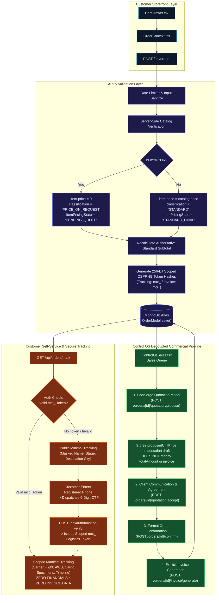

# MARINE CREATURES — P0 REMEDIATION
## MASTER TECHNICAL REMEDIATION SPECIFICATION: SECURITY & DATA INTEGRITY (REVISED)

**Document ID:** `MC-REM-P0-001-REV2`  
**Date:** November 6, 2026 (Revised Edition)  
**Auditor / Principal Software Architect:** Principal Enterprise Architect, AppSec & Systems Auditor  
**System:** Marine Creatures Control OS / Storefront / Order Management Infrastructure  
**Priority:** P0 — Production Blocking  
**Mode:** READ-ONLY SPECIFICATION COMPLETE — WAITING FOR IMPLEMENTATION AUTHORISATION  

---

## 1. EXECUTIVE SUMMARY & REVISED ARCHITECTURAL PRINCIPLES

Following the comprehensive health audit and architectural review conducted on November 6, 2026, severe structural and security failures were uncovered in the Marine Creatures order-to-dispatch workflow. This revised master specification incorporates four critical architectural corrections:
1. **Cryptographic OTP Token Delivery (Revision A):** A 10-digit phone number, phone suffix, or order ID is strictly an identity claim, **NEVER** an authenticator. Scoped 256-bit CSPRNG tokens (`mct_` for tracking, `mci_` for invoices) are issued strictly post-OTP verification or through verified concierge handoff.
2. **Evidence-Based POR Classification (Revision B):** Zero price does **NOT** automatically mean Price-on-Request. An 11-vector evidentiary model and 6-category classification prevent corrupting valid promotional items, warranty replacements, or standard orders.
3. **Controlled Atomic Migration (Revision C):** Metadata migrations require dry-run verification by default, immutable before-image manifests, optimistic concurrency guards, and transaction-safe rollback.
4. **Decoupled Commercial Lifecycle (Revision D):** Price proposal, customer agreement, order confirmation, and invoice generation are strictly decoupled. Entering a proposed quotation does not imply customer acceptance, and customer agreement does not automatically generate an invoice.

---

## 2. REVISED DELIVERABLES DIRECTORY

The remediation documentation suite under [`docs/REMEDIATION/P0_SECURITY_DATA_INTEGRITY/`](file:///c:/Users/User/OneDrive/Desktop/Marine%20Creatures/marine-creatures/docs/REMEDIATION/P0_SECURITY_DATA_INTEGRITY/) comprises:

| Ref | Deliverable File | Focus Area & Architectural Role |
|---|---|---|
| **00** | [`P0_REMEDIATION_SPECIFICATION.md`](file:///c:/Users/User/OneDrive/Desktop/Marine%20Creatures/marine-creatures/docs/REMEDIATION/P0_SECURITY_DATA_INTEGRITY/P0_REMEDIATION_SPECIFICATION.md) | This master architectural specification and executive synthesis. |
| **01** | [`01-HISTORICAL-CUSTOMER-TOKEN-ISSUANCE.md`](file:///c:/Users/User/OneDrive/Desktop/Marine%20Creatures/marine-creatures/docs/REMEDIATION/P0_SECURITY_DATA_INTEGRITY/01-HISTORICAL-CUSTOMER-TOKEN-ISSUANCE.md) | Cryptographic 256-bit CSPRNG tokens, OTP delivery, capability scoping (`mct_` vs `mci_`), and edge cases. |
| **02** | [`02-EVIDENCE-BASED-POR-CLASSIFICATION.md`](file:///c:/Users/User/OneDrive/Desktop/Marine%20Creatures/marine-creatures/docs/REMEDIATION/P0_SECURITY_DATA_INTEGRITY/02-EVIDENCE-BASED-POR-CLASSIFICATION.md) | 11-vector evidence scoring model, 6 classification outcomes, and manual review queues. |
| **03** | [`03-ATOMIC-METADATA-MIGRATION.md`](file:///c:/Users/User/OneDrive/Desktop/Marine%20Creatures/marine-creatures/docs/REMEDIATION/P0_SECURITY_DATA_INTEGRITY/03-ATOMIC-METADATA-MIGRATION.md) | Dry-run CLI contract, before-image manifests, ACID transactions, and safe rollback. |
| **04** | [`04-PRICE-AGREEMENT-ORDER-CONFIRMATION-INVOICE.md`](file:///c:/Users/User/OneDrive/Desktop/Marine%20Creatures/marine-creatures/docs/REMEDIATION/P0_SECURITY_DATA_INTEGRITY/04-PRICE-AGREEMENT-ORDER-CONFIRMATION-INVOICE.md) | Decoupled 6-stage lifecycle (`proposedUnitPrice` != `agreedUnitPrice` != `isConfirmed` != `invoiceIssued`). |
| **05** | [`05-REVISED-IMPLEMENTATION-SEQUENCE.md`](file:///c:/Users/User/OneDrive/Desktop/Marine%20Creatures/marine-creatures/docs/REMEDIATION/P0_SECURITY_DATA_INTEGRITY/05-REVISED-IMPLEMENTATION-SEQUENCE.md) | Phased dependency graph, owner sign-off gates, isolated test requirements, and records protection. |
| **06** | [`06-CROSS-DOCUMENT-CONSISTENCY-AUDIT.md`](file:///c:/Users/User/OneDrive/Desktop/Marine%20Creatures/marine-creatures/docs/REMEDIATION/P0_SECURITY_DATA_INTEGRITY/06-CROSS-DOCUMENT-CONSISTENCY-AUDIT.md) | 14-point consistency audit, resolved contradictions register, and open policy decisions. |
| **07** | [`CURRENT_STATE_FINDINGS.md`](file:///c:/Users/User/OneDrive/Desktop/Marine%20Creatures/marine-creatures/docs/REMEDIATION/P0_SECURITY_DATA_INTEGRITY/CURRENT_STATE_FINDINGS.md) | Baseline Git forensics, mounted component analysis, and defect matrix. |
| **08** | [`API_SECURITY_PERMISSION_MATRIX.csv`](file:///c:/Users/User/OneDrive/Desktop/Marine%20Creatures/marine-creatures/docs/REMEDIATION/P0_SECURITY_DATA_INTEGRITY/API_SECURITY_PERMISSION_MATRIX.csv) | Endpoint-by-endpoint RBAC authorization matrix covering all order and dispatch routes. |
| **09** | [`ORDER_DATA_INTEGRITY_SPEC.md`](file:///c:/Users/User/OneDrive/Desktop/Marine%20Creatures/marine-creatures/docs/REMEDIATION/P0_SECURITY_DATA_INTEGRITY/ORDER_DATA_INTEGRITY_SPEC.md) | Server-side catalogue pricing authority, POR flagging, and Mongoose pre-save hooks. |
| **10** | [`CUSTOMER_TRACKING_INVOICE_SECURITY.md`](file:///c:/Users/User/OneDrive/Desktop/Marine%20Creatures/marine-creatures/docs/REMEDIATION/P0_SECURITY_DATA_INTEGRITY/CUSTOMER_TRACKING_INVOICE_SECURITY.md) | Dual tracking schemas (Public Minimal vs Scoped Full Manifest), timing-safe token verification. |
| **11** | [`ORDER_STATE_TRANSITION_MATRIX.csv`](file:///c:/Users/User/OneDrive/Desktop/Marine%20Creatures/marine-creatures/docs/REMEDIATION/P0_SECURITY_DATA_INTEGRITY/ORDER_STATE_TRANSITION_MATRIX.csv) | Pairwise lifecycle transition rules, linear enforcement, and quarantine gates. |
| **12** | [`LEGACY_ORDER_RECOVERY_PLAN.md`](file:///c:/Users/User/OneDrive/Desktop/Marine%20Creatures/marine-creatures/docs/REMEDIATION/P0_SECURITY_DATA_INTEGRITY/LEGACY_ORDER_RECOVERY_PLAN.md) | Safe reconciliation plan for `MC-740020EJ` and `MC-429334LH` without automatic price guessing. |
| **13** | [`ISOLATED_TEST_STRATEGY.md`](file:///c:/Users/User/OneDrive/Desktop/Marine%20Creatures/marine-creatures/docs/REMEDIATION/P0_SECURITY_DATA_INTEGRITY/ISOLATED_TEST_STRATEGY.md) | Specification for 22 real MongoDB integration tests replacing synthetic mocks. |
| **14** | [`ACCEPTANCE_CRITERIA.md`](file:///c:/Users/User/OneDrive/Desktop/Marine%20Creatures/marine-creatures/docs/REMEDIATION/P0_SECURITY_DATA_INTEGRITY/ACCEPTANCE_CRITERIA.md) | Formal testable criteria for production sign-off across P0-A through P0-G. |

---

## 3. REVISED ARCHITECTURAL SYSTEM TOPOLOGY

---

## 4. SUMMARY OF P0 REVISED DOMAINS

### P0-A: Remove Production QA Interceptors
- **Action:** Delete hardcoded `if (orderId.startsWith('MC-QA-'))` blocks from all production routes.
- **Result:** Zero mock interceptors in production. All operations interact directly with MongoDB.

### P0-B: Repair Checkout Data Integrity
- **Action:** Enforce server-side catalogue authority. Preserve POR metadata; standard items take catalogue prices; POR specimens enter `PENDING_QUOTE`. Pre-save hook enforces that unresolved POR items cannot be approved or marked confirmed.
- **Result:** High-value corals can never silently become free standard items.

### P0-C: Secure Customer Order Tracking
- **Action:** Remove the 4-digit phone suffix check. Public queries return Public Minimal Schema. Full manifests mandate the `mct_` tracking token issued post-OTP verification or through verified concierge handoff. Customer tracking strictly surrenders zero pricing, total, or invoice data.
- **Result:** Eliminates customer manifest harvesting; keeps financial data internal.

### P0-D: Strict Administrative Invoice Access & Route Decommissioning
- **Action:** Decommission public `/invoice/[id]` web route and public token endpoint `/api/orders/[id]`. Invoices are internal business documents restricted exclusively to authenticated Control OS under granular RBAC (`invoices.view`, `invoices.generate`, `invoices.download`, `invoices.revise`, `invoices.revoke`). Permanent heading `INVOICE & DISPATCH MANIFEST`.
- **Result:** Invoices are never directly accessed by customers; complete corporate financial privacy.

### P0-E: Enforce Granular RBAC
- **Action:** Replace `isAdminRequest` with `requirePermission(req, '...')`. Implement fine-grained permissions for propose, commit, confirm, invoice, and dispatch.
- **Result:** Strict deny-by-default access control.

### P0-F: Unify Order State Transitions
- **Action:** Author `lib/orders/state-machine.ts` enforcing strictly linear progression: `placed` -> `quarantine` -> `packed` -> `dispatched` -> `delivered`. Livestock requires quarantine health sign-off before packing.
- **Result:** Prevents skipped stages and protects specimen welfare.

### P0-G: Controlled Historical Recovery
- **Action:** Execute dry-run diagnostic `scripts/reconcile-por-metadata.mjs` applying the 11-vector evidence scoring model. Create before-image manifests; require owner review for `MC-740020EJ` and `MC-429334LH`.
- **Result:** Zero automatic price inference; safe, audited reconciliation.

---

## 5. NEXT STEPS & IMPLEMENTATION READINESS

With this revised specification complete:
- **Source Code Status:** Strictly untouched. Zero application files modified.
- **Database Status:** Strictly untouched. Zero records altered.
- **Git State:** Exactly preserved (`main` branch @ `ffd220d`, 8 modified files intact).
- **Deliverables:** All 14 documents created/revised under `docs/REMEDIATION/P0_SECURITY_DATA_INTEGRITY/`.

**Awaiting explicit user authorisation before commencing implementation.**
