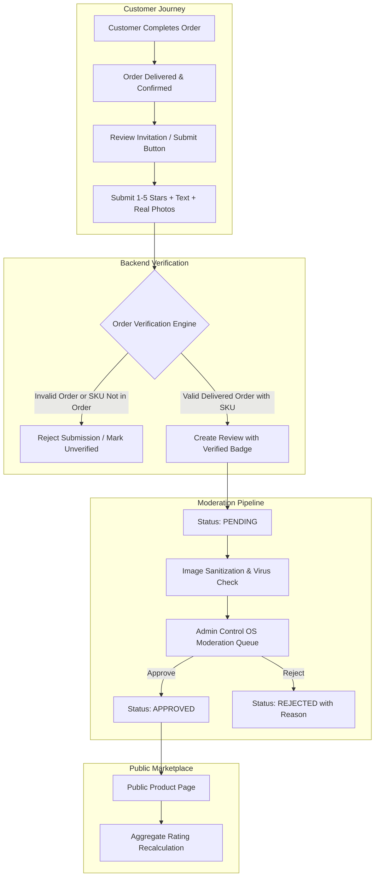

# MARINE CREATURES — FIRST-PARTY CUSTOMER REVIEW SYSTEM ARCHITECTURE
**Document Reference:** MC-REV-ARCH-NOV2026  
**Date:** 6 November 2026  
**Architect:** Senior E-Commerce Architect & Principal Next.js Engineer  
**Classification:** System Architecture & Data Engineering Specification  
**Status:** COMPLETE (DESIGN SPECIFICATION — STRICTLY READ-ONLY)

---

## 1. ARCHITECTURAL OBJECTIVE & PHILOSOPHY

Marine Creatures caters to discerning marine aquarists, public institutions, and luxury private residences across India. Fabricated ratings and stock photos erode customer trust and violate Indian e-commerce consumer protection regulations.

The first-party customer review architecture must establish:

1. **Absolute Authenticity:** Reviews are submitted exclusively by genuine users, with verified purchase status anchored cryptographically to delivered customer orders.
2. **Immutable Integrity:** Customer words and ratings cannot be silently edited or manipulated by administrators.
3. **Pervasive Moderation:** All submissions enter an administrative queue before public visibility, filtering out spam, defamatory language, PII leaks, and malicious image uploads.
4. **Abyssal Luxury Aesthetic:** Seamlessly integrated into the Next.js 16 / Tailwind CSS visual design system without visual clutter.



---

## 2. DATA ARCHITECTURE & DATABASE SCHEMAS

The review architecture integrates with existing MongoDB Atlas schemas (`models/Product.ts`, `models/Order.ts`, `models/Customer.ts`, `models/AuditLog.ts`).

### A. Model 1: `ProductReview` (`models/ProductReview.ts`)

```typescript
import mongoose, { Schema, Document, Model } from 'mongoose';

export type ReviewStatus = 'PENDING' | 'APPROVED' | 'REJECTED' | 'REPORTED' | 'REMOVED_BY_USER';

export interface IReviewMedia {
  id: string;
  url: string;
  thumbnailUrl: string;
  mimeType: string;
  fileSize: number;
  width?: number;
  height?: number;
  status: 'PENDING' | 'APPROVED' | 'REJECTED';
  uploadedAt: Date;
}

export interface IProductReviewDocument extends Document {
  id: string;                         // Unique UUID v4
  productId: string;                  // Target Product ID (e.g., 'bubble-magus-qq2')
  productName: string;                // Historical product snapshot
  productCategory: string;            // 'marine-life' | 'hardware' | 'salt-chemistry' | etc.
  
  // Customer & Verification Anchor
  customerId?: string;                // Authenticated Customer UUID (if logged in)
  customerName: string;               // Display name (e.g., "Suraj S." or "A. Nambiar")
  customerLocation: string;           // Verified city/state (e.g., "Bengaluru, Karnataka")
  customerPhoneMasked?: string;       // "+91 ****** 4390"
  
  orderId?: string;                   // Reference to Order._id or Order.id
  isVerifiedPurchase: boolean;        // True ONLY if verified against delivered order
  verifiedAt?: Date;                  // Timestamp when purchase was verified
  
  // Review Body
  rating: number;                     // Integer 1 to 5
  title: string;                      // Max 120 chars
  comment: string;                    // Max 2000 chars
  media: IReviewMedia[];              // Up to 4 customer tank photos
  
  // Engagement
  helpfulVotes: number;               // Community helpful count
  helpfulVoterIps: string[];          // Prevent duplicate voting
  
  // Moderation & Governance
  status: ReviewStatus;
  moderatedBy?: string;               // Admin User ID / Employee ID
  moderatedAt?: Date;
  moderationNotes?: string;           // Internal audit notes
  rejectionReason?: string;           // Customer-facing rejection explanation
  
  createdAt: Date;
  updatedAt: Date;
}

const ProductReviewSchema = new Schema<IProductReviewDocument>(
  {
    id: { type: String, required: true, unique: true, index: true },
    productId: { type: String, required: true, index: true },
    productName: { type: String, required: true },
    productCategory: { type: String, required: true },
    
    customerId: { type: String, index: true },
    customerName: { type: String, required: true, trim: true, maxlength: 60 },
    customerLocation: { type: String, required: true, trim: true, maxlength: 80 },
    customerPhoneMasked: { type: String },
    
    orderId: { type: String, index: true },
    isVerifiedPurchase: { type: Boolean, default: false, index: true },
    verifiedAt: { type: Date },
    
    rating: { type: Number, required: true, min: 1, max: 5, index: true },
    title: { type: String, required: true, trim: true, maxlength: 120 },
    comment: { type: String, required: true, trim: true, maxlength: 2000 },
    media: [
      {
        id: { type: String, required: true },
        url: { type: String, required: true },
        thumbnailUrl: { type: String, required: true },
        mimeType: { type: String, required: true },
        fileSize: { type: Number, required: true },
        width: { type: Number },
        height: { type: Number },
        status: { type: String, enum: ['PENDING', 'APPROVED', 'REJECTED'], default: 'PENDING' },
        uploadedAt: { type: Date, default: Date.now },
      },
    ],
    
    helpfulVotes: { type: Number, default: 0 },
    helpfulVoterIps: { type: [String], default: [] },
    
    status: {
      type: String,
      enum: ['PENDING', 'APPROVED', 'REJECTED', 'REPORTED', 'REMOVED_BY_USER'],
      default: 'PENDING',
      index: true,
    },
    moderatedBy: { type: String },
    moderatedAt: { type: Date },
    moderationNotes: { type: String },
    rejectionReason: { type: String },
  },
  {
    timestamps: true,
    collection: 'product_reviews',
  }
);

// Compound Index: Enforce 1 review per customer per purchased product per order
ProductReviewSchema.index(
  { customerId: 1, productId: 1, orderId: 1 },
  { unique: true, partialFilterExpression: { customerId: { $exists: true }, orderId: { $exists: true } } }
);

// Compound Index: Fast querying for public product page
ProductReviewSchema.index({ productId: 1, status: 1, createdAt: -1 });

export const ProductReviewModel: Model<IProductReviewDocument> =
  mongoose.models.ProductReview ||
  mongoose.model<IProductReviewDocument>('ProductReview', ProductReviewSchema);
```

---

### B. Model 2: `ExternalReviewSource` (`models/ExternalReviewSource.ts`)

For products with established community track records, curated third-party summaries are managed through a dedicated collection:

```typescript
import mongoose, { Schema, Document, Model } from 'mongoose';

export interface IExternalReviewSourceDocument extends Document {
  id: string;                         // UUID
  productId: string;                  // Marine Creatures Product ID
  sourcePlatform: string;             // 'Bulk Reef Supply' | 'Reef2Reef' | 'Amazon' | 'Feefo'
  sourceUrl: string;                  // Direct source URL
  externalRating: number;             // e.g., 4.9
  externalMaxRating: number;          // e.g., 5.0
  reviewCountSummary?: number;        // e.g., 140 reviews on platform
  sentimentSummary: string;           // Concise factual summary of community experience
  keyPros: string[];                  // e.g. ["Silent operation", "Compact footprint"]
  keyCons: string[];                  // e.g. ["Sensitive to water level"]
  lastAuditedAt: Date;
  isActive: boolean;
}

const ExternalReviewSourceSchema = new Schema<IExternalReviewSourceDocument>(
  {
    id: { type: String, required: true, unique: true, index: true },
    productId: { type: String, required: true, index: true },
    sourcePlatform: { type: String, required: true },
    sourceUrl: { type: String, required: true },
    externalRating: { type: Number, required: true },
    externalMaxRating: { type: Number, default: 5.0 },
    reviewCountSummary: { type: Number },
    sentimentSummary: { type: String, required: true, maxlength: 500 },
    keyPros: { type: [String], default: [] },
    keyCons: { type: [String], default: [] },
    lastAuditedAt: { type: Date, default: Date.now },
    isActive: { type: Boolean, default: true, index: true },
  },
  {
    timestamps: true,
    collection: 'external_review_sources',
  }
);

export const ExternalReviewSourceModel: Model<IExternalReviewSourceDocument> =
  mongoose.models.ExternalReviewSource ||
  mongoose.model<IExternalReviewSourceDocument>('ExternalReviewSource', ExternalReviewSourceSchema);
```

---

### C. Model 3: `ReviewModerationLog` (`models/ReviewModerationLog.ts`)

Maintains an immutable audit trail of every moderation action:

```typescript
import mongoose, { Schema, Document, Model } from 'mongoose';

export interface IReviewModerationLogDocument extends Document {
  id: string;
  reviewId: string;
  action: 'SUBMITTED' | 'APPROVED' | 'REJECTED' | 'REPORTED' | 'IMAGE_REJECTED' | 'RESTORED' | 'DELETED';
  moderatorId: string;
  moderatorEmail: string;
  reason?: string;
  previousStatus?: string;
  newStatus: string;
  ipAddress?: string;
  createdAt: Date;
}

const ReviewModerationLogSchema = new Schema<IReviewModerationLogDocument>(
  {
    id: { type: String, required: true, unique: true, index: true },
    reviewId: { type: String, required: true, index: true },
    action: { type: String, required: true },
    moderatorId: { type: String, required: true },
    moderatorEmail: { type: String, required: true },
    reason: { type: String },
    previousStatus: { type: String },
    newStatus: { type: String, required: true },
    ipAddress: { type: String },
  },
  {
    timestamps: { createdAt: true, updatedAt: false },
    collection: 'review_moderation_logs',
  }
);

export const ReviewModerationLogModel: Model<IReviewModerationLogDocument> =
  mongoose.models.ReviewModerationLog ||
  mongoose.model<IReviewModerationLogDocument>('ReviewModerationLog', ReviewModerationLogSchema);
```

---

## 3. VERIFIED PURCHASE VALIDATION ENGINE

A review is designated `isVerifiedPurchase = true` **if and only if** the submission passes all 4 algorithmic verification checks:

```typescript
// Verification Service: lib/reviews/verificationEngine.ts
import { OrderModel } from '@/models/Order';

export async function verifyCustomerPurchase(
  orderId: string,
  productId: string,
  customerId?: string,
  customerPhone?: string
): Promise<{ isVerified: boolean; failureReason?: string; verifiedAt?: Date }> {
  // Check 1: Order exists in MongoDB
  const order = await OrderModel.findOne({
    $or: [{ id: orderId }, { _id: orderId }],
  });

  if (!order) {
    return { isVerified: false, failureReason: 'Order record not found.' };
  }

  // Check 2: Customer Identity Alignment
  if (customerId && order.customerId && order.customerId !== customerId) {
    return { isVerified: false, failureReason: 'Customer account does not match order record.' };
  }

  // Check 3: SKU exists within order line items
  const containsProduct = order.items.some(
    (item: any) => item.product?.id === productId || item.id === productId
  );

  if (!containsProduct) {
    return { isVerified: false, failureReason: 'Product was not part of this order.' };
  }

  // Check 4: Order must be delivered/completed
  // Orders in 'placed' or 'processing' cannot be reviewed until living arrival / equipment delivery is finalized
  const isDelivered =
    order.currentStep === 'delivered' ||
    (order.isApproved && order.statusHistory?.some((s: any) => s.step === 'delivered'));

  if (!isDelivered) {
    return {
      isVerified: false,
      failureReason: 'Order has not reached verified delivered status.',
    };
  }

  return { isVerified: true, verifiedAt: new Date() };
}
```

---

## 4. API SPECIFICATION & ROUTE HANDLERS

All API routes follow Next.js 16 App Router standards with strict input validation using Zod and session-based access control:

| Route | Method | Authentication | Rate Limit | Purpose |
| :--- | :---: | :---: | :---: | :--- |
| `/api/products/[id]/reviews` | `GET` | Public | 60 req / min | Fetch approved reviews for a product with pagination & filter |
| `/api/products/[id]/external-feedback` | `GET` | Public | 60 req / min | Fetch curated external community feedback summaries |
| `/api/reviews/submit` | `POST` | Verified Customer / Session | 3 submissions / day | Submit a new review with order anchor & media |
| `/api/reviews/[id]/helpful` | `POST` | Public / IP Tracked | 10 votes / min | Vote helpful on a review (1 vote per IP) |
| `/api/admin/reviews` | `GET` | Admin Session (`role: admin`) | 120 req / min | List reviews with status filter (`PENDING`, `APPROVED`, etc.) |
| `/api/admin/reviews/[id]` | `PATCH` | Admin Session (`role: admin`) | 60 req / min | Approve, Reject, or Update Moderation Notes |
| `/api/admin/reviews/[id]/media` | `PATCH` | Admin Session (`role: admin`) | 60 req / min | Approve or Reject individual customer images |
| `/api/reviews/[id]/request-removal` | `POST` | Review Author | 5 req / hour | Customer request to delete their submitted review |

---

## 5. USER EXPERIENCE & ABYSSAL LUXURY UI INTEGRATION

### A. Dual-Tab Marketplace Presentation

On the product detail page (`components/marketplace/ProductDetailView.tsx`), the review section will feature a luxury tabbed interface:

```tsx
// Structure of Tabbed Section:
<div className="mt-16 pt-12 border-t border-slate-800/80">
  <div className="flex items-center gap-6 border-b border-slate-800 mb-8">
    <button
      onClick={() => setActiveTab('verified-reviews')}
      className={`pb-3 text-sm font-semibold tracking-wide transition-colors ${
        activeTab === 'verified-reviews'
          ? 'text-white border-b-2 border-cyan-400'
          : 'text-slate-400 hover:text-slate-200'
      }`}
    >
      Verified Customer Reviews ({reviews.length})
    </button>

    {externalFeedback && (
      <button
        onClick={() => setActiveTab('external-feedback')}
        className={`pb-3 text-sm font-semibold tracking-wide transition-colors ${
          activeTab === 'external-feedback'
            ? 'text-white border-b-2 border-amber-400'
            : 'text-slate-400 hover:text-slate-200'
        }`}
      >
        External Product Feedback
      </button>
    )}
  </div>

  {activeTab === 'verified-reviews' && <VerifiedCustomerReviewsView reviews={reviews} />}
  {activeTab === 'external-feedback' && <ExternalFeedbackView feedback={externalFeedback} />}
</div>
```

### B. Rating Aggregate Calculation

The star rating displayed on the product card and hero banner is strictly computed from approved reviews:

$$\text{Aggregate Rating} = \frac{\sum_{i=1}^{N} \text{rating}_i}{N} \quad (\text{where } \text{status} = \text{'APPROVED'})$$

* If $N = 0$: **Do not render star ratings or fake counts.** Render: `"No customer reviews yet"` with a `"Write a Review"` CTA button for verified buyers.

