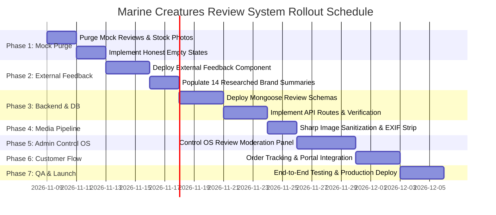

# MARINE CREATURES — REVIEW SYSTEM IMPLEMENTATION ROADMAP
**Document Reference:** MC-REV-ROADMAP-NOV2026  
**Date:** 6 November 2026  
**Architect:** Principal E-Commerce Architect & Senior Full-Stack Engineer  
**Classification:** Engineering Roadmap & Rollout Plan  
**Status:** READY FOR FOUNDER APPROVAL (CHANGE CONTROL: READ-ONLY AUDIT)

---

## 1. IMPLEMENTATION OVERVIEW & PHASING

This roadmap outlines the precise, sequential execution strategy to transition Marine Creatures from synthetic placeholder reviews to a legally compliant, dual-tiered review architecture comprising:
1. **Tier 1:** Curated **"EXTERNAL PRODUCT FEEDBACK"** with explicit third-party attribution and source linking.
2. **Tier 2:** A permanent **First-Party Customer Review Platform** anchored cryptographically to delivered customer orders.

---

## 2. DETAILED PHASE SPECIFICATIONS

### PHASE 1 — IMMEDIATE REMEDIATION & MOCK PURGE
* **Duration:** 4 Days
* **Prerequisite:** Founder Approval.
* **Scope of Work:**
  1. **Purge Mock Review Generator:** Delete `getDefaultReviews(product)` in `components/marketplace/ProductReviewsSection.tsx`.
  2. **Purge Unsplash Stock Photography:** Remove all references to `photo-1544551763-46a013bb70d5`, `photo-1546026423-cc4642628d2b`, `photo-1583212292454-1fe6229603b7`, and `photo-1582967788606-a171c1080cb0`.
  3. **Purge Artificial Ratings & Counts:** Remove hardcoded ratings and review counts from `lib/data/products.ts` and `models/Product.ts`.
  4. **Implement Elegant Empty States:** When a product has no reviews, display:
     * *"No reviews yet — be the first verified buyer to share your results."*
     * Remove the star rating banner from `ProductDetailView.tsx` when review count is zero.
  5. **Purge Misleading Copy:** Remove the header text `"Verified Indian Reefers"` and replace with genuine brand copy.

### PHASE 2 — DEPLOY "EXTERNAL PRODUCT FEEDBACK" COMPONENT
* **Duration:** 5 Days
* **Scope of Work:**
  1. Build `ExternalFeedbackSection.tsx` under approved banner `"EXTERNAL PRODUCT FEEDBACK"`.
  2. Display clear disclaimer:
     > *"Aggregated from independent marine aquarium communities, specialist forums, and authorized global retailers. Not submitted directly to Marine Creatures."*
  3. Populate the 14 verified external review summaries (Bubble Magus QQ2, Mini Q, Seachem Cupramine, Seachem Calcium, Hikari Mysis, Sunsun pumps, Blue Treasure salts, Quantum salt, Biozym 303, Boyu box).
  4. Include verified direct source links (`rel="noopener noreferrer nofollow"`).
  5. Ensure zero third-party user photos are embedded.

### PHASE 3 — DATABASE SCHEMAS & VERIFICATION API
* **Duration:** 6 Days
* **Scope of Work:**
  1. Create Mongoose models:
     * `models/ProductReview.ts`
     * `models/ExternalReviewSource.ts`
     * `models/ReviewModerationLog.ts`
  2. Implement verification engine `lib/reviews/verificationEngine.ts`:
     * Validates that `orderId` exists, belongs to user, contains the reviewed SKU, and has status `delivered`.
  3. Build Next.js 16 API endpoints:
     * `POST /api/reviews/submit`
     * `GET /api/products/[id]/reviews`
     * `GET /api/products/[id]/external-feedback`
     * `POST /api/reviews/[id]/helpful`
  4. Implement rate limiting and Zod input validation.

### PHASE 4 — IMAGE SANITIZATION & EXIF STRIPPING PIPELINE
* **Duration:** 2 Days
* **Scope of Work:**
  1. Integrate `sharp` image processing utility (`lib/reviews/imageProcessor.ts`).
  2. Enforce binary magic number checks for JPEG, PNG, and WebP (rejecting SVGs and executables).
  3. Strip all EXIF geolocation and camera metadata to protect client privacy.
  4. Generate standardized WebP display assets (max 1440px) and square thumbnails (320px).

### PHASE 5 — ADMIN CONTROL OS REVIEW MODERATION MODULE
* **Duration:** 4 Days
* **Scope of Work:**
  1. Add new **"Reviews"** tab to the Marine Creatures Admin Control OS (`components/admin/ControlOsReviews.tsx`).
  2. Implement tabbed queue views:
     * **Pending Reviews:** Review card showing customer identity, order ID, product name, rating, text, and photo preview.
     * **Approved Reviews:** Published reviews with unpublish/removal controls.
     * **Rejected Reviews:** Archive with rejection reasons and moderator notes.
     * **Reported Reviews:** Flagged reviews requiring immediate attention.
  3. Implement Image Lightbox with single-click photo approval/rejection.
  4. Enforce immutable text policy (moderators can approve or reject, but cannot edit customer words).

### PHASE 6 — CUSTOMER PORTAL & ORDER TRACKING INTEGRATION
* **Duration:** 3 Days
* **Scope of Work:**
  1. In `OrderTrackingModal.tsx` and customer account portal:
     * When order step reaches `delivered`, render a discreet `"Review Your Specimen / Equipment"` button next to eligible line items.
  2. Review Submission Modal:
     * Star rating selector (1–5).
     * Review title and detailed text area.
     * Multi-photo drag-and-drop uploader with client-side preview.
     * Clear notice explaining that reviews undergo administrative moderation before publication.

### PHASE 7 — QA, RESPONSIVE VERIFICATION & PRODUCTION LAUNCH
* **Duration:** 3 Days
* **Scope of Work:**
  1. Mobile responsive testing across 320px, 375px, 390px, 430px, 768px, and 1280px viewports.
  2. Security penetration testing (testing XSS injection, SVG uploads, rate-limit bypassing, order ID spoofing).
  3. Legal compliance audit against Consumer Protection (E-Commerce) Rules, 2020.
  4. Production deployment and monitoring.

---

## 3. CHANGE CONTROL & APPROVAL GATEWAY

| Gateway Step | Requirement | Responsible Party | Status |
| :--- | :--- | :--- | :---: |
| **Gateway 1** | Delivery of 7 Forensic Research & Architecture Documents | Senior Researcher | **COMPLETE** |
| **Gateway 2** | Founder Review & Written Implementation Authorization | Business Owner / Founder | **PENDING APPROVAL** |
| **Gateway 3** | Staging Branch Creation & Phase 1 Mock Purge | Engineering Team | **LOCKED (READ-ONLY)** |
| **Gateway 4** | Verification of First Real Customer Delivery & Test Review | QA / Admin | **LOCKED (READ-ONLY)** |

> [!IMPORTANT]
> In accordance with strict instructions, **zero code, database records, or configuration files have been altered during this audit**. All 7 deliverables have been written exclusively to the documentation repository (`docs/REVIEWS/`). Work is halted pending founder review and written authorization.

