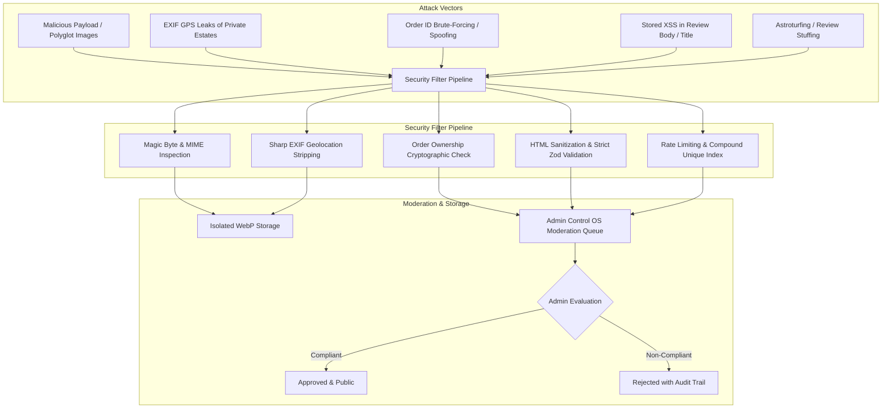

# MARINE CREATURES — REVIEW SECURITY AND MODERATION SPECIFICATION
**Document Reference:** MC-REV-SEC-NOV2026  
**Date:** 6 November 2026  
**Auditor / Security Architect:** Senior Security & Data Integrity Engineer  
**Classification:** Technical Security Standard & Moderation SOP  
**Status:** COMPLETE (SECURITY SPECIFICATION — STRICTLY READ-ONLY)

---

## 1. THREAT MODEL & ATTACK VECTORS

Because Marine Creatures caters to high-net-worth marine aquarium enthusiasts, luxury residential estates, and corporate installations, the customer review platform must be defended against deliberate exploitation, privacy infringement, and malicious tampering.



### Threat Breakdown:

1. **Client Privacy Infringement (EXIF Geolocation Leakage):**
   * *Risk:* Customers uploading photos of private residential reef installations often capture embedded GPS coordinates, camera serial numbers, and home Wi-Fi metadata in high-resolution smartphone EXIF tags.
   * *Impact:* Publishing unstripped images could expose exact residential addresses of high-net-worth clients.
   * *Mitigation:* Zero raw customer images are served. The image processing pipeline strips 100% of EXIF/IPTC metadata.

2. **Order ID Forgery & Unearned Verification Badges:**
   * *Risk:* Malicious users or scrapers attempting to supply guessed order IDs (e.g., `ORD-10023`) to obtain an unearned "Verified Purchase" badge.
   * *Impact:* Compromises catalog integrity and violates Indian e-commerce consumer protection laws.
   * *Mitigation:* Orders are verified against authenticated session credentials, verified delivery status, and line-item SKU presence.

3. **Malicious File Uploads (Polyglot / Web Shell Executables):**
   * *Risk:* Attackers renaming executable scripts or SVG files containing embedded XML/JavaScript as `.jpg` or `.png`.
   * *Impact:* Remote code execution (RCE) or cross-site scripting (XSS).
   * *Mitigation:* Strict binary magic number validation (disallowing SVGs and executables), followed by re-encoding into clean WebP via `sharp`.

4. **Stored Cross-Site Scripting (XSS):**
   * *Risk:* Injection of malicious `<script>` tags, `javascript:` URIs, or malicious markdown in review titles, comments, or author names.
   * *Impact:* Session hijacking or administrative account takeover when an admin opens the review moderation queue.
   * *Mitigation:* Server-side input escaping, Zod schema constraints, and strict React JSX safe text rendering.

5. **Administrative Manipulation & Silent Editing:**
   * *Risk:* Administrators silently editing customer complaints into glowing endorsements.
   * *Impact:* Severe violation of consumer protection regulations and loss of brand credibility.
   * *Mitigation:* The moderation interface provides only binary decisions (`APPROVE` or `REJECT`). Text fields are immutable.

---

## 2. IMAGE SANITIZATION & PROCESSING PIPELINE

The image processing pipeline must execute before any user-uploaded image is written to disk or cloud object storage:

```typescript
// lib/reviews/imageProcessor.ts
import sharp from 'sharp';
import { v4 as uuidv4 } from 'uuid';
import path from 'path';
import fs from 'fs/promises';

const ALLOWED_MIME_TYPES = ['image/jpeg', 'image/png', 'image/webp'];
const MAX_FILE_SIZE_BYTES = 5 * 1024 * 1024; // 5 MB

export async function processCustomerReviewImage(
  fileBuffer: Buffer,
  declaredMimeType: string
): Promise<{ url: string; thumbnailUrl: string; width: number; height: number; fileSize: number }> {
  // 1. File size check
  if (fileBuffer.length > MAX_FILE_SIZE_BYTES) {
    throw new Error('Image exceeds maximum allowed size of 5 MB.');
  }

  // 2. Binary Magic Number verification
  const isJpeg = fileBuffer[0] === 0xff && fileBuffer[1] === 0xd8;
  const isPng =
    fileBuffer[0] === 0x89 &&
    fileBuffer[1] === 0x50 &&
    fileBuffer[2] === 0x4e &&
    fileBuffer[3] === 0x47;
  const isWebp =
    fileBuffer.slice(8, 12).toString('ascii') === 'WEBP';

  if (!isJpeg && !isPng && !isWebp) {
    throw new Error('Invalid image binary. Only genuine JPEG, PNG, or WebP files are accepted.');
  }

  const imageId = uuidv4();
  const outputDir = path.join(process.cwd(), 'public', 'uploads', 'reviews');
  await fs.mkdir(outputDir, { recursive: true });

  // 3. Process Display Image: Strip EXIF, resize to max 1440px, convert to WebP
  const displayFilename = `${imageId}.webp`;
  const displayPath = path.join(outputDir, displayFilename);

  const displayPipeline = sharp(fileBuffer)
    .rotate() // Auto-orient based on EXIF before stripping
    .resize({ width: 1440, height: 1440, fit: 'inside', withoutEnlargement: true })
    .webp({ quality: 82 }); // Strips EXIF metadata automatically

  const displayInfo = await displayPipeline.toFile(displayPath);

  // 4. Process Thumbnail Image: 320x320 square crop
  const thumbFilename = `${imageId}_thumb.webp`;
  const thumbPath = path.join(outputDir, thumbFilename);

  await sharp(fileBuffer)
    .rotate()
    .resize(320, 320, { fit: 'cover', position: 'centre' })
    .webp({ quality: 75 })
    .toFile(thumbPath);

  return {
    url: `/uploads/reviews/${displayFilename}`,
    thumbnailUrl: `/uploads/reviews/${thumbFilename}`,
    width: displayInfo.width,
    height: displayInfo.height,
    fileSize: displayInfo.size,
  };
}
```

---

## 3. SERVER-SIDE INPUT VALIDATION & RATE LIMITING

### A. Zod Validation Schema

```typescript
// lib/reviews/validation.ts
import { z } from 'zod';

export const ReviewSubmissionSchema = z.object({
  productId: z.string().min(1, 'Product ID is required').max(80),
  orderId: z.string().min(1, 'Order ID is required for verification').max(80),
  customerName: z.string().min(2, 'Name must be at least 2 characters').max(60),
  customerLocation: z.string().min(2, 'Location is required').max(80),
  rating: z.number().int().min(1, 'Rating must be at least 1').max(5, 'Rating cannot exceed 5'),
  title: z.string().min(3, 'Title must be at least 3 characters').max(120),
  comment: z
    .string()
    .min(10, 'Review comment must be at least 10 characters')
    .max(2000, 'Review cannot exceed 2,000 characters'),
  images: z.array(z.string().url()).max(4, 'Maximum of 4 images allowed').optional(),
});
```

### B. Rate Limiting Policy

1. **Submission Rate Limit:** Max 3 reviews per customer account / IP per 24 hours.
2. **Helpful Vote Rate Limit:** Max 10 votes per IP per minute; 1 vote per review per IP stored in `helpfulVoterIps`.
3. **Database Guardrail:** Compound unique index on `{ customerId: 1, productId: 1, orderId: 1 }` makes it structurally impossible for a customer to spam multiple reviews for the same purchased item.

---

## 4. ADMIN CONTROL OS REVIEW MODERATION WORKFLOW

### A. State Machine & Status Transitions

```
[Customer Submits] ──> (PENDING)
                           │
             ┌─────────────┴─────────────┐
             ▼                           ▼
        (APPROVED)                  (REJECTED)
             │                           │
      [Publicly Visible]          [Hidden from Public]
             │
             ▼
     (REPORTED by User)
             │
     [Re-enters Queue]
```

### B. Standard Operating Procedures (SOP) for Review Moderators

1. **Evaluation Checklist:**
   * Is the reviewer commenting on the actual product and its biological/mechanical performance?
   * Does the review contain profanity, hate speech, or harassment?
   * Does the review expose personal phone numbers, full residential street addresses, or private financial details?
   * Are the uploaded photographs authentic aquarium photographs, or are they downloaded internet stock images?
   * Is the review an inquiry or customer service support request rather than product feedback? (If so, route to Concierge / WhatsApp support).
2. **Rejection Protocol:**
   * When rejecting a review, the administrator must select an official rejection category and provide internal notes:
     * `REASON_PROFANITY`: Inappropriate or defamatory language.
     * `REASON_PII_LEAK`: Contains private telephone numbers or personal residential addresses.
     * `REASON_STOCK_PHOTO`: Attached imagery is identified as internet stock photography.
     * `REASON_SUPPORT_QUERY`: Review is a logistics enquiry better handled by customer concierge.
     * `REASON_IRRELEVANT`: Content does not pertain to the purchased product.
3. **No Silent Alterations Rule:**
   * Administrators are **strictly prohibited** from altering the wording, rating, or meaning of any submitted review.
   * If a review is 95% great but contains a private phone number, the admin **must reject** the review with notes: *"Please resubmit without your personal phone number in the review body."*

---

## 5. ONGOING SITE-WIDE TERMINOLOGY POLICY ENFORCEMENT

* In strict adherence to Marine Creatures' brand and regulatory governance, **the term "Coral" or "Corals" must not appear in any customer-facing UI, category labels, or system copy**.
* When rendering customer reviews, review titles and comments that use natural customer language will be preserved exactly as written by the customer (as altering customer words violates ASCI standards). However, all system-generated UI labels, filter pills, empty states, and section headings must strictly use **"Reef Life"**, **"Reef Systems"**, and **"Marine Aquariums"**.

