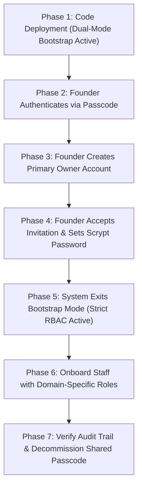

# Marine Creatures — Zero-Downtime RBAC Migration Plan

**Document Version:** 1.0.0  
**Target Environment:** Marine Creatures Production Admin Dashboard (`Control OS`)  
**Scope:** Migration from Shared Admin Passcode to Granular Role-Based Access Control  
**Security Classification:** Confidential  
**Author:** Principal Software Architect & Application Security Engineering  
**Date:** November 2026  

---

## 1. Executive Summary & Migration Objectives

This document establishes the step-by-step operational procedure for migrating Marine Creatures from a single shared administrative passcode (`ADMIN_PASSCODE`) to individual employee identities governed by Role-Based Access Control (RBAC).

### Core Migration Tenets

* **Zero Customer Disruption:** Front-end store browsing, cart checkout, inquiries, order tracking, and public API endpoints remain 100% functional throughout the entire migration.
* **Guaranteed Founder Lockout Immunity:** A dual-mode bootstrap mechanism ensures the founder retains continuous super-administrative access throughout the transition.
* **Reversible & Contained:** Every migration phase is verifiable and accompanied by an explicit contingency rollback procedure.
* **Immediate Cryptographic Enrolment:** Every team member establishes a private high-entropy password hashed via `crypto.scrypt` with a unique cryptographic salt.

---

## 2. Pre-Migration Checklist

Before initiating production deployment, confirm:

1. [x] Git branch `feature/rbac-employee-management` passes all automated TypeScript diagnostics (`npx tsc --noEmit`).
2. [x] Full production build succeeds with 136/136 static and dynamic routes generated (`npm run build`).
3. [x] Automated regression suite passes 117/117 checks (`node scripts/test-invoice-pdf-flow.mjs`).
4. [x] RBAC security test suite passes all 60 security, role barrier, suspension, and revocation assertions (`node scripts/test-rbac-security.mjs`).
5. [x] MongoDB Atlas replica set is healthy with operational read/write latency < 25ms.
6. [x] Production environment variables verify `ADMIN_PASSCODE` and `MONGODB_URI` are present in `.env.local` / host environment.

---

## 3. Migration Execution Phases



### Phase 1: Production Deployment & Bootstrap State

1. Merge `feature/rbac-employee-management` into production branch upon explicit founder authorization.
2. Deploy the Next.js application to the production server.
3. **State Assessment:**
   * Because the `employees` collection contains zero active records with `roleId: 'owner'`, the server automatically activates **Bootstrap Mode**.
   * Any request presenting the master passcode or existing legacy HMAC session cookie is assigned temporary `bootstrap_owner` privileges.
   * Administrative access is maintained without interruption.

### Phase 2: Founder Primary Owner Provisioning

1. The founder (Suraj Shasmal) navigates to `https://marinecreatures.com/admin`.
2. The login screen presents dual options:
   * **Staff Email & Password**
   * **Founder Master Passcode**
3. The founder enters the master passcode to enter `Control OS`.
4. A prominent alert informs the founder:
   > *"BOOTSTRAP MODE ACTIVE: No permanent Owner account is registered. Please create your primary Owner identity to complete system protection."*
5. The founder navigates to the **Employees & Access** module (`/admin/employees`).
6. The founder clicks **"Invite Employee"**:
   * **Full Name:** `Suraj Shasmal`
   * **Email Address:** `suraj@marinecreatures.com` (or official founder email)
   * **Assigned Role:** `Owner / Super Admin`
7. Clicking **"Create Invitation"** generates a single-use 64-character cryptographic token valid for 48 hours.
8. The dashboard displays the invitation link: `https://marinecreatures.com/admin/invite?token=<token>`.

### Phase 3: Owner Activation & Password Creation

1. The founder clicks the link or opens a new browser window.
2. The page verifies the invitation token via `GET /api/auth/invitation/verify`.
3. The founder enters a strong personal password:
   * Minimum 8 characters.
   * Contains uppercase, lowercase, number, and symbol.
4. Clicking **"Set Password & Activate Account"**:
   * Hashes the password using `crypto.scryptSync` with an individual 16-byte cryptographic salt.
   * Marks employee status as `active`.
   * Invalidates the invitation token digest in MongoDB.
   * Automatically issues a signed HMAC-SHA256 session cookie (`mc_admin_session`) and redirects to `/admin`.
5. **System Milestone:** Because an active `Owner` employee now exists in MongoDB, **Bootstrap Mode automatically deactivates**.

### Phase 4: Department Staff Onboarding

The founder invites team members according to operational domains:

| Department / Role | Initial Candidate / Assignee | Assigned System Role | Operational Focus |
| :--- | :--- | :--- | :--- |
| Operations Lead | Operations Supervisor | `operations_manager` | Orders, dispatch logistics, quarantine exit, maintenance |
| Packing / Logistics | Fulfilment Team | `orders_fulfilment` | Packing stages, AWB tracking assignments, dispatch |
| Livestock & Hardware | Inventory Manager | `inventory_manager` | Catalog additions, stock quantities, media uploads |
| Customer Care | Support Representative | `customer_support` | Concierge inquiries, customer notes, order tracking lookups |
| Accounting / Billing | Finance Specialist | `finance_manager` | Official tax invoices, POR quotation pricing, revenue |
| Marketing & Curation | Creative / Content Lead | `content_seo` | Architectural case studies, promotional banners, SEO |
| Compliance / Auditor | External / Internal Auditor | `auditor` | Strict read-only oversight across all business logs |

Each invited employee receives their personalized invitation link, sets their private password, and accesses strictly authorized modules.

---

## 5. Post-Migration Verification & Health Sign-Off

1. **Security Audit Log Check:**
   * Open `/admin/system/audit` and verify:
     * `EMPLOYEE_INVITED` events logged with creator identity.
     * `EMPLOYEE_INVITATION_ACCEPTED` events.
     * `EMPLOYEE_LOGIN_SUCCESS` events with IP and timestamp.
2. **Permission Boundary Verification:**
   * Log into a test employee account (e.g. Customer Support).
   * Confirm that administrative modules outside their domain (e.g. Catalog modifications, Finance invoices, Employee management) are inaccessible or hidden.
3. **Session Revocation Test:**
   * From the Owner dashboard, locate the test employee and click **"Revoke Sessions"**.
   * Verify that the test employee's browser immediately receives HTTP 401 on their next action and is redirected to login.
4. **Suspension Test:**
   * Toggle the test employee status to **"Suspended"**.
   * Confirm that login attempts return HTTP 403 (*"This account has been suspended"*).
   * Reactivate the account and confirm normal login resumes.

---

## 6. Contingency Rollback Procedure

In the highly unlikely event that an unforeseen database corruption or operational obstacle requires reverting:

1. **Immediate Fallback:**
   * Because `ADMIN_PASSCODE` remains intact in `.env.local`, purging or deactivating records in the `employees` collection immediately restores Bootstrap Mode.
   * Emergency database command to revert to Bootstrap Mode:
     ```bash
     node -e "
     const mongoose = require('mongoose');
     mongoose.connect(process.env.MONGODB_URI).then(async () => {
       await mongoose.connection.collection('employees').updateMany(
         { roleId: 'owner' },
         { \$set: { status: 'suspended' } }
       );
       console.log('Bootstrap mode restored.');
       process.exit(0);
     });
     "
     ```
2. **Git Reversion:**
   * If a critical runtime regression is identified, git commit history allows immediate checkout of `main`:
     ```bash
     git checkout main
     npm run build
     ```
   * All customer and order data remains completely unaffected.

