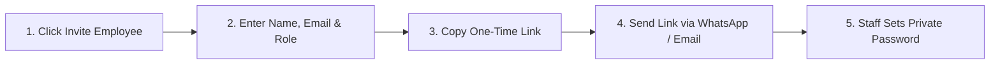

# Marine Creatures — Control OS: Owner Operating Guide
## Employee Management & Role-Based Access Control (RBAC)

**Audience:** Suraj Shasmal, Founder & Super Administrator  
**Platform:** Marine Creatures Admin Dashboard (`Control OS`)  
**Design Tone:** Abyss Black & Deep Ocean Architectural Luxury  
**Version:** 1.0.0 (Production Release)  

---

## 1. Welcome to Control OS Employee Management

Welcome to the new individual Employee Management and Role-Based Access Control system for Marine Creatures.

Previously, administrative tasks relied on a single shared passcode. With this update, your dashboard is fully protected by individual team accounts:

* **No More Shared Passwords:** Each team member logs in with their own registered email and private password.
* **Controlled Access:** Staff only see and touch what they are authorized to manage (e.g., packing staff cannot see revenue, customer support cannot change prices).
* **Instant Accountability:** Every order status change, price quotation, customer note, and catalog edit is stamped with the exact employee who performed it.
* **Instant Control:** If a phone is lost or an employee departs, you can freeze their access or terminate their active sessions with one click.

---

## 2. Getting Started: Creating Your Primary Owner Account

When you deploy this update, the system starts in **Bootstrap Mode** so you will never be locked out.

### Step 1: Log in with your Master Passcode
1. Go to your dashboard URL: `https://marinecreatures.com/admin`.
2. Select **"Founder Master Passcode"** on the login screen.
3. Enter your existing master passcode and log in.
4. You will see an alert notifying you that **Bootstrap Mode** is active.

### Step 2: Create Your Personal Owner Account
1. In the sidebar or top navigation, click **"Employees & Access"**.
2. Click the gold **"Invite Employee"** button.
3. Fill in your details:
   * **Full Name:** `Suraj Shasmal`
   * **Email Address:** Your primary email (e.g., `suraj@marinecreatures.com`)
   * **Assigned Role:** Select **"Owner / Super Admin"**
4. Click **"Create Invitation Link"**.
5. Copy the generated link (e.g., `https://marinecreatures.com/admin/invite?token=...`).

### Step 3: Set Your Password
1. Open the copied invitation link in your browser.
2. Enter your chosen strong password (at least 8 characters, with uppercase, lowercase, numbers, and symbols).
3. Click **"Set Password & Activate Account"**.
4. You will be automatically logged in as the permanent Owner.
5. **System Complete:** Bootstrap Mode is now deactivated. From now on, you and your staff log in using your individual email and password!

---

## 3. How to Invite New Team Members

Inviting staff takes less than 30 seconds:

1. Navigate to **Employees & Access** in the admin dashboard.
2. Click **"Invite Employee"** in the top right.
3. Enter the employee's **Full Name** and **Work Email**.
4. Select the appropriate **Role** from the dropdown (see role guide below).
5. Click **"Generate Invitation"**.
6. Click **"Copy Link"** to copy the secure invitation link.
7. Send this link directly to the team member via WhatsApp, Email, or Slack.
   * *Note:* Each link is single-use and expires after **48 hours**. If it expires, simply click **"Resend Link"** next to their name.

---

## 4. Understanding Pre-Built Roles

Control OS comes with **8 pre-configured roles** designed for marine aquarium business operations:

| Role Name | Who it's for | What they CAN do | What they CANNOT do |
| :--- | :--- | :--- | :--- |
| **Owner / Super Admin** | Suraj Shasmal (Founder) | Complete control over every setting, employee, price, and report. | None. Full system authority. |
| **Operations Manager** | Logistics Lead / Shop Supervisor | Manage orders, dispatch logistics, quarantine exit, client maintenance routes, and customer notes. | Cannot invite/delete employees, edit system roles, or change security settings. |
| **Orders & Fulfilment** | Packing & Dispatch Staff | Update order progress (placed $\rightarrow$ packed $\rightarrow$ dispatched), enter courier AWB tracking, check stock. | Cannot see financial profit metrics, change prices, or access customer marketing. |
| **Inventory Manager** | Livestock & Equipment Curator | Add new marine fish & hardware, update live stock quantities, upload high-res photos. | Cannot view customer orders, issue invoices, or view financial revenue. |
| **Customer Support** | Concierge & Inquiries Rep | Respond to bespoke tank inquiries, record customer notes, view client history. | Cannot modify catalog prices, change stock numbers, or issue tax invoices. |
| **Finance Manager** | Accountant / Billing Specialist | Set agreed custom prices for Price on Request (POR) specimens, generate tax invoices, view revenue reports. | Cannot alter physical stock counts, modify website content, or manage staff. |
| **Content & SEO Manager** | Marketing & Web Curator | Create Living Reef case studies, publish promotional banners, optimize Google SEO titles and meta tags. | Cannot view customer orders, access financial records, or touch inventory. |
| **Auditor / Viewer** | External Advisor / Investor | Strict read-only view of orders, customer records, and system audit logs. | Read-only. Cannot edit, create, or delete anything in the system. |

---

## 5. Daily Employee Management Actions

### Changing an Employee's Role
1. In the **Employees & Access** tab, find the employee in the directory.
2. Click **"Edit"** next to their name.
3. Select their new role from the dropdown menu.
4. Click **"Save Changes"**.
5. Their permissions update immediately.

### Suspending Access (Instant Freeze)
If an employee takes leave, or leaves the company:
1. Locate their name in the employee directory.
2. In the status column or action menu, click **"Suspend"**.
3. **Result:** The suspension takes effect **immediately**. If they are currently browsing the dashboard, their very next click will be blocked with an *"Account Suspended"* notice.
4. To reactivate them later, simply click **"Reactivate"**.

### Revoking Active Sessions (Lost Device or Emergency)
If an employee loses a laptop or phone:
1. Open the employee's profile menu.
2. Click **"Revoke Sessions"**.
3. **Result:** All active logins on all devices for that employee are terminated immediately. They will be forced to log in again with their password.

### Last-Owner Safety Guarantee
You can never accidentally lock yourself out. The system will automatically block any attempt to:
* Delete your own Owner account.
* Demote yourself from the Owner role.
* Delete the final remaining Owner in the company.

---

## 6. Creating Custom Roles

If your team grows and you need a specialized job title (for example, a dedicated *"Quarantine Biologist"* who only handles live fish treatments):

1. Go to **Employees & Access** $\rightarrow$ select the **"Roles & Permissions"** tab.
2. Click **"Create Custom Role"**.
3. Enter a Role Name (e.g., `Marine Biologist`) and Description.
4. Check the exact permissions you want them to have (e.g., check `Quarantine Husbandry` and `View Stock`, uncheck everything else).
5. Click **"Save Role"**.
6. You can now assign this role to any employee!

*Safety Rule:* You can never delete a role if an employee is currently assigned to it. You must first reassign those employees to another role.

---

## 7. Inspecting the Audit Log

Every action taken inside Control OS is recorded in the **System Audit Log**:

1. In the dashboard, click **"System"** $\rightarrow$ **"Audit Log"**.
2. You can filter by:
   * **Action Type** (e.g., `EMPLOYEE_INVITED`, `EMPLOYEE_LOGIN_SUCCESS`, `ORDER_STATUS_UPDATED`, `POR_PRICE_SET`).
   * **Actor** (see all actions performed by a specific email).
   * **Date Range**.
3. Each record shows the exact timestamp, actor email, IP address, and details of what changed.

---

## 8. Frequently Asked Questions (FAQ)

**Q: Can I still use the Master Passcode if an emergency occurs?**  
A: During initial setup (Bootstrap Mode), yes. Once your Owner account is active, your dashboard is protected by your personal Owner email and password. If you ever need to reset a password, you can do so through the dashboard.

**Q: What happens if an employee forgets their password?**  
A: As the Owner, you can locate the employee in **Employees & Access** and click **"Reset Password / Resend Invitation"**. This issues a new one-time setup link directly to their email.

**Q: Can employees see each other's passwords?**  
A: Never. Passwords are never stored in plain text anywhere in the database. They are hashed using `scrypt` cryptographic algorithms. Even system administrators cannot see anyone's password.

**Q: Can an Operations Manager make themselves an Owner?**  
A: No. The system has built-in privilege escalation prevention. Only an existing Owner can grant the Owner role to another user.

