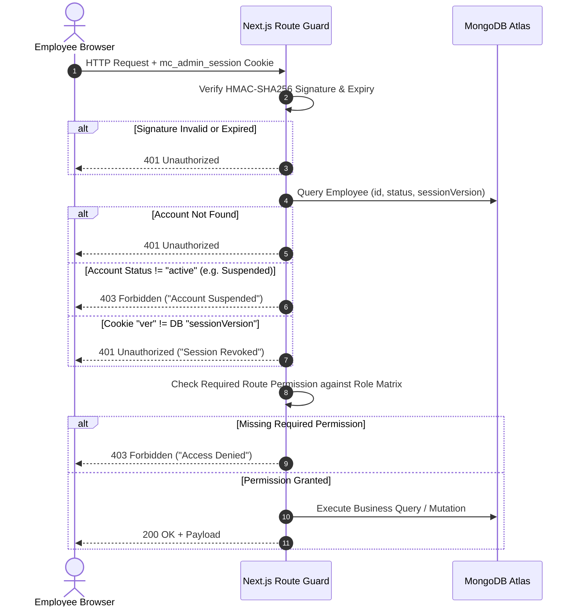

# Marine Creatures — Role-Based Access Control (RBAC) Architecture Specification

**Document Version:** 1.0.0  
**Security Classification:** Highly Confidential / Internal  
**Target Environment:** Production (`Control OS` Admin Dashboard)  
**Author:** Principal Software Architect & Security Engineering Team  
**Date:** November 2026  

---

## 1. Executive Summary & Core Objectives

The Marine Creatures administration infrastructure (`Control OS`) previously operated on a shared administrative passcode model. To meet institutional-grade enterprise security standards, maintain customer privacy, and ensure comprehensive operational accountability, this Role-Based Access Control (RBAC) and Employee Management architecture replaces shared access with individual employee identities, strictly scoped authorizations, and automated audit trails.

### Core Architecture Principles

1. **Individual Identity & Zero Shared Credentials:** Every team member has an isolated identity authenticated via registered email and an individual cryptographic password. Shared accounts are strictly prohibited.
2. **Principle of Least Privilege (PoLP):** Permissions are denied by default (`Deny-by-Default`). Team members are granted access strictly to the resources and actions necessary for their operational responsibilities.
3. **Decoupled Identity & Capabilities:** Permissions are assigned to Roles, and Roles are assigned to Employees. Bespoke operational roles can be created dynamically without codebase redeployments.
4. **Immediate Revocation & Zero Stale Tokens:** Session invalidation and account suspensions take effect instantaneously across all devices via real-time session version verification against the database.
5. **Zero-Trust Server-Side Enforcement:** Frontend UI elements selectively render based on permissions, but all authorization boundaries are strictly enforced on the server within API route handlers.
6. **Continuous Auditability:** All sensitive administrative operations, authentication events, credential updates, and permission changes are recorded immutably in MongoDB.
7. **Founder Continuity & Lockout Immunity:** A dual-mode bootstrap mechanism guarantees that the founder can initialize the system without risking administrative lockout.

---

## 2. Identity & Credential Cryptography

### 2.1 Password Hashing via Scrypt KDF

Marine Creatures implements Node.js native `crypto.scryptSync` as the Key Derivation Function (KDF) for all employee passwords. Scrypt provides industry-standard resistance against GPU/ASIC brute-force attacks by requiring substantial memory and CPU resources per hash computation.

```
+-----------------------------------------------------------------------------------------+
| Password Storage Format:                                                                |
| scrypt$N=16384,r=8,p=1$<salt_hex>$<derived_key_hex>                                     |
+-----------------------------------------------------------------------------------------+
```

* **Salt Generation:** 16 bytes of cryptographically secure random bytes generated per employee using `crypto.randomBytes(16)`.
* **KDF Parameters:**
  * CPU/Memory cost parameter ($N$): $16,384$ ($2^{14}$)
  * Block size parameter ($r$): $8$ (1,024 bytes)
  * Parallelization parameter ($p$): $1$
  * Derived key length: $64$ bytes (512 bits)
* **Constant-Time Verification:** Password comparison uses `crypto.timingSafeEqual` between derived candidate buffers and stored hash buffers to defeat side-channel timing attacks.
* **Storage Protection:** The `passwordHash` field is marked with `{ select: false }` in Mongoose schema definitions to prevent inadvertent exposure in directory queries.

### 2.2 Password Complexity Policy

All employee passwords must satisfy stringent complexity requirements enforced during invitation acceptance and credential changes:
* Minimum length: 8 characters.
* Maximum length: 128 characters.
* At least one uppercase Latin character (`A-Z`).
* At least one lowercase Latin character (`a-z`).
* At least one numerical digit (`0-9`).
* At least one special symbol (`!@#$%^&*()_+-=[]{}|;:,.<>?`).

### 2.3 Cryptographically Secure Invitation Tokens

Employee onboarding operates via time-bounded, single-use invitation tokens:
* **Token Generation:** 32 bytes of cryptographic randomness generated via `crypto.randomBytes(32).toString('hex')` (yielding a 64-character unguessable URL token).
* **Hash Storage:** The raw invitation token is **never** stored in the database. Only its SHA-256 digest (`crypto.createHash('sha256').update(rawToken).digest('hex')`) is persisted in `invitationTokenHash`.
* **Temporal Expiration:** Invitations expire exactly 48 hours from generation (`invitationExpiresAt`).
* **Single-Use Enforcement:** Upon successful password creation, `invitationTokenHash` and `invitationExpiresAt` are set to `null`, and the account status transitions from `invited` to `active`.

---

## 3. Cryptographic Session Management & Invalidation

### 3.1 Stateless HMAC-SHA256 Signed Session Cookies

Authentication state is transported via an encrypted, signed HTTP-only cookie (`mc_admin_session`):
* **Payload Structure:**
  ```json
  {
    "sub": "<employee_mongodb_object_id>",
    "email": "employee@marinecreatures.com",
    "name": "Jane Doe",
    "role": "operations_manager",
    "ver": 1,
    "iat": 1730700000000,
    "exp": 1730786400000
  }
  ```
* **Cookie Flags:**
  * `HttpOnly`: Prevents client-side JavaScript access (mitigating XSS session theft).
  * `SameSite=Lax`: Defends against Cross-Site Request Forgery (CSRF).
  * `Secure`: Enforced in production environments (`process.env.NODE_ENV === 'production'`).
  * `Path=/`: Scoped to the entire administrative origin.
  * Maximum Age: 24 hours ($86,400,000\text{ ms}$).

### 3.2 Real-Time Session Invalidation Pipeline

While token signatures are stateless, authorization validity is verified dynamically in `resolveAuthContext` against MongoDB on every incoming administrative request:



### 3.3 Instant Revocation Mechanisms

1. **Immediate Account Suspension:**
   * Changing employee status to `suspended` immediately causes `resolveAuthContext` to reject incoming requests with HTTP `403 Forbidden`. No waiting for JWT expiry.
2. **Targeted Session Revocation:**
   * Triggering `/api/admin/employees/[id]/revoke-sessions` increments `sessionVersion` in MongoDB ($ver \leftarrow ver + 1$).
   * Any existing session token containing the previous `ver` integer is instantly rejected with HTTP `401 Unauthorized` on its next request.
3. **Password Reset Revocation:**
   * Setting a new password automatically bumps `sessionVersion`, immediately signing out all other concurrent sessions across mobile, desktop, or tablet devices.

---

## 4. Central Permission Registry & System Roles

### 4.1 Permission Registry Architecture

Permissions are formatted using dot-notation (`domain.action`) across 12 distinct business domains comprising 42 granular capabilities:

* **Orders:** `orders.read`, `orders.update_status`, `orders.approve`, `orders.por_price.set`, `orders.invoice.generate`, `orders.tracking.update`, `orders.delete`
* **Customers:** `customers.read`, `customers.update`, `customers.notes.create`
* **Enquiries:** `enquiries.read`, `enquiries.update_status`, `enquiries.notes.create`
* **Follow-ups:** `follow_ups.read`, `follow_ups.manage`
* **Catalog:** `products.read`, `products.create`, `products.update`, `products.archive`
* **Inventory:** `inventory.read`, `inventory.update`
* **Media:** `media.read`, `media.upload`, `media.delete`
* **Operations:** `quarantine.read`, `quarantine.update`, `dispatch.read`, `dispatch.update`, `maintenance.read`, `maintenance.manage`
* **Worlds:** `worlds.read`, `worlds.manage`
* **Content & SEO:** `content.read`, `content.manage`, `seo.read`, `seo.update`
* **Financials & Analytics:** `analytics.read`, `finance.read`, `finance.invoice.generate`
* **System & Governance:** `employees.read`, `employees.create`, `employees.update`, `employees.suspend`, `employees.delete`, `roles.read`, `roles.create`, `roles.update`, `roles.delete`, `audit.read`, `backups.read`, `backups.create`, `health.read`, `security.read`, `security.manage`, `settings.read`, `settings.update`

### 4.2 System Roles Summary

| Role ID | Role Name | Primary Responsibility | Permissions Scope |
| :--- | :--- | :--- | :--- |
| `owner` | Owner / Super Admin | Complete governance over business, employees, and settings | Full Matrix (`*` / 42 permissions) |
| `operations_manager` | Operations Manager | Oversees orders, dispatch, quarantine, and client relationships | 24 operational permissions |
| `orders_fulfilment` | Orders & Fulfilment | Packs orders, logs tracking AWBs, manages quarantine exit | 10 logistics permissions |
| `inventory_manager` | Inventory Manager | Stock updates, product cataloging, and photography uploads | 9 catalog & inventory permissions |
| `customer_support` | Customer Support | Concierge enquiries, customer assistance, and order status lookups | 9 concierge & CRM permissions |
| `finance_manager` | Finance Manager | POR quotation pricing, tax invoices, and revenue reporting | 7 financial permissions |
| `content_seo` | Content & SEO Manager | Case studies, homepage banners, and catalog metadata | 11 marketing & SEO permissions |
| `auditor` | Auditor / Viewer | Independent observation of financial and operational trails | 14 strict read-only permissions |

### 4.3 Custom Roles Engine

Custom roles are defined declaratively in the `Role` collection in MongoDB:
* Custom roles can combine any subset of registered permissions.
* The system enforces strict foreign-key integrity: an unassigned role may be deleted, but a role currently assigned to one or more active employees cannot be deleted (HTTP `400 Bad Request`).
* System roles (`isSystem: true`) are immutable and cannot be renamed or deleted.

---

## 5. Dual-Mode Founder Bootstrap & Lockout Prevention

To transition from the legacy single-passcode system without service disruption or risk of lockout:

1. **Bootstrap State Detection:**
   * On every authentication check, `resolveAuthContext` evaluates whether any active employee holding the `owner` role exists in MongoDB.
   * If zero active owners exist, the system operates in **Bootstrap Mode**.
2. **Bootstrap Authentication:**
   * In Bootstrap Mode, presenting the legacy master passcode (`ADMIN_PASSCODE`) or legacy signed cookie issues a temporary `bootstrap_owner` context with full administrative rights.
   * A prominent notification appears in the dashboard inviting the founder to register their personal Owner profile.
3. **Transition to Strict Enforcement:**
   * Once the founder creates and activates their permanent Owner employee account, the system automatically exits Bootstrap Mode.
   * Administrative access thereafter requires individual employee credentials.
4. **Last-Owner Safeguard:**
   * An Owner cannot delete their own profile.
   * An Owner cannot demote their own role.
   * An Owner cannot suspend their own account.
   * If only one active Owner remains in the system, any attempt to delete, demote, or suspend that account is rejected by the server (HTTP `400 Bad Request`).

---

## 6. Server-Side Guard Implementation

Authorization boundaries are enforced via functional middleware guards in `lib/rbac/guard.ts`:

* `resolveAuthContext(req)`: Validates HMAC cookie, checks DB employee status and session version, resolves granted permissions.
* `requireAuthenticatedEmployee(req)`: Ensures caller is authenticated; returns 401 on failure.
* `requirePermission(req, perm)`: Asserts presence of specific permission string; returns 401 if unauthenticated or 403 if unauthorized.
* `requireAnyPermission(req, perms[])`: Permits access if caller possesses at least one permission in the candidate set.
* `requireAllPermissions(req, perms[])`: Asserts caller holds every permission in the candidate set.

All 28 administrative API route families have been refactored to incorporate these guards, guaranteeing that direct HTTP requests cannot bypass the UI permissions logic.

