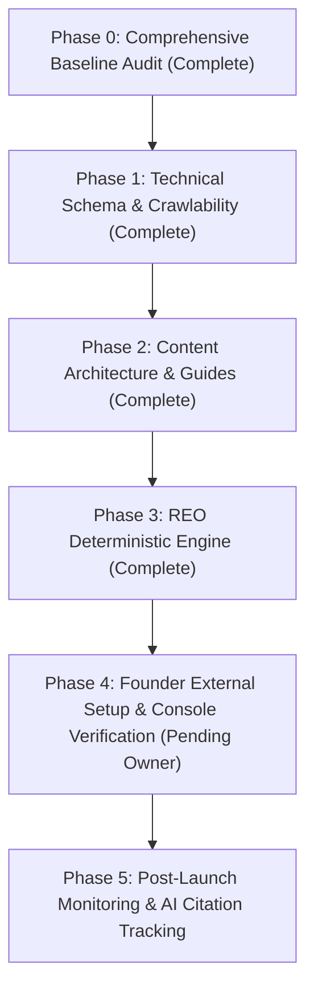

# MARINE CREATURES — AEO + REO IMPLEMENTATION ROADMAP & PHASE 1 EXECUTION PLAN
**Reference:** MC-AEO-REO-ROADMAP-NOV2026  
**Date:** November 15, 2026  
**Auditor / Architect:** Lead Systems Architect / CTO Office  
**Target Domain:** `https://www.marinecreatures.co.in`  
**Classification:** Strategic Search & AI Answer Engine Optimization (P0)

---

## 1. STRATEGIC OBJECTIVE

To transform Marine Creatures into an authoritative, machine-discoverable, and recommendation-ready digital presence.

The roadmap addresses two pillars:
1. **Answer Engine Optimization (AEO):** Ensure the website provides structured, citable answers for Google AI Overviews, Perplexity, ChatGPT Search, Gemini, and Microsoft Copilot.
2. **Recommendation Engine Optimization (REO):** Ensure product discovery and recommendation agents understand when Marine Creatures' luxury living systems, services, and equipment are the appropriate match for customer inquiries.

---

## 2. PHASED ROADMAP OVERVIEW

---

## 3. PHASE BREAKDOWN & DELIVERABLES

### Phase 0: Baseline Audit & Discovery (Status: COMPLETE)
* [x] Exhaustive inventory of all 102 route files across App Router.
* [x] Technical crawlability audit (`robots.ts`, `sitemap.ts`, canonical URLs).
* [x] Baseline structured data audit (`WebSite`, `LocalBusiness`, `Product`, `Service`).
* [x] 54-product attribute completeness inspection.
* [x] Identification of gaps: missing FAQ schemas, missing starting price markups, missing AI search user-agents, missing `llms.txt`.
* **Deliverable:** `docs/SEO/MC-AEO-REO-BASELINE-AUDIT.md`

### Phase 1: Technical Foundation & AI Discovery (Status: COMPLETE)
* [x] Enhanced Schema.org generators (`lib/seo/structuredData.ts`):
  * `generateFaqJsonLd` (FAQPage)
  * `generateArticleJsonLd` (Article)
  * `generateServiceJsonLd` (with confirmed ₹35,000 / ₹15,000 baseline prices and `UnitPriceSpecification`)
  * `generateProductJsonLd` (with `itemCondition` and `isRelatedTo` graph)
  * `generateOrganizationJsonLd` (with verified business name `MARINE CREATURES` and service offers)
* [x] Robots directives expansion (`app/robots.ts`) for AI crawlers: `GPTBot`, `ChatGPT-User`, `PerplexityBot`, `ClaudeBot`, `Applebot-Extended`, `Bingbot`, `Googlebot`.
* [x] Machine-readable AI manifests deployed: `public/llms.txt` and `public/llms-full.txt`.
* [x] XML Sitemap expansion (`app/sitemap.ts`) including `/guides` hub and educational content.
* [x] Fix marketplace query handling (`app/marketplace/page.tsx`) to support `?q=`, `?search=`, and `?category=`.

### Phase 2: Answer-Ready Content Architecture (Status: COMPLETE)
* [x] Turnkey Installation ([`app/installation/page.tsx`](file:///c:/Users/User/OneDrive/Desktop/Marine%20Creatures/marine-creatures/app/installation/page.tsx)):
  * Confirmed baseline price badge ("Starting from ₹35,000").
  * Server-rendered 5-part Q&A accordion.
  * Schema.org `FAQPage` + `Service` JSON-LD.
* [x] Aquarium Renovation ([`app/renovation/page.tsx`](file:///c:/Users/User/OneDrive/Desktop/Marine%20Creatures/marine-creatures/app/renovation/page.tsx)):
  * Confirmed baseline price badge ("Starting from ₹15,000").
  * Server-rendered 5-part Q&A accordion covering zero-livestock-loss protocol.
  * Schema.org `FAQPage` + `Service` JSON-LD.
* [x] Services Directory ([`app/services/page.tsx`](file:///c:/Users/User/OneDrive/Desktop/Marine%20Creatures/marine-creatures/app/services/page.tsx)):
  * Service policy Q&A accordion and multiple `Service` JSON-LD schemas.
* [x] Entity Consistency ([`app/about/page.tsx`](file:///c:/Users/User/OneDrive/Desktop/Marine%20Creatures/marine-creatures/app/about/page.tsx)):
  * Reconciled metrics with `lib/config.ts` (5+ years of expertise, 50+ aquariums created).
* [x] Educational Guides Hub ([`app/guides/`](file:///c:/Users/User/OneDrive/Desktop/Marine%20Creatures/marine-creatures/app/guides/)):
  * `/guides`: Central Knowledge Hub
  * `/guides/marine-aquarium-setup-guide`: Water chemistry standards (1.025 SG, pH 8.1–8.4, 8–9 dKH) and nitrogen cycle stages.
  * `/guides/aquarium-installation-cost-factors`: Breakdown of custom installation costs in India, starting from ₹35,000.
  * `/guides/reef-tank-lighting-par-guide`: PAR zones (Soft: 50–100, LPS: 100–180, SPS: 200–350+), 395nm UV spectrum, and NemoLight Extreme comparison.
  * `/guides/marine-fish-compatibility`: Protandrous hermaphroditism clownfish pairing, reef-safe classifications, and 14-day quarantine protocol.

### Phase 3: Recommendation Engine Optimization (REO) (Status: COMPLETE)
* [x] Created `lib/data/product-recommendations.ts`: Deterministic, explainable recommendation engine mapping compatible equipment, accessories, and maintenance essentials without fake popularity metrics.
* [x] Integrated `getExplainableRecommendations` into `app/marketplace/[id]/page.tsx` and emitted `isRelatedTo` in Schema.org `Product` JSON-LD.

### Phase 4: External Setup & Search Console Verification (Status: PENDING FOUNDER)
* [ ] Verify domain ownership in Google Search Console via DNS TXT or `NEXT_PUBLIC_GOOGLE_SITE_VERIFICATION`.
* [ ] Submit `https://www.marinecreatures.co.in/sitemap.xml` in Search Console.
* [ ] Import property to Bing Webmaster Tools and configure IndexNow key.
* [ ] Claim and optimize Google Business Profile for **MARINE CREATURES** (Kolkata).
* **Checklist Reference:** `docs/SEO/MC-AEO-REO-EXTERNAL-SETUP-CHECKLIST.md`

### Phase 5: Monitoring & Verification (Ongoing)
* [ ] Rich Results Test verification on production deployment.
* [ ] Search Console Page Indexing monitoring.
* [ ] Monthly tracking of organic queries and AI citation appearances.

---

## 4. STRICT OPERATIONAL BOUNDARIES REMINDER
* **Zero Fabricated Content:** Never invent reviews, ratings, certifications, or awards.
* **Brand Language Rule:** Strictly avoid prohibited coral terms in customer-facing website copy.
* **Financial Integrity:** Never emit zero-rupee prices for Price On Request items.
* **Separation of Concerns:** External account logins and DNS changes remain founder actions.
