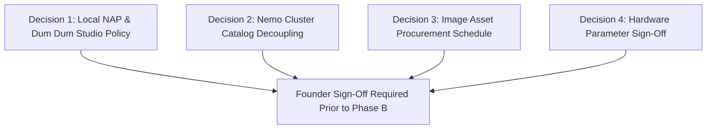

# CLIENT CONFIRMATION & STRATEGIC SIGN-OFF REGISTER
**Pre-Implementation Decision Log & Unverified Technical Parameters**  
**Document Location:** `marine-creatures/docs/SEO/STAGE_A3/CLIENT_CONFIRMATION_REQUIRED.md`  
**Brand:** Marine Creatures  
**Auditor & Strategist:** Senior Technical SEO Architect  

---

## 1. PURPOSE OF THIS REGISTER

In strict accordance with professional engineering ethics and search quality guidelines, **no assumptions, fabricated technical specifications, or unverified business policies will be published to the production codebase**. 

This register isolates every decision point and missing parameter that requires explicit confirmation from the founder (**Suraj Shasmal**) prior to Phase B implementation.

---

## 2. DECISION LOG: CRITICAL BUSINESS & ARCHITECTURAL CHOICES

### DECISION 1: Local NAP & Physical Studio Public Policy
* **Current Situation:** Google Maps Place ID `0x39f89f8664ad172f:0xa65b5d5b786ec00a` shows:  
  `29, Purna Chandra Mitra Rd, Dum Dum, Kolkata 700079`.  
  The website schema currently emits a generic string (`"Registered Aquaculture Studio, Kolkata"`).
* **Question for Founder:**
  * **Option A (Public Walk-In Studio - Recommended):** Confirm that the Dum Dum facility accepts walk-in customers and appointments. We will update the website schema, footer, and contact page to match this address verbatim, unlocking Google Maps Local 3-Pack authority.
  * **Option B (Private Holding Facility / Service-Area Only):** If the Dum Dum location is a private residence or quarantine breeding facility where unannounced walk-ins are discouraged, confirm whether GBP should be masked to a Service-Area Business (SAB) covering Kolkata, Salt Lake, New Town, and Howrah.
* **Founder Choice:** `[ PENDING FOUNDER INPUT ]`

---

### DECISION 2: Nemo Model Cluster Architecture Choice
* **Current Situation:** `/marketplace/nemo-e450`, `nemo-e600`, `nemo-e900`, and `nemo-e1200` are alias routes rendering identical H1 headings, identical body copy, and a flat ₹6,500 price tag, risking Google duplicate content penalties.
* **Question for Founder:**
  * **Option A (Decouple into 4 Standalone SKUs - Strongly Recommended):** Decouple into 4 standalone products in the database with individual H1s, dedicated descriptions, model-specific pricing, and tailored PAR specs. The legacy `/marketplace/nemo-extreme-led` will become an authoritative Series Comparison Hub.
  * **Option B (301 Redirect to Flagship E600):** Consolidate all alias routes into `/marketplace/nemo-extreme-led` and use dropdown variants.
* **Founder Choice:** `[ PENDING FOUNDER INPUT ]`

---

### DECISION 3: Nemo Retail Pricing Verification
If Option A is selected, the founder must confirm the exact retail and compare-at prices for each model:

| Model | Proposed Retail Price | Verified Market Range | Founder Confirmed Price |
| :--- | :---: | :---: | :---: |
| **Nemo E450 (24W / 45–60 cm)** | ₹6,500 | ₹5,500 – ₹7,750 | `[ PENDING FOUNDER INPUT ]` |
| **Nemo E600 (36W / 60–80 cm)** | ₹8,500 | ₹7,000 – ₹9,250 | `[ PENDING FOUNDER INPUT ]` |
| **Nemo E900 (60W / 90–110 cm)** | ₹11,500 | ₹10,000 – ₹13,750 | `[ PENDING FOUNDER INPUT ]` |
| **Nemo E1200 (72W / 120–140 cm)**| ₹13,500 | ₹11,500 – ₹15,500 | `[ PENDING FOUNDER INPUT ]` |

---

## 3. TECHNICAL SPECIFICATION CONFIRMATION REGISTER

The following three products require verified parameters to complete the expanded 150–200-word product descriptions without fabricating engineering metrics:

### 1. RE Ocean Mini 80 Internal Filter (`re-ocean-mini-80`):
* **Pump Flow Rate:** Estimated 800–1200 L/h. Exact rating: `[ PENDING CLIENT INPUT ]`
* **Power Consumption:** Estimated 12–18 Watts. Exact wattage: `[ PENDING CLIENT INPUT ]`
* **Physical Dimensions:** Height $\times$ Width $\times$ Depth in mm: `[ PENDING CLIENT INPUT ]`
* **Included Media:** Sponges, carbon cartridge, or ceramic bio-rings: `[ PENDING CLIENT INPUT ]`

### 2. Qtermoline Thermal Fused Biological Media (`qtermoline-bio-media`):
* **Net Packaging Quantity:** Grams / Kilograms / Litres per box: `[ PENDING CLIENT INPUT ]`
* **Specific Surface Area:** $m^2/\text{Litre}$ or $m^2/\text{gram}$: `[ PENDING CLIENT INPUT ]`
* **Pore Diameter Rating:** Microns: `[ PENDING CLIENT INPUT ]`

### 3. Manual Marine Aquarium Light (`manual-marine-light`):
* **Electrical Wattage:** Exact Watt rating: `[ PENDING CLIENT INPUT ]`
* **Diode Breakdown:** Blue vs White diode counts: `[ PENDING CLIENT INPUT ]`
* **Supported Tank Length:** Minimum & maximum glass span in inches: `[ PENDING CLIENT INPUT ]`
* **Target Price / Threshold:** Expected retail price point: `[ PENDING CLIENT INPUT ]`

---

## 4. CONTACT & LOCAL SCHEMA VERIFICATION

### 1. Contact Page Truncation Fix (`app/contact/page.tsx` Line 422):
* **Finding:** Mobile Direct Studio button renders `"Call +91 93304"` (missing `36603`).
* **Correction:** Update label to `"Call +91 93304 36603"`.
* **Founder Approval:** `[ READY FOR SIGN-OFF ]`

### 2. Studio Operating Hours for Schema.org:
* **Proposed Schedule:** Monday through Saturday, 10:00 AM – 8:00 PM (Closed Sundays).
* **Founder Confirmation:** Please confirm or supply your exact studio operating hours: `[ PENDING CLIENT INPUT ]`

---

## 5. IMAGE ASSET PROCUREMENT SCHEDULE

Ten dry-goods products currently render fallback specification cards. To index these products in Google Image Search, Google Lens, and Google Shopping, authentic client photographs (1200x800 WebP/JPEG) are required:

| Product ID | Product Name | Required Photography | Asset Delivery Date |
| :--- | :--- | :--- | :---: |
| `tici-live-phytoplankton` | TiCi Live Marine Phytoplankton | Authentic bottle photo with TiCi label | `[ PENDING ]` |
| `re-ocean-mini-80` | RE Ocean Mini 80 Internal Filter | Unboxed filter unit with suction bracket | `[ PENDING ]` |
| `re-ocean-mini-60` | RE Ocean Mini 60 Internal Filter | Unboxed filter unit with suction bracket | `[ PENDING ]` |
| `manual-marine-light` | Manual Marine Aquarium Light | Fixture with toggle switch and brackets | `[ PENDING ]` |
| `magic-bag-media-reactor` | Magic Bag Micron Filter Bag | Mesh bag with cinch closure holding resin | `[ PENDING ]` |
| `amozorb-ammonia-adsorbent` | Amozorb Ammonia Adsorbent | Product jar / container with label | `[ PENDING ]` |
| `qtermoline-bio-media` | Qtermoline Thermal Fused Media | Rough open-cell ceramic media blocks | `[ PENDING ]` |
| `bio-pods-filter-media` | Sintered Quartz Bio Pods | Spherical bio-pods in retail packaging | `[ PENDING ]` |
| `ceramic-house-filter-media` | Porous Ceramic House Media | Hollow ceramic shelter block | `[ PENDING ]` |
| `trwil-tower-filter-media` | Trwil Tower Trickle Media | Structured trickle column | `[ PENDING ]` |

