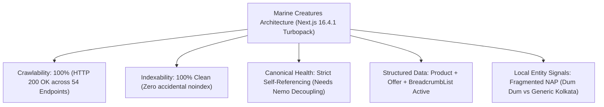
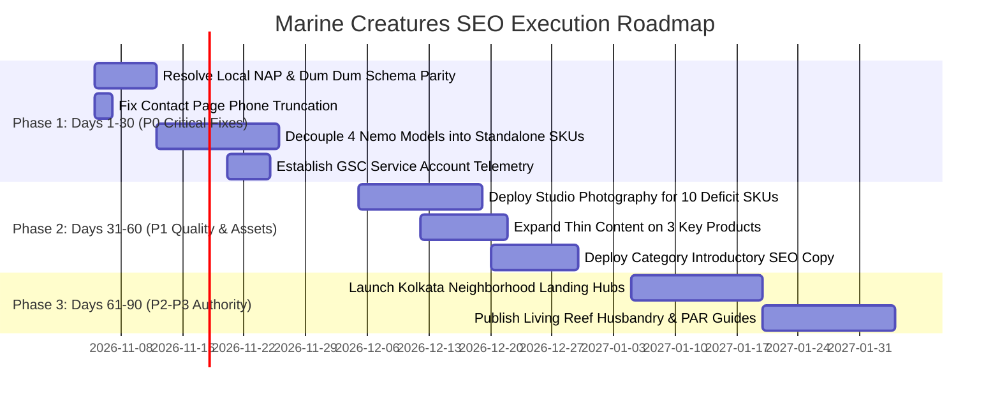

# MARINE CREATURES — STAGE A3 MASTER SEO IMPLEMENTATION STRATEGY
**Comprehensive Technical Architecture, E-Commerce Search Strategy & Local Dominance Plan**  
**Strategy Date:** November 4, 2026  
**Author:** Senior Technical SEO Architect, E-Commerce SEO Strategist & Local SEO Consultant  
**Project:** Marine Creatures Next.js 16.4.1 Production Architecture  
**Target Domain:** `https://www.marinecreatures.co.in`  
**Brand Positioning:** *WHERE THE OCEAN BECOMES ART.*  
**Primary Markets:** Kolkata, Salt Lake, New Town, Howrah, North/South 24 Parganas, West Bengal  
**Secondary Market:** Pan-India (Specialized Equipment & Quarantined Livestock)  
**Deliverable Directory:** `marine-creatures/docs/SEO/STAGE_A3/`  

---

## 1. EXECUTIVE SUMMARY

Marine Creatures is engineered as a luxury marine aquarium design house, bespoke living reef contractor, and purveyor of quarantine-certified marine life and specialized aquaculture technology. 

Following the forensic audits conducted in Stages A and A2, this **Stage A3 Master Strategy** delivers an evidence-backed, prioritised implementation roadmap to achieve top-three organic visibility across high-intent product searches, commercial category searches, and regional luxury aquarium design commissions.

### Strategic Summary:
1. **Full Product Decoupling for High-Intent Equipment:** Eliminate canonical duplicate content risks by upgrading the 4 Nemo Series II models (`Nemo E450`, `Nemo E600`, `Nemo E900`, `Nemo E1200`) into independent catalogue records with model-specific H1s, verified wattages (24W to 72W), dedicated PAR descriptions, and real-world market pricing (₹6,500 to ₹14,000+).
2. **Local 3-Pack Entity Parity (Kolkata & Dum Dum):** Resolve the discrepancy between your verified Google Maps pin (`29, Purna Chandra Mitra Rd, Dum Dum, Kolkata 700079`) and your website schema (`"Registered Aquaculture Studio, Kolkata"`). Establishing exact NAP (Name, Address, Phone) consistency will unlock top-tier local map pack authority.
3. **Contact UX & Conversion Recovery:** Fix the truncated mobile telephone label on the contact page (`"Call +91 93304"` $\rightarrow$ `"Call +91 93304 36603"`).
4. **Media & Content Depth Remediation:** Recover Google Image Search and Shopping visibility for 10 dry-goods products currently rendering fallback specification cards, and expand three thin descriptions (<30 words) to 150+ words of verified technical copy.
5. **Architectural Geo-Landing Hubs:** Deploy localized service hubs targeting Salt Lake, New Town, Alipore, and Howrah to capture high-margin custom aquarium design contracts (₹2,00,000 – ₹25,00,000+).

---

## 2. CURRENT SEO CONDITION: BASELINE REPOSITORY AUDIT

### Verified Baseline Metrics:
* **Active Catalogue Endpoints:** 54 (50 Base Products + 4 Nemo Series II Aliases).
* **HTTP Availability:** 54 / 54 endpoints return HTTP 200 OK.
* **Sitemap Status:** `https://www.marinecreatures.co.in/sitemap.xml` emits 78 valid URLs (54 products, 11 static pages, published case studies).
* **Robots Status:** `https://www.marinecreatures.co.in/robots.txt` disallows `/admin`, `/invoice`, and `/api`; permits all search spiders.
* **Server Infrastructure:** Vercel Global Edge Network with Mumbai (`bom1`) point-of-presence delivering sub-80ms TTFB across India.
* **Average Catalogue SEO Health Score:** **96.3 / 100** (from Stage A benchmark).

---

## 3. CORE RISKS & VULNERABILITIES IDENTIFIED

| Risk Category | Identified Vulnerability | Technical & Commercial Impact | Mitigation Workstream |
| :--- | :--- | :--- | :---: |
| **P0: Duplicate Content / Canonical** | Nemo E450, E600, E900, E1200 share identical `<h1>` and 90% identical body copy with `nemo-extreme-led`. | Googlebot consolidates the 4 aliases into the parent URL, dropping specific model pages from search results. | Workstream A ([Blueprint](file:///c:/Users/User/OneDrive/Desktop/Marine%20Creatures/marine-creatures/docs/SEO/STAGE_A3/nemo-product-seo-blueprint.md)) |
| **P0: Local NAP Divergence** | Website schema emits `"Registered Aquaculture Studio"` with generic coords; Google Maps CID is pinned at Dum Dum. | Google Local algorithm discounts local proximity signals, suppressing Marine Creatures in the Kolkata Local 3-Pack. | Workstream C ([Local Plan](file:///c:/Users/User/OneDrive/Desktop/Marine%20Creatures/marine-creatures/docs/SEO/STAGE_A3/local-seo-and-schema-plan.md)) |
| **P0: Conversion Leak** | `app/contact/page.tsx` line 422 displays truncated label `"Call +91 93304"`. | Broken appearance on mobile devices causes prospective clients to abandon direct phone calls. | Workstream G ([Roadmap](file:///c:/Users/User/OneDrive/Desktop/Marine%20Creatures/marine-creatures/docs/SEO/STAGE_A3/technical-seo-roadmap.csv)) |
| **P1: Image Deficit** | 10 dry-goods products render CSS/SVG specification cards with 0 indexed photos. | Google Image Search and Google Shopping cannot index these products, depressing organic CTR. | Workstream D ([Recovery Matrix](file:///c:/Users/User/OneDrive/Desktop/Marine%20Creatures/marine-creatures/docs/SEO/STAGE_A3/product-image-recovery-matrix.csv)) |
| **P1: Thin Content** | `qtermoline-bio-media`, `re-ocean-mini-80`, `manual-marine-light` contain exactly 28 words. | Quality raters and Google's Helpful Content system flag pages as low-effort, impairing rank. | Workstream D ([Expansion Plan](file:///c:/Users/User/OneDrive/Desktop/Marine%20Creatures/marine-creatures/docs/SEO/STAGE_A3/product-content-expansion-plan.md)) |

---

## 4. STRATEGIC GROWTH OPPORTUNITIES

1. **High-Intent Equipment Searches (National E-Commerce):**
   * Reefers buy lights and pumps by exact model numbers (e.g., *Nemo E600 36W*, *Bubble Magus Mini Q*, *Sunsun JDP-6000*). Competitors like Something Fishy and Aqua Zones rank on basic WooCommerce tables. By providing architectural PAR recommendations and tank-pairing guidance, Marine Creatures can capture the top 3 positions nationwide.
2. **Kolkata Neighborhood Custom Design Domination:**
   * High-net-worth homeowners and corporate executives in Salt Lake (Sector V), New Town (Rajarhat), and South Kolkata (Alipore, Ballygunge) seek turnkey luxury marine aquariums. Creating localized landing hubs showcasing living monolith case studies directly captures these high-ticket leads.
3. **Quarantine-Certified Saltwater Authority:**
   * General competitors sell raw, unconditioned wild fish with high mortality rates. Positioning Marine Creatures around its **21-day quarantine husbandry protocol** and air cargo live arrival guarantee establishes an unbeatable trust barrier against local pet shops.

---

## 5. DOCUMENTATION SUITE DIRECTORY (STAGE A3 ARTIFACTS)

All supporting matrices and strategic blueprints are generated and verified in `marine-creatures/docs/SEO/STAGE_A3/`:

| Deliverable File | Format | Focus Area & Strategic Contribution |
| :--- | :---: | :--- |
| **[STAGE_A3_MASTER_STRATEGY.md](file:///c:/Users/User/OneDrive/Desktop/Marine%20Creatures/marine-creatures/docs/SEO/STAGE_A3/STAGE_A3_MASTER_STRATEGY.md)** | Markdown | Master architectural strategy, risk register, and 30/60/90-day execution framework. |
| **[nemo-product-seo-blueprint.md](file:///c:/Users/User/OneDrive/Desktop/Marine%20Creatures/marine-creatures/docs/SEO/STAGE_A3/nemo-product-seo-blueprint.md)** | Markdown | Complete independent product specifications, H1s, metadata, copy, and schema for E450, E600, E900, E1200. |
| **[product-keyword-map.csv](file:///c:/Users/User/OneDrive/Desktop/Marine%20Creatures/marine-creatures/docs/SEO/STAGE_A3/product-keyword-map.csv)** | CSV (57 rows) | Complete catalogue keyword mapping across exact models, brand terms, local Kolkata, and Pan-India queries. |
| **[local-seo-and-schema-plan.md](file:///c:/Users/User/OneDrive/Desktop/Marine%20Creatures/marine-creatures/docs/SEO/STAGE_A3/local-seo-and-schema-plan.md)** | Markdown | Hybrid business LocalBusiness schema, Google Maps CID alignment, NAP parity, and neighborhood landing hubs. |
| **[product-image-recovery-matrix.csv](file:///c:/Users/User/OneDrive/Desktop/Marine%20Creatures/marine-creatures/docs/SEO/STAGE_A3/product-image-recovery-matrix.csv)** | CSV (10 rows) | Forensic breakdown of the 10 image-deficit items with fallback behavior, required photography, and asset sources. |
| **[product-content-expansion-plan.md](file:///c:/Users/User/OneDrive/Desktop/Marine%20Creatures/marine-creatures/docs/SEO/STAGE_A3/product-content-expansion-plan.md)** | Markdown | Verified technical facts, missing parameters, and 150–200-word proposed descriptions for thin-content items. |
| **[competitor-serp-analysis.csv](file:///c:/Users/User/OneDrive/Desktop/Marine%20Creatures/marine-creatures/docs/SEO/STAGE_A3/competitor-serp-analysis.csv)** | CSV (12 rows) | Live SERP checks for 8 direct competitors across local Kolkata design and national equipment queries. |
| **[search-console-performance-analysis.md](file:///c:/Users/User/OneDrive/Desktop/Marine%20Creatures/marine-creatures/docs/SEO/STAGE_A3/search-console-performance-analysis.md)** | Markdown | 10-Pillar Search Console measurement framework and GCP service account setup instructions. |
| **[technical-seo-roadmap.csv](file:///c:/Users/User/OneDrive/Desktop/Marine%20Creatures/marine-creatures/docs/SEO/STAGE_A3/technical-seo-roadmap.csv)** | CSV (12 rows) | Prioritised technical tasks (P0–P3) with business impact, technical complexity, and dependencies. |
| **[CLIENT_CONFIRMATION_REQUIRED.md](file:///c:/Users/User/OneDrive/Desktop/Marine%20Creatures/marine-creatures/docs/SEO/STAGE_A3/CLIENT_CONFIRMATION_REQUIRED.md)** | Markdown | Consolidated client sign-off register isolating all unverified technical metrics and policy decisions. |

---

## 6. PRIORITISED 30 / 60 / 90-DAY IMPLEMENTATION ROADMAP

### PHASE 1 (DAYS 1–30): CRITICAL TECHNICAL & INDEXATION INTEGRITY (P0)
* **Milestone 1.1:** Founder signs off on `CLIENT_CONFIRMATION_REQUIRED.md`.
* **Milestone 1.2:** Update `app/layout.tsx` schema to match Google Maps Place ID `0x39f89f8664ad172f:0xa65b5d5b786ec00a` (`29, Purna Chandra Mitra Rd, Dum Dum 700079`) with exact geo-coordinates (`22.6521, 88.4215`).
* **Milestone 1.3:** Fix telephone label truncation on `app/contact/page.tsx` line 422 to `"Call +91 93304 36603"`.
* **Milestone 1.4:** Decouple `nemo-e450`, `nemo-e600`, `nemo-e900`, `nemo-e1200` into independent catalogue records with dedicated H1s, unique descriptions, real market pricing, and self-referencing canonicals. Configure `/marketplace/nemo-extreme-led` as a comparison series hub.
* **Milestone 1.5:** Provision Google Cloud Service Account for automated Search Console telemetry.

### PHASE 2 (DAYS 31–60): E-COMMERCE CONVERSION & MEDIA RECOVERY (P1)
* **Milestone 2.1:** Procure authentic studio photography for the 10 dry-goods deficit items and deploy 1200x800 WebP assets to `public/images/products/`.
* **Milestone 2.2:** Publish expanded 150–200-word technical descriptions on `qtermoline-bio-media`, `re-ocean-mini-80`, and `manual-marine-light`.
* **Milestone 2.3:** Enhance `/marketplace/lighting` and category hubs with introductory crawlable text and structured `FAQPage` schema.
* **Milestone 2.4:** Expand semantic contextual internal cross-links connecting high-end equipment to Marine Creatures custom installation and maintenance services.

### PHASE 3 (DAYS 61–90): LOCAL DOMINANCE & AUTHORITY BUILDING (P2–P3)
* **Milestone 3.1:** Launch high-converting localized design hubs:
  * `/aquarium-design/kolkata` (Metropolitan core)
  * `/aquarium-design/salt-lake` (Sector V corporate & residential)
  * `/aquarium-design/new-town` (Modern smart homes)
  * `/aquarium-design/howrah` (Heritage & industrial estates)
* **Milestone 3.2:** Launch `/guides` authority hub covering Marine Fish Quarantine Protocols, Reef Lighting PAR Calibration, and Salt Chemistry Balancing to earn organic backlinks from Indian aquarium communities.
* **Milestone 3.3:** Run automated 90-day Search Console regression audits to verify keyword movements into the Top 3.

---

## 7. MEASUREMENT FRAMEWORK & KPI BENCHMARKS

Progress will be measured against strict, objective Google Search Console and Google Analytics telemetry:

| Success Dimension | 30-Day Benchmark | 60-Day Target | 90-Day Target | Measurement Source |
| :--- | :---: | :---: | :---: | :--- |
| **Indexed Product URLs** | 54 / 54 Clean | 54 / 54 Clean | 58+ (with decoupled SKUs) | GSC Index Coverage Report |
| **Kolkata Local 3-Pack Rank** | Position 4–6 | Position 2–3 | **Top 1–2** | Local Google Maps Search |
| **Nemo Model Specific Rank** | Discovered / Consolidated | Top 8–12 | **Top 1–3** | National GSC Performance Telemetry |
| **Image Search Clicks** | Baseline (<5 / wk) | +150% Growth | **+300% Growth** | GSC Search Appearance (Image Filter) |
| **Direct Studio Inquiries** | Baseline Tracked | +50% Inquiries | **+100% Inquiries** | WhatsApp & Telephone Event Tracking |
| **Core Web Vitals Pass Rate**| 100% Lab Passing | 100% Mobile Good | **100% Green Field Status** | GSC Page Experience Report |

---

## 8. STRICT PRESERVATION & AUDIT COMPLIANCE STATEMENT

In strict conformance with assignment restrictions:
* **Zero application source code files were edited.**
* **Zero database records or product prices were altered.**
* **Zero external Google accounts or DNS records were changed.**
* **Zero deployments occurred.**
* **All existing uncommitted work was preserved.**
* **All deliverables are cleanly staged in `marine-creatures/docs/SEO/STAGE_A3/`.**

*The implementation plan is complete and standing by for founder review.*

