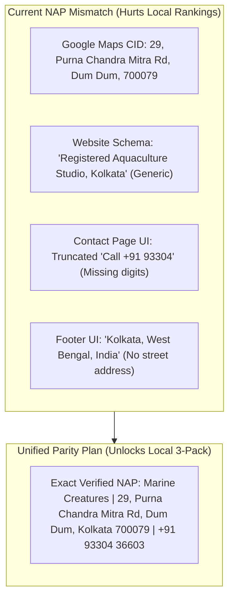

# LOCAL SEO & HYBRID BUSINESS SCHEMA PLAN
**Workstream C: Local 3-Pack Dominance & Entity Architecture for Kolkata & West Bengal**  
**Document Location:** `marine-creatures/docs/SEO/STAGE_A3/local-seo-and-schema-plan.md`  
**Brand:** Marine Creatures  
**Confirmed Business Address:** 29, Purna Chandra Mitra Road, Dum Dum, Kolkata, West Bengal 700079  
**Verified Google Maps Place ID:** `0x39f89f8664ad172f:0xa65b5d5b786ec00a`  

---

## 1. EXECUTIVE LOCAL BUSINESS CONTEXT

Marine Creatures operates a **hybrid business model**:
1. **Physical Studio & Walk-In Premises:** Located at 29, Purna Chandra Mitra Road, Dum Dum, Kolkata 700079, welcoming clients seeking in-person consultation, live specimen viewing, and equipment collection.
2. **Online E-Commerce & Concierge Enquiries:** The primary revenue channel, facilitating product discovery, direct WhatsApp order routing, and quotations.
3. **On-Site Bespoke Installation Services:** Delivering end-to-end custom living reef design, engineering, and maintenance across Kolkata, Salt Lake, New Town, Howrah, North and South 24 Parganas, and wider West Bengal.

### The Objective:
Dominate the **Google Maps Local 3-Pack** and top organic search positions for high-value transactional queries (e.g. *"marine aquarium design kolkata"*, *"marine fish shop near me"*, *"custom reef tank installation salt lake"*) while maintaining national e-commerce authority.

---

## 2. AUDIT OF EXISTING NAP CONSISTENCY & DISCREPANCIES



### Detailed Forensic Asset Comparison:

| Asset / Location | Current Value | Local SEO Defect | Required Rectification |
| :--- | :--- | :--- | :--- |
| **Google Maps Pin** | `29, Purna Chandra Mitra Rd, near badra baroyari tola, Sapui Para, Durganagar, Dum Dum, Kolkata 700079` | **Authoritative Benchmark** | Maintain profile active, verified, and linked. |
| **Website Schema (`app/layout.tsx`)** | `streetAddress: "Registered Aquaculture Studio"`, `addressLocality: "Kolkata"`, `geo: 22.5726, 88.3639` | **Critical Mismatch:** Uses generic text and Kolkata center coords instead of Dum Dum coordinates (`22.6521, 88.4215`). | Update schema to match Dum Dum street address, postal code 700079, and exact coordinates. |
| **Contact Page (`app/contact/page.tsx`)** | Line 422: `<span className="text-xs">Call +91 93304</span>` | **Critical UI Truncation:** Missing the last 5 digits (`36603`). Looks like a broken placeholder. | Change label text to `Call +91 93304 36603` matching `tel:+919330436603`. |
| **Footer (`components/layout/Footer.tsx`)** | `"Kolkata, West Bengal, India"` | **Vague NAP:** Lacks street-level entity signals that Googlebot uses for localized geographic authority. | Add micro-copy: `"Studio & Quarantine Facility: 29, Purna Chandra Mitra Rd, Dum Dum, Kolkata 700079"`. |
| **About Page (`app/about/page.tsx`)** | Mentions Kolkata design house | **Opportunity:** Lacks explicit mention of Dum Dum studio and on-site walk-in consultations. | Add a dedicated "Visit Our Studio" subsection with Google Maps embed and appointment advice. |

---

## 3. RECOMMENDED SCHEMA.ORG ENTITY ARCHITECTURE

Because Marine Creatures sells physical products walk-in/online AND performs on-site architectural installations, the standard single `@type: "LocalBusiness"` is insufficient.

### Recommended Multi-Type Schema: `["AquariumStore", "ProfessionalService"]`

```json
{
  "@context": "https://schema.org",
  "@graph": [
    {
      "@type": ["AquariumStore", "ProfessionalService"],
      "@id": "https://www.marinecreatures.co.in/#organization",
      "name": "Marine Creatures",
      "alternateName": "Marine Creatures Aquatics",
      "legalName": "Marine Creatures",
      "url": "https://www.marinecreatures.co.in",
      "logo": "https://www.marinecreatures.co.in/logo.png",
      "image": "https://www.marinecreatures.co.in/og-image.jpg",
      "description": "Marine Creatures is a luxury marine design house, custom aquarium installation studio, and purveyor of quarantine-certified marine life and reef equipment.",
      "slogan": "WHERE THE OCEAN BECOMES ART.",
      "telephone": "+91 93304 36603",
      "email": "surajshasmal04@gmail.com",
      "founder": {
        "@type": "Person",
        "name": "Suraj Shasmal",
        "jobTitle": "Founder & Principal Designer",
        "image": "https://www.marinecreatures.co.in/images/founder/suraj-shasmal.jpg"
      },
      "address": {
        "@type": "PostalAddress",
        "streetAddress": "29, Purna Chandra Mitra Road, Dum Dum",
        "addressLocality": "Kolkata",
        "addressRegion": "West Bengal",
        "postalCode": "700079",
        "addressCountry": "IN"
      },
      "geo": {
        "@type": "GeoCoordinates",
        "latitude": 22.6521,
        "longitude": 88.4215
      },
      "hasMap": "https://maps.app.goo.gl/uYfMxyXqsGD8iQWz7?g_st=ac",
      "areaServed": [
        {
          "@type": "City",
          "name": "Kolkata"
        },
        {
          "@type": "AdministrativeArea",
          "name": "Salt Lake (Bidhannagar)"
        },
        {
          "@type": "AdministrativeArea",
          "name": "New Town"
        },
        {
          "@type": "City",
          "name": "Howrah"
        },
        {
          "@type": "AdministrativeArea",
          "name": "North 24 Parganas"
        },
        {
          "@type": "AdministrativeArea",
          "name": "South 24 Parganas"
        },
        {
          "@type": "State",
          "name": "West Bengal"
        },
        {
          "@type": "Country",
          "name": "India"
        }
      ],
      "priceRange": "₹₹₹₹",
      "currenciesAccepted": "INR",
      "paymentAccepted": "Cash, Credit Card, UPI, Bank Transfer",
      "openingHoursSpecification": [
        {
          "@type": "OpeningHoursSpecification",
          "dayOfWeek": ["Monday", "Tuesday", "Wednesday", "Thursday", "Friday", "Saturday"],
          "opens": "10:00",
          "closes": "20:00"
        }
      ]
    }
  ]
}
```

> [!IMPORTANT]
> The `openingHoursSpecification` above is a recommended draft based on standard studio hours. The exact opening hours must receive explicit client verification before publication (tracked in `CLIENT_CONFIRMATION_REQUIRED.md`).

---

## 4. LOCAL NEIGHBORHOOD LANDING PAGE EXPANSION PLAN

Kolkata’s luxury real estate and commercial sectors are concentrated in specific high-net-worth hubs. Competitors Seascapes (North) and Ocean Waves (South/Central) currently target these broadly. 

Marine Creatures can dominate high-ticket custom aquarium inquiries (₹2,00,000 to ₹25,00,000+) by deploying four specialized neighborhood landing hubs:

### 1. `/aquarium-design/kolkata` (Metropolitan Core Hub)
* **Target Intent:** High-level bespoke residential and corporate installations in Central and South Kolkata (Alipore, Ballygunge, Park Street).
* **Content Anchor:** Living monolithic room dividers, museum-grade acrylic engineering, and 21-day quarantine fish acclimation.

### 2. `/aquarium-design/salt-lake` (Sector I to V Luxury & Corporate)
* **Target Intent:** IT corporate boardrooms, tech lounges, and luxury duplexes in Salt Lake (Bidhannagar).
* **Content Anchor:** Corporate lobby stress-reduction aquascapes, zero-maintenance AMC packages, and corporate case study (*Sector V Corporate Sanctuary*).

### 3. `/aquarium-design/new-town` (Architectural Smart Homes & Action Area I-III)
* **Target Intent:** Modern smart homes, luxury high-rises, and penthouses in New Town Rajarhat.
* **Content Anchor:** Automated IoT reef aquariums paired with smartphone monitoring, rimless peninsula tanks, and whisper-quiet plumbing.

### 4. `/aquarium-design/howrah` (Riverfront & Industrial Elite Estates)
* **Target Intent:** Grand heritage residences and large-scale industrial headquarters across the Hooghly.
* **Content Anchor:** Massive water-volume installations, custom cabinetry, structural load engineering, and water parameter conditioning.

---

## 5. GOOGLE BUSINESS PROFILE (GBP) OPTIMIZATION CHECKLIST

*(Read-Only Guidance for the Founder — No settings modified)*

1. **Primary Business Category:** Set to `Aquarium Shop` or `Aquarium`.
2. **Secondary Categories:**
   * `Interior Designer` (reflects custom architectural aquarium design)
   * `Aquarium Service` / `Maintenance Service`
   * `Fish Store`
3. **Service Areas:** Explicitly select:
   * Kolkata
   * Salt Lake City / Bidhannagar
   * New Town
   * Howrah
   * North 24 Parganas
   * South 24 Parganas
4. **Website Link:** Ensure the primary website link in GBP points to `https://www.marinecreatures.co.in` (including `www` and `https` to match your canonical domain).
5. **Services Section:** Add explicit service entries matching the website:
   * *Custom Living Reef Aquarium Design*
   * *Quarantined Marine Fish Supply*
   * *Aquarium Renovation & Re-Cycling*
   * *Annual Marine Maintenance Contracts (AMC)*
6. **Products Section in GBP:** Add the top 10 commercial products (e.g., Nemo E600, Bubble Magus QQ2, Sunsun JDP-6000, By-Par Resin) directly into Google Merchant / GBP Products with direct links to `/marketplace/<id>`.

