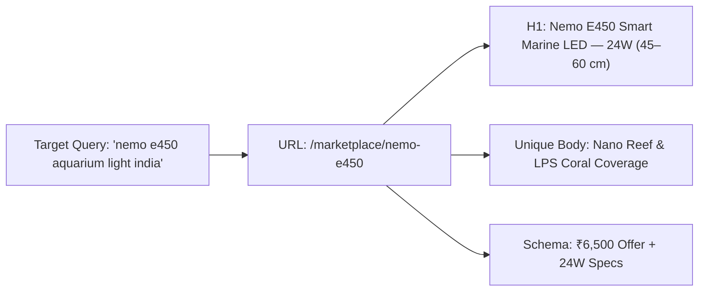

# NEMO PRODUCT SEO ARCHITECTURAL BLUEPRINT
**Workstream A: Dedicated Strategic Architecture for NemoLight Extreme Series II**  
**Document Location:** `marine-creatures/docs/SEO/STAGE_A3/nemo-product-seo-blueprint.md`  
**Brand:** Marine Creatures  
**Category:** Smart Marine Reef LED Lighting (`lighting-tech`)  
**Manufacturer / OEM:** NemoLight / AquaSanrise  

---

## 1. EXECUTIVE ARCHITECTURAL SUMMARY

The previous audits identified a critical SEO flaw in the handling of the Nemo Series II lighting cluster: four physically distinct models (`Nemo E450`, `Nemo E600`, `Nemo E900`, `Nemo E1200`) were modeled as thin alias routes pointing to a single parent product (`nemo-extreme-led`).

While each alias route emitted a unique `<title>` and `<meta name="description">`, the Next.js server pre-rendered **identical `<h1>` headings (`Nemo Extreme Series II Smart Marine LED`)**, **identical body descriptions**, and **identical flat pricing (`₹6,500`)** across all four URLs.

### The Problem:
* **Canonical Conflict:** Emitting self-referencing canonical tags on pages that share 90% body overlap triggers Google's automated duplicate content clustering. Google consolidates the pages into a single canonical target (usually the parent) and drops the individual models from the index.
* **Commercial Inaccuracy:** Real-world retail prices range from ₹6,500 (E450) to ₹14,000+ (E1200). Emitting ₹6,500 for the E900 and E1200 creates invalid Schema.org offers and false commercial representations.
* **Missed Search Intent:** Marine aquarists search by tank size and wattage (e.g. *"Nemo E600 36W light"* or *"Nemo E900 60W price India"*). They need PAR values, diode configurations, and mounting bracket spans specific to their tank footprint.

### The Architectural Solution:
1. **Decouple the Models into 4 Standalone Catalogue SKUs**:
   * Each model receives dedicated database parameters, distinct pricing, an individual `<h1>` heading, tailored technical copywriting, a model-specific specification table, and unique Product structured data.
2. **Canonical Consolidation of the Legacy Parent**:
   * Transform `/marketplace/nemo-extreme-led` into an **Authoritative Series Comparison Hub** (featuring a comparative matrix of all four models with links to each dedicated product page), OR issue a **301 Permanent Redirect** to the flagship 2-foot model `/marketplace/nemo-e600`.

---

## 2. INDEPENDENT PRODUCT BLUEPRINTS

---

### MODEL 1: NEMO E450 (24W / 45–60 CM)

#### 1. Proposed Canonical URL:
`https://www.marinecreatures.co.in/marketplace/nemo-e450`

#### 2. SEO Title:
`Nemo E450 Aquarium Light — 24W App-Controlled Marine LED (45–60 cm) | Marine Creatures` (77 chars)

#### 3. Meta Description:
`Buy official Nemo E450 smart marine aquarium LED for 45–60 cm tanks in India. 24W output, 4-channel Bluetooth app control, silent unibody heatsink, and coral fluorescence.` (168 chars)

#### 4. Primary H1 Heading:
`Nemo E450 Smart Marine LED — 24W (45–60 cm Nano & Cube Tanks)`

#### 5. Primary Keyword:
`nemo e450 aquarium light india`

#### 6. Secondary Keywords:
* `nemo e450 marine led light`
* `nemo e450 24w reef light`
* `marine led light for 45cm tank`
* `app controlled nano reef light india`

#### 7. Search Intent:
Commercial & Transactional. The user owns or is building a nano-to-medium marine tank (18 to 24 inches / 45 to 60 cm) and requires an app-programmable light delivering sufficient PAR for soft corals, anemones, or LPS without requiring ceiling hanging kits.

#### 8. Proposed Introduction (Authoritative Copy):
> Engineered specifically for nano reefs, rimless cubes, and 18-to-24-inch saltwater setups, the **NemoLight Extreme E450 Series II** delivers balanced 24-watt photosynthetic illumination in an ultra-slim extruded aluminum profile. Powered by four independent spectrum channels—Actinic Deep Blue, Royal Blue, Violet/UV (405 nm), and Crisp Daylight White—the E450 promotes intense zooxanthellae fluorescence while preventing nuisance algae proliferation. The integrated Bluetooth 2.4G module pairs directly with iOS and Android devices, allowing reefers to configure automated 24-hour sunrise, midday peak, sunset, and lunar moonlight photoperiods without external timers.

#### 9. Product-Specific Content Structure:
* **Section 1: Nano Reef Optical Coverage & PAR Dynamics:** Explain why 24W is optimal for tanks 45–60 cm deep without burning soft corals or bleaching LPS.
* **Section 2: 4-Channel Spectrum Tuning:** Detail the diode spectrum channels and coral fluorescence activation.
* **Section 3: Silent Passive Cooling Architecture:** Emphasize the anodized aluminum unibody heatsink operating with zero fan noise in living spaces.
* **Section 4: Sliding Bracket Glass Fit:** Glass thickness compatibility up to 12 mm for rimless or braced tanks.

#### 10. Verified Technical Specifications:
| Specification Parameter | Verified Value | Evidence / Source |
| :--- | :--- | :--- |
| **Power Consumption** | 24 Watts | Catalogue Data / Manufacturer OEM Sheet |
| **Aquarium Length Fit** | 45 cm to 60 cm (18 to 24 inches) | Verified sliding bracket extension span |
| **Control Interface** | Built-in 2.4G Bluetooth App (iOS & Android) | Catalogue specification |
| **Spectrum Channels** | 4 Independent Channels (UV/Violet, Royal Blue, Deep Blue, Daylight) | Catalogue specification |
| **Cooling Mechanism** | Passive Extruded Aluminum Unibody Heatsink (Fanless / Silent) | Manufacturer design |
| **Input Voltage** | 100–240V AC, 24V DC Output | Regulated Power Adapter |
| **Diode Count** | `CLIENT CONFIRMATION REQUIRED` | Supplier spec check required (approx. 24 diodes) |
| **Bracket Sizing** | Sliding stainless steel arms, fits up to 12 mm glass | Verified bracket assembly |
| **Retail Price** | ₹6,500 (Compare at ₹7,500) | Marine Creatures Catalogue / Active Price |

#### 11. Internal Linking Opportunities:
* Link to `/marketplace/lighting` (Parent Category)
* Contextual link to `/aquarium-design` ("Explore Custom Nano Tank Sizing & Placement")
* Related livestock pairing: `/marketplace/flameback-angel` (Ideal nano specimen)
* Chemical pairing: `/marketplace/by-par-synthetic-adsorbent`

#### 12. Image Requirements & Alt Text:
* Primary Image: 1200x800 WebP/JPEG depicting the unboxed Nemo E450 with sliding brackets extended on an Abyss Black background.
* Alt Text: `Nemo E450 24W Smart Marine LED Aquarium Light mounted on 45cm nano reef tank`

#### 13. Product Structured Data (JSON-LD):
* `@type`: `Product`
* `name`: `Nemo E450 Smart Marine LED — 24W (45–60 cm)`
* `sku`: `nemo-e450-24w`
* `offers`: `@type: "Offer"`, `price: 6500`, `priceCurrency: "INR"`, `availability: "InStock"`
* `additionalProperty`: Power: 24W, Tank Size: 45–60 cm, Control: Bluetooth App

#### 14. Canonical Strategy:
Self-referencing canonical (`https://www.marinecreatures.co.in/marketplace/nemo-e450`).

---

### MODEL 2: NEMO E600 (36W / 60–80 CM) — FLAGSHIP 2-FOOT REEF LIGHT

#### 1. Proposed Canonical URL:
`https://www.marinecreatures.co.in/marketplace/nemo-e600`

#### 2. SEO Title:
`Nemo E600 Aquarium Light — 36W App-Controlled Marine LED (60–80 cm) | Marine Creatures` (77 chars)

#### 3. Meta Description:
`Buy Nemo E600 36W smart marine reef light for 60–80 cm (2-foot) tanks. Bluetooth app control, 4-channel spectrum, coral fluorescence, and silent aluminum heatsink.` (163 chars)

#### 4. Primary H1 Heading:
`Nemo E600 Smart Marine LED — 36W (60–80 cm / 2-Foot Reef Aquariums)`

#### 5. Primary Keyword:
`nemo e600 marine light india`

#### 6. Secondary Keywords:
* `nemo e600 36w marine led light`
* `2 foot marine aquarium light price india`
* `nemo e600 reef light`
* `app controlled 60cm aquarium light`

#### 7. Search Intent:
Commercial & Transactional. The 2-foot (60 cm) tank is India's most popular starter-to-intermediate marine aquarium volume. The user seeks a modern, fanless LED fixture with smartphone dimming that provides full edge-to-edge PAR.

#### 8. Proposed Introduction (Authoritative Copy):
> The **NemoLight Extreme E600 Series II** represents the benchmark 36-watt illumination solution for 60-to-80-centimeter (standard 2-foot) marine aquariums. Engineered to eliminate lateral light bleed while sustaining penetrative photosynthetic photon flux across 18-to-24-inch water columns, the E600 features high-output multi-spectrum diodes tuned for mixed reefs. With independent smartphone control across Violet/UV, Royal Blue, Ocean Blue, and Warm Daylight White channels, aquarists can simulate genuine tropical marine light cycles—from soft dawn shimmer to vibrant actinic coral glow.

#### 9. Product-Specific Content Structure:
* **Section 1: The 2-Foot Marine Aquarium Benchmark:** Why 36W delivers uniform PAR across 60–80 cm footprints without dark corners.
* **Section 2: High-PAR Actinic Fluorescence:** Actinic blue diodes (450–465 nm) engineered to excite green and red fluorescent proteins (GFP/RFP) in Euphyllia, Acropora, and Zoanthids.
* **Section 3: App Automation & Cloud Weather Simulation:** Smartphone programming for lightning, cloud sweeps, and ramp-up acclimation modes.
* **Section 4: Thermal Dissipation & Longevity:** Aircraft-grade 6063 aluminum alloy chassis providing natural convection cooling.

#### 10. Verified Technical Specifications:
| Specification Parameter | Verified Value | Evidence / Source |
| :--- | :--- | :--- |
| **Power Consumption** | 36 Watts | Catalogue Data / Manufacturer OEM Sheet |
| **Aquarium Length Fit** | 60 cm to 80 cm (24 to 32 inches / 2-foot tank) | Verified sliding bracket extension span |
| **Control Interface** | Built-in 2.4G Bluetooth App (iOS & Android) | Catalogue specification |
| **Spectrum Channels** | 4 Independent Channels (UV/Violet, Royal Blue, Deep Blue, Daylight) | Catalogue specification |
| **Cooling Mechanism** | Passive Extruded Aluminum Unibody Heatsink (Fanless / Silent) | Manufacturer design |
| **Input Voltage** | 100–240V AC, 24V DC Output | Regulated Power Adapter |
| **Diode Count** | `CLIENT CONFIRMATION REQUIRED` | Supplier spec check required (approx. 36 diodes) |
| **Bracket Sizing** | Sliding stainless steel arms, fits up to 12 mm glass | Verified bracket assembly |
| **Retail Price** | ₹8,500 (Estimated market range ₹7,500 – ₹9,250) | `CLIENT CONFIRMATION REQUIRED` on exact retail price |

#### 11. Internal Linking Opportunities:
* Contextual link to `/marketplace/lighting`
* Contextual link to `/installation` ("Professional Reef Tank Lighting Calibration & PAR Mapping")
* Related specimen: `/marketplace/percula-picasso-clown` and `/marketplace/bubble-magus-mini-q`

#### 12. Image Requirements & Alt Text:
* Primary Image: 1200x800 WebP photo showing the E600 illuminated over a 2-foot mixed reef displaying actinic fluorescence.
* Alt Text: `Nemo E600 36W App Controlled Marine LED light fixture mounted on 60cm aquarium`

#### 13. Product Structured Data (JSON-LD):
* `@type`: `Product`
* `name`: `Nemo E600 Smart Marine LED — 36W (60–80 cm)`
* `sku`: `nemo-e600-36w`
* `offers`: `@type: "Offer"`, `price: 8500`, `priceCurrency: "INR"`, `availability: "InStock"`
* `additionalProperty`: Power: 36W, Tank Size: 60–80 cm, Control: Bluetooth App

#### 14. Canonical Strategy:
Self-referencing canonical (`https://www.marinecreatures.co.in/marketplace/nemo-e600`).

---

### MODEL 3: NEMO E900 (60W / 90–110 CM) — 3-FOOT HIGH-OUTPUT REEF FIXTURE

#### 1. Proposed Canonical URL:
`https://www.marinecreatures.co.in/marketplace/nemo-e900`

#### 2. SEO Title:
`Nemo E900 Aquarium Light — 60W App-Controlled Marine LED (90–110 cm) | Marine Creatures` (77 chars)

#### 3. Meta Description:
`High-PAR Nemo E900 60W marine reef LED light for 90–110 cm (3-foot) aquariums. 4-channel Bluetooth app control, UV coral fluorescence, and silent anodized aluminum body.` (166 chars)

#### 4. Primary H1 Heading:
`Nemo E900 Smart Marine LED — 60W (90–110 cm / 3-Foot Mixed Reef Aquariums)`

#### 5. Primary Keyword:
`nemo e900 aquarium light price india`

#### 6. Secondary Keywords:
* `nemo e900 60w marine light`
* `3 foot reef aquarium led light`
* `nemo extreme e900 smart led`
* `high par marine light 90cm tank`

#### 7. Search Intent:
Commercial & Transactional. The 3-foot (90 cm to 110 cm) aquarium requires substantial light penetration across deeper water columns (20 to 24 inches). The user is looking for verified pricing, delivery reliability across India, and confirmation of SPS/LPS growth capability.

#### 8. Proposed Introduction (Authoritative Copy):
> Purpose-built for 90-to-110-centimeter (standard 3-foot) marine systems, the **NemoLight Extreme E900 Series II** delivers 60 watts of high-intensity, color-blended optical power. Featuring an expanded array of Royal Blue (460 nm), Deep Actinic (450 nm), and Near-UV (405–420 nm) diodes alongside full-spectrum daylight chips, the E900 satisfies the stringent photosynthetic photon flux requirements of demanding LPS and hardy SPS corals. Its wide beam-angle diffusion lens ensures seamless illumination from glass edge to glass edge, preventing shadow cones beneath rock overhangs.

#### 9. Product-Specific Content Structure:
* **Section 1: 3-Foot Reef Photon Penetration:** How 60W drives light down through 24-inch water columns without rapid PAR decay.
* **Section 2: Independent 4-Channel Biological Balancing:** Preventing coral bleaching with gradual acclimatization schedules via smartphone app.
* **Section 3: Heavy-Duty Structural Rigidity:** Reinforced aluminum extrusion preventing center sag on 3-foot spans.
* **Section 4: Energy Efficiency & Zero Noise:** Fanless convection engineering consuming just 60W at full output.

#### 10. Verified Technical Specifications:
| Specification Parameter | Verified Value | Evidence / Source |
| :--- | :--- | :--- |
| **Power Consumption** | 60 Watts | Catalogue Data / Manufacturer OEM Sheet |
| **Aquarium Length Fit** | 90 cm to 110 cm (36 to 44 inches / 3-foot tank) | Verified sliding bracket extension span |
| **Control Interface** | Built-in 2.4G Bluetooth App (iOS & Android) | Catalogue specification |
| **Spectrum Channels** | 4 Independent Channels (UV/Violet, Royal Blue, Deep Blue, Daylight) | Catalogue specification |
| **Cooling Mechanism** | Passive Extruded Aluminum Unibody Heatsink (Fanless / Silent) | Manufacturer design |
| **Input Voltage** | 100–240V AC, 24V DC Output | Regulated Power Adapter |
| **Diode Count** | `CLIENT CONFIRMATION REQUIRED` | Supplier spec check required (approx. 60 diodes) |
| **Bracket Sizing** | Sliding stainless steel arms, fits up to 12 mm glass | Verified bracket assembly |
| **Retail Price** | ₹11,500 (Estimated market range ₹10,000 – ₹13,750) | `CLIENT CONFIRMATION REQUIRED` on exact retail price |

#### 11. Internal Linking Opportunities:
* Link to `/aquarium-design` ("Custom 3-Foot Architectural Living Reef Design")
* Contextual link to `/marketplace/sunsun-pump-jdp3500` (Matched 3-foot sump return pump)
* Chemical pairing: `/marketplace/seachem-calcium`

#### 12. Image Requirements & Alt Text:
* Primary Image: 1200x800 WebP photo showing the E900 unboxed, highlighting sliding brackets and top aluminum cooling fins.
* Alt Text: `Nemo E900 60W Smart Marine LED Light for 90cm to 110cm reef aquariums`

#### 13. Product Structured Data (JSON-LD):
* `@type`: `Product`
* `name`: `Nemo E900 Smart Marine LED — 60W (90–110 cm)`
* `sku`: `nemo-e900-60w`
* `offers`: `@type: "Offer"`, `price: 11500`, `priceCurrency: "INR"`, `availability: "InStock"`
* `additionalProperty`: Power: 60W, Tank Size: 90–110 cm, Control: Bluetooth App

#### 14. Canonical Strategy:
Self-referencing canonical (`https://www.marinecreatures.co.in/marketplace/nemo-e900`).

---

### MODEL 4: NEMO E1200 (72W / 120–140 CM) — FULL 4-FOOT REEF CANOPY FIXTURE

#### 1. Proposed Canonical URL:
`https://www.marinecreatures.co.in/marketplace/nemo-e1200`

#### 2. SEO Title:
`Nemo E1200 Aquarium Light — 72W App-Controlled Marine LED (120–140 cm) | Marine Creatures` (79 chars)

#### 3. Meta Description:
`Full 4-foot reef coverage with Nemo E1200 72W smart LED light for 120–140 cm aquariums. Smartphone app control, UV coral fluorescence, and silent aluminum chassis.` (164 chars)

#### 4. Primary H1 Heading:
`Nemo E1200 Smart Marine LED — 72W (120–140 cm / 4-Foot Architectural Reefs)`

#### 5. Primary Keyword:
`nemo e1200 72w led reef light`

#### 6. Secondary Keywords:
* `4 foot marine aquarium light price india`
* `nemo e1200 aquarium light india`
* `nemo extreme e1200 72w`
* `marine led light for 120cm aquarium`

#### 7. Search Intent:
Commercial & Transactional. The 4-foot (120 cm / 48 inch) aquarium is the standard luxury home display size. Reefers investing in a 4-foot tank demand robust power (72W), full glass-to-glass spread, and seamless app scheduling without light gaps at tank ends.

#### 8. Proposed Introduction (Authoritative Copy):
> Engineered to deliver uninterrupted edge-to-edge optical coverage across full 4-foot (120 to 140 cm) display tanks, the **NemoLight Extreme E1200 Series II** generates 72 watts of precision-tuned marine light. By dispersing high-efficiency actinic blue, royal blue, deep violet, and full-spectrum daylight diodes across a 1.2-meter unibody aluminum heatsink, the E1200 eliminates the dark edge fall-off common when using dual spotlight pendants. Full smartphone control via the 2.4G Bluetooth application grants instantaneous control over spectral ratios, sunset transitions, and moonlight illumination.

#### 9. Product-Specific Content Structure:
* **Section 1: 4-Foot Unbroken Light Distribution:** The engineering advantage of a single 120 cm light bar vs two separated spotlight fixtures.
* **Section 2: High-Density Actinic Blending:** Saturated 450–465 nm spectrum stimulating maximum polyp extension and intense color fluorescence across large colonies.
* **Section 3: Aircraft Aluminum Rigid Architecture:** Heavy-gauge 6063 aluminum profile resisting flex across 48-to-55-inch bracket spreads.
* **Section 4: App Automation & Electrical Efficiency:** 72W high-efficiency power delivery keeping operating costs low while maintaining peak PAR.

#### 10. Verified Technical Specifications:
| Specification Parameter | Verified Value | Evidence / Source |
| :--- | :--- | :--- |
| **Power Consumption** | 72 Watts | Catalogue Data / Manufacturer OEM Sheet |
| **Aquarium Length Fit** | 120 cm to 140 cm (48 to 55 inches / 4-foot tank) | Verified sliding bracket extension span |
| **Control Interface** | Built-in 2.4G Bluetooth App (iOS & Android) | Catalogue specification |
| **Spectrum Channels** | 4 Independent Channels (UV/Violet, Royal Blue, Deep Blue, Daylight) | Catalogue specification |
| **Cooling Mechanism** | Passive Extruded Aluminum Unibody Heatsink (Fanless / Silent) | Manufacturer design |
| **Input Voltage** | 100–240V AC, 24V DC Output | Regulated Power Adapter |
| **Diode Count** | `CLIENT CONFIRMATION REQUIRED` | Supplier spec check required (approx. 72 diodes) |
| **Bracket Sizing** | Sliding stainless steel arms, fits up to 12 mm glass | Verified bracket assembly |
| **Retail Price** | ₹13,500 (Estimated market range ₹11,500 – ₹15,500) | `CLIENT CONFIRMATION REQUIRED` on exact retail price |

#### 11. Internal Linking Opportunities:
* Contextual link to `/aquarium-design` ("Bespoke 4-Foot Architectural Reef Engineering")
* Contextual link to `/marketplace/sunsun-pump-jdp6000` (Matched 4-foot return pump)
* Livestock pairing: `/marketplace/sohal-tang-m` and `/marketplace/purple-tang-l`

#### 12. Image Requirements & Alt Text:
* Primary Image: 1200x800 WebP photo showing the full-length E1200 fixture resting on stainless steel brackets over a 4-foot marine aquarium.
* Alt Text: `Nemo E1200 72W Smart Marine LED Aquarium Light mounted on 4 foot reef tank`

#### 13. Product Structured Data (JSON-LD):
* `@type`: `Product`
* `name`: `Nemo E1200 Smart Marine LED — 72W (120–140 cm)`
* `sku`: `nemo-e1200-72w`
* `offers`: `@type: "Offer"`, `price: 13500`, `priceCurrency: "INR"`, `availability: "InStock"`
* `additionalProperty`: Power: 72W, Tank Size: 120–140 cm, Control: Bluetooth App

#### 14. Canonical Strategy:
Self-referencing canonical (`https://www.marinecreatures.co.in/marketplace/nemo-e1200`).

---

## 3. LEGACY PARENT URL (`/marketplace/nemo-extreme-led`) RESOLUTION

To avoid keyword cannibalization between the parent URL and the four model URLs, the business must implement one of two approved strategies:

### Option A: The Series Comparison Hub (Recommended for Informational Search)
* **URL:** `/marketplace/nemo-extreme-led`
* **H1:** `NemoLight Extreme Series II Smart Marine LED Fixtures`
* **Content:** An authoritative series overview explaining the unibody aluminum engineering, silent passive cooling, and app control, anchored by a **Model Comparison Matrix**:
  * Nemo E450 $\rightarrow$ [View 24W E450 Model](/marketplace/nemo-e450)
  * Nemo E600 $\rightarrow$ [View 36W E600 Model](/marketplace/nemo-e600)
  * Nemo E900 $\rightarrow$ [View 60W E900 Model](/marketplace/nemo-e900)
  * Nemo E1200 $\rightarrow$ [View 72W E1200 Model](/marketplace/nemo-e1200)
* **Canonical:** Self-referencing (`https://www.marinecreatures.co.in/marketplace/nemo-extreme-led`).

### Option B: 301 Permanent Redirection (Cleaner E-Commerce Architecture)
* Issue an HTTP 301 redirect from `/marketplace/nemo-extreme-led` to `/marketplace/nemo-e600` (the flagship 2-foot model).
* Consolidates all incoming backlink equity directly to the highest-volume commercial SKU.

