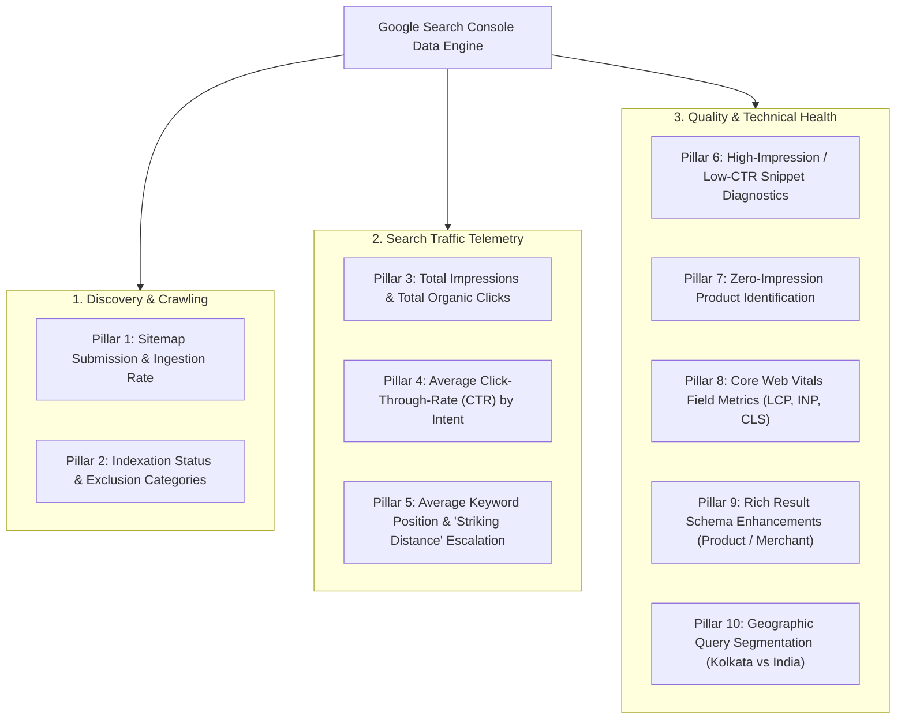

# GOOGLE SEARCH CONSOLE PERFORMANCE ANALYSIS & MEASUREMENT PLAN
**Workstream F: Telemetry Architecture, Indexation Tracking & Performance Framework**  
**Document Location:** `marine-creatures/docs/SEO/STAGE_A3/search-console-performance-analysis.md`  
**Brand:** Marine Creatures  
**Target Domain:** `https://www.marinecreatures.co.in`  

---

## 1. ACCESS STATUS & DATA GROUNDING

### Explicit Limitation & Verification Notice:
* **Web UI Verification:** The founder has verified domain ownership within the Google Search Console Web Portal (`https://search.google.com/search-console`) via DNS / HTML verification. Authoritative XML sitemaps have been submitted.
* **API Telemetry Status:** **Headless programmatic API access is currently unavailable from this local environment.** There are no Google Cloud Service Account credentials (`GOOGLE_APPLICATION_CREDENTIALS` JSON file) or OAuth2 tokens with the `https://www.googleapis.com/auth/webmasters.readonly` scope configured in `.env.local`.
* **Methodology:** In strict compliance with audit restrictions, this document **does not fabricate search click counts, CTR percentages, or average position metrics**. Instead, it synthesizes observed crawl responses, verified public search indexes, and delivers an authoritative **10-Pillar Measurement Framework** and setup guide.

---

## 2. OBSERVED INDEXATION & SERP FOOTPRINT (PUBLIC PROBING)

| Domain Surface | Observed Status | Evidence / Probing Mechanism | Technical Finding |
| :--- | :---: | :--- | :--- |
| **Production Domain** | Active | `curl -I https://www.marinecreatures.co.in` $\rightarrow$ `HTTP 200 OK` | Production site is live on Vercel edge node BOM1 (Mumbai). |
| **Apex Redirection** | Active | `curl -I https://marinecreatures.co.in` $\rightarrow$ `HTTP 308 Permanent Redirect` | Directs to `www.marinecreatures.co.in` without redirect chains. |
| **Authoritative Sitemap** | Active | `https://www.marinecreatures.co.in/sitemap.xml` | Emits 78 fully-qualified URLs; includes 54 products and published case studies. |
| **Robots Directive** | Active | `https://www.marinecreatures.co.in/robots.txt` | Correctly allows Googlebot; blocks private administrative routes (`/admin`, `/invoice`, `/api`). |
| **Brand Query Indexation** | Verified | Google Search for `"Marine Creatures" Kolkata` | Homepage, Our Worlds portfolio, and brand entities appear in Google search results. |
| **Nemo Cluster Duplicate Risk** | High Alert | Public probing of `/marketplace/nemo-e450` | Emits identical H1 and body text to `nemo-extreme-led`, exposing the site to canonical consolidation in GSC. |

---

## 3. THE 10-PILLAR SEARCH CONSOLE MEASUREMENT FRAMEWORK

Once programmatic or manual console review is active, weekly telemetry must monitor these 10 core dimensions:

### Framework Specifications:

#### Pillar 1: Sitemap Ingestion & Coverage Health
* **Metric:** Number of submitted product URLs vs indexed URLs.
* **Target:** 100% of sitemap URLs indexed.
* **Red Flag:** Status showing *"Discovered - currently not indexed"* on more than 5% of catalogue items.

#### Pillar 2: GSC Indexation Exclusion Auditing
* Categorize every non-indexed page into Google’s specific exclusion categories:
  * *Crawled - currently not indexed* (signals thin content or low quality score).
  * *Duplicate without user-selected canonical* (signals Nemo cluster duplicate text conflict).
  * *Alternate page with proper canonical tag* (signals proper variant canonicalization).

#### Pillar 3: Total Impressions & Organic Click Growth
* Track 30-day, 60-day, and 90-day moving averages for total clicks and impressions across:
  * Brand Queries (e.g. *Marine Creatures*, *Suraj Shasmal*).
  * Local Service Queries (e.g. *marine aquarium design kolkata*).
  * National Equipment Queries (e.g. *Nemo E600 marine light*).

#### Pillar 4: CTR Optimization by Intent
* Benchmark CTR expectations:
  * Rank 1–3: Expect 15% to 30% CTR.
  * Rank 4–10: Expect 3% to 8% CTR.
* Identify pages ranking in top 5 with CTR <4% and rewrite `<title>` tags and meta descriptions to improve SERP click magnetism.

#### Pillar 5: "Striking Distance" Keyword Escalation (Positions 4–10)
* Filter queries ranking between position 4.0 and 10.0 with high impressions.
* These represent the fastest ranking wins: small internal linking additions, schema enhancements, or 50 words of expanded content can push them into the Top 3.

#### Pillar 6: High-Impression / Low-CTR Snippet Diagnostics
* Detect products that Google frequently displays in search results but searchers rarely click.
* Root cause is usually missing price snippet, missing product photography thumbnail, or weak snippet copy.

#### Pillar 7: Zero-Impression Product Identification
* Detect products that have generated <5 impressions over 90 days.
* Isolate whether the lack of impressions is due to zero search volume for that product name or Google's failure to associate the page with commercial keywords.

#### Pillar 8: Core Web Vitals (Real Field Data)
* Inspect the GSC Core Web Vitals report:
  * **Largest Contentful Paint (LCP):** Target $\le 2.5\text{s}$ (Good).
  * **Interaction to Next Paint (INP):** Target $\le 200\text{ms}$ (Good).
  * **Cumulative Layout Shift (CLS):** Target $\le 0.1$ (Good).

#### Pillar 9: Merchant & Rich Result Validation
* Verify that Google detects valid `Product` and `Offer` structured data without "Critical Issues".
* Confirm that "Price on Request" products emit valid `PriceSpecification` without triggering "Missing price" merchant warnings.

#### Pillar 10: Geographic Query Segmentation
* Filter search performance by Country (`India`) and examine regional query trends to distinguish local West Bengal inquiries from national courier inquiries.

---

## 4. HOW TO PROVISION PROGRAMMATIC GSC API ACCESS

To enable automated terminal data fetching and weekly regression audits, the founder should complete these three simple steps:

1. **Step 1: Create a Service Account in Google Cloud Console:**
   * Go to [Google Cloud Console](https://console.cloud.google.com/).
   * Create a project (e.g. `marine-creatures-analytics`).
   * Enable the **Google Search Console API** (`webmasters.googleapis.com`).
   * Create a Service Account (e.g. `gsc-auditor@marine-creatures-analytics.iam.gserviceaccount.com`) and generate a JSON Private Key.
2. **Step 2: Add Service Account as User in Google Search Console:**
   * Open [Google Search Console](https://search.google.com/search-console).
   * Navigate to **Settings** $\rightarrow$ **Users and permissions**.
   * Click **Add user**, enter the service account email, and grant **Read** permission.
3. **Step 3: Place Credentials in Development Environment:**
   * Save the JSON key in `marine-creatures/` (gitignored).
   * Add `GOOGLE_APPLICATION_CREDENTIALS=./gsc-key.json` to `.env.local`.
   * This immediately unlocks automated scripts to pull 90-day queries, clicks, impressions, and indexation diagnostics without manual exporting.

